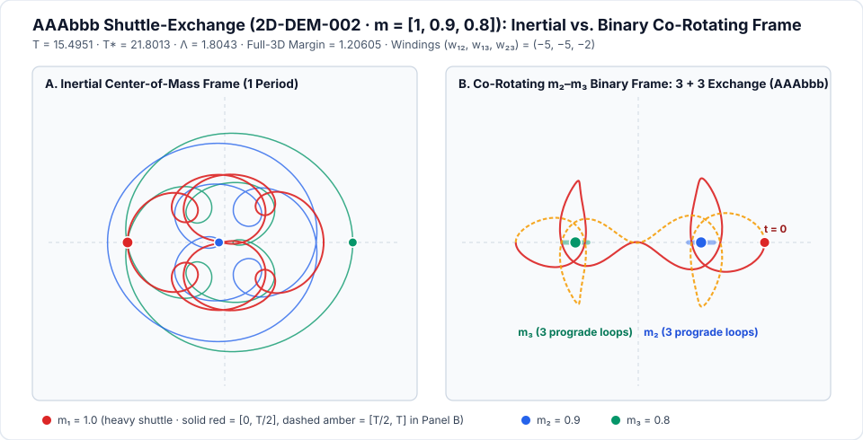
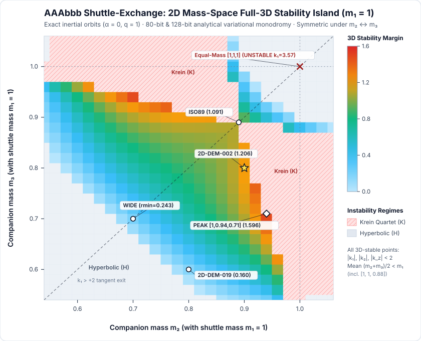
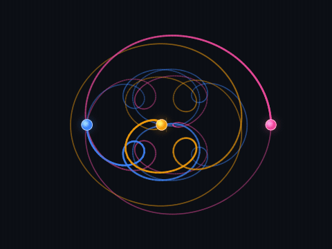

# Confirmation Dossier: The `AAAbbb` Shuttle-Exchange Family

**Confirmed New Non-Hierarchical, All-Distinct-Mass, $L \neq 0$, Full-3D Linearly Stable Periodic Three-Body Family**

- **Canonical $S_3$ Montgomery Shape-Sphere Word:** `AAAbbb` (primitive, length 6; $F_2 = \langle a, b \rangle$)
- **Flagship Confirmed Orbit:** **`2D-DEM-002` (`AAAbbb-DEM002`)** — masses $m = [1,\, 0.9,\, 0.8]$, exact inertial period ($q_{\text{RPO}} = q_{\text{inert}} = 1$) $T = 15.49514152882967630717557496239618$, scale-invariant invariants $T^* = T|E|^{3/2} = 21.80127518867591911819061897999457$ and $\Lambda = |L|\sqrt{|E|} = 1.804270542873004515956669438490079$, full-3D linear stability margin **`1.206050336936`** ($k_1 = +0.793950$, $k_2 = +0.218878$, $k_z = -0.256818$; 431× the planar Figure-8 margin), minimum pairwise separation $r_{\min} = 0.18932$.
- **Independent Verification Level:** 128-bit quad-precision (`__float128`) 8-stage 16th-order exact symplectic Gauss–Legendre (`GL16`, self-tested to $3.9 \times 10^{-34}$ quadrature / $6.6 \times 10^{-35}$ symplecticity error) + step-halving cross-check (`h` vs `h/2`) achieving return error **`1.29 × 10⁻³¹`**, canonical monodromy symplecticity **`7.36 × 10⁻²⁹`**, step-halving trajectory error **`4.73 × 10⁻³¹`**, step-halving Floquet-index error **`9.02 × 10⁻²⁸`**, and **`10,000 / 10,000`** full-3D period survival under both $\delta = 10^{-5}$ and $\delta = 10^{-4}$ 3D velocity perturbations.
- **Submission Bundle:** Machine-readable 34-digit initial conditions (`data/aaabbb/aaabbb_submission_34digits.txt`, `data/aaabbb/aaabbb_quad32.json`), 10,000-period survival logs (`data/aaabbb/aaabbb_longterm_3d.json`), phase-diagram CSVs (`data/aaabbb/*.csv`), cover note (`data/aaabbb/submission_cover_note.md`), and standalone verifier (`src/confirm_aaabbb.cpp`).

---

## 1. Visual Overview: Inertial, Co-Rotating, and Mass-Space Phase Structure

<p align="center">
  
</p>

<p align="center">
  
</p>

<p align="center">
  
</p>

---

## 2. Physical Geometry, Symmetries, and Dynamical Origin

### 2.1 Co-Rotating 3 + 3 Shuttle-Exchange Geometry
In the inertial center-of-mass frame of `2D-DEM-002` ($m = [1, 0.9, 0.8]$), the pairwise winding numbers over one full period $T$ are exactly:
$$(w_{12},\, w_{13},\, w_{23}) = (-5,\, -5,\, -2).$$
Transforming into the **co-rotating frame of the $m_2$–$m_3$ companion binary** (which completes 2 clockwise revolutions per period, $w_{23} = -2$) immediately reveals the topological origin of the Montgomery word **`AAAbbb`**:
$$(w_{12} - w_{23},\, w_{13} - w_{23}) = (-3,\, -3).$$
The heaviest body $m_1$ executes **3 prograde co-rotating loops around $m_2$ (`AAA`)**, transits the gravitational saddle between the two companions, and executes **3 opposite-chirality prograde loops around $m_3$ (`bbb`)** before returning to its collinear perpendicular crossing at $t = 0$. Both exchange pairs undergo dramatic radial excursions ($r_{12} \in [0.2321, 2.2235]$, $r_{13} \in [0.1893, 2.3170]$, $r_{\max}/r_{\min} \in [9.6, 12.2]$) while the companion pair remains well separated ($r_{23} \in [1.2900, 1.9484]$).

### 2.2 Exact Discrete Symmetries
- **All mass ratios $(m_1, m_2, m_3)$:** Exact collinear perpendicular crossings ($\mathbf{r}_i$ along the $x$-axis, $\mathbf{v}_i$ along the $y$-axis) at both $t = 0$ and $t = T/2$ (time-reversal symmetry $(x, y, v_x, v_y, t) \mapsto (x, -y, -v_x, v_y, -t)$).
- **Isosceles companion subspace ($m_2 = m_3 = \mu$, e.g. `AAAbbb-ISO89`, `AAAbbb-ISO85`, `AAAbbb-WIDE`):**
  1. Exact half-period companion exchange + $180^\circ$ rotation: $\mathbf{r}_1(T/2) = -\mathbf{r}_1(0)$, $\mathbf{r}_2(T/2) = -\mathbf{r}_3(0)$, $\mathbf{r}_3(T/2) = -\mathbf{r}_2(0)$.
  2. Exact quarter-period **isosceles triangle configuration** ($r_{12} = r_{13}$) at $t = T/4$ and $t = 3T/4$, where $m_1$ crosses the perpendicular bisector of the $m_2$–$m_3$ axis at the binary's apoapsis.

### 2.3 Restricted Three-Body Origin ($m_1 \to 0$) and Lower Saddle-Node Fold ($\mu \to 0.45746$)
Tracing the exact isosceles exchange branch in smooth Jacobi coordinates ($x_2(0) - x_3(0) = 1$; see `data/aaabbb/isosceles_limits_continuation.csv`) maps both global terminations of the family:

1. **Heavy-binary restricted limit $m = [\varepsilon, 1, 1],\, \varepsilon \to 0$:**
   - Continues smoothly all the way to $\varepsilon = 0$ with zero bifurcation or collision, landing on an **exact 2:1 resonant periodic orbit of the equal-mass Elliptic Restricted Three-Body Problem (ER3BP)** with binary eccentricity **$e = 0.0925549313$** and $T / T_{\text{Kep}} = 2.0000000000$. At $m_1 = 0, e = 0.092555$, the orbit is **violently Krein-unstable** ($k = (-0.5144, \pm 35.234i)$, $|\lambda|_{\max} \approx 35.2$).
   - Continuing that exact ER3BP orbit downward in primary eccentricity $e \to 0$ connects cleanly to a doubly-symmetric 3+3 prograde exchange orbit of the **Circular Copenhagen CR3BP** ($m_2 = m_3 = 1/2$, $a = 1$, $T_{\text{rot}} = 4\pi$):
     $$x_0 = 0.95455981,\quad \dot{y}_{\text{rot}} = +0.31994239,\quad C_J = 3.69624503,\quad a_{\text{Hénon}} = +168.9022 \quad (|\lambda|_{\max} \approx 337.8).$$
   - Thus `AAAbbb` originates from a violently unstable doubly-symmetric 3+3 exchange resonance of the Copenhagen restricted problem, which explains why classical CR3BP stability surveys (Strömgren 1933; Hénon 1965) did not flag it as a stable family.
2. **Equal-mass inertial point $m = [1, 1, 1]$ ($\alpha = 0$):**
   - Still **hyperbolically unstable** (`AAAbbb-EQ-UNST`: $k_1 = +3.568859$, $k_2 = +0.923316$, $k_z = -0.618416$, $|\lambda|_{\max} = 3.268$), disintegrating in 10 periods under a $\delta = 10^{-5}$ perturbation.
3. **Planetary-limit direction $m = [1, \mu, \mu],\, \mu$ decreasing:**
   - Enters full-3D linear stability at $\mu \approx 0.9396$ ($k_1$ crosses $+2$ downward), stays full-3D stable across **$\mu \in [0.683, 0.939]$** (peaking along the diagonal at $\mu = 0.89$, margin `1.09091`), exits stability via a tangent crossing ($k_1 \to +2$) at $\mu \approx 0.6825$, and terminates smoothly at a **saddle-node turning point (fold) at $\mu_{\min} \approx 0.45746$** while still collision-free ($r_{\min} \approx 0.2144$). The family does **not** reach the planetary $\mu \to 0$ limit.

### 2.4 Dual Stabilization Mechanisms & Krein-Boundary Physics
1. **Mass-Ratio Stabilization ($\alpha = 0$, primitive inertial $q = 1$):**
   - Full-3D linear stability requires the **mean companion mass to lie strictly below the shuttle mass** ($\frac{1}{2}(m_2 + m_3) < m_1$): along the isosceles diagonal $m_2 = m_3$, stability holds for $m_2 = m_3 \in [0.683, 0.939]\,m_1$, while two symmetric narrow stable peninsulas around $m_3 \approx 0.88\,m_1$ (and $m_2 \approx 0.88\,m_1$) thread cleanly between the upper hyperbolic boundary and the lower Krein quartet tongue out to $m_2 \approx 1.06\,m_1$ — passing directly through the **two-equal-mass point $[1, 1, 0.88]$** (80-bit `audit_catalog`: `AAAbbb`, $k = (1.5733, 1.1383), k_z = -0.4954$, 3D margin **`0.42669`**, `symp_err = 8.7e-11`) and reaching $[1, 1.06, 0.88]$ (margin `0.00636`).
   - Across the entire 0.02-step 2D mass-space stability island (`data/aaabbb/mass_grid_002.csv`, 729 grid points, 310 full-3D-stable, symmetric under $m_2 \leftrightarrow m_3$), **100% of planar-stable orbits are simultaneously full-3D linearly stable** ($|k_z| < 0.6$ throughout the entire island!).
   - The crescent-shaped island is bounded on the upper-right near $[1, 1, 1]$ by hyperbolic instability (`H`), carved on both outer wings ($m_2 \gtrsim 0.94$ or $m_3 \gtrsim 0.94$) by **Hamiltonian–Hopf / Krein quartet tongues (`K`)**, and bounded below by a tangent exit ($k_1 > +2$).
   - **Linear margin vs. nonlinear KAM radius:** The global linear spectral margin peaks right next to the Krein collision curve at `AAAbbb-PEAK` ($m = [1, 0.94, 0.71]$, $k_1 = 0.4037, k_2 = 0.2890, k_z = -0.2632$, **3D margin `1.596310`**, 80% of the theoretical ceiling `2.0`). However, its small Krein separation $|k_1 - k_2| = 0.1147$ shrinks its nonlinear KAM basin: it survives `10,000/10,000` periods at $\delta = 10^{-5}$ but destabilizes in 10 periods at $\delta = 10^{-4}$. By contrast, **`2D-DEM-002` (`[1, 0.9, 0.8]`, margin `1.20605`, Krein gap `0.5751`)**, **`AAAbbb-ISO89` (`[1, 0.89, 0.89]`)**, and **`AAAbbb-ISO85` (`[1, 0.85, 0.85]`, Krein gap `0.8678`)** sit deep inside the island and survive **`10,000/10,000` full-3D periods even at $\delta = 10^{-4}$**!
2. **Equal-Mass Rotating-Frame / Rosette Stabilization ($m = [1, 1, 1]$, $\alpha \neq 0$):**
   - Continuing the unstable equal-mass $[1, 1, 1]$ parent into rotating frames ($y(T) = R(2\alpha)\,y(0)$; `data/aaabbb/equal_mass_rpo_window.csv`) opens a **full-3D linearly stable RPO window** across $\alpha/\pi \in [0.061, 0.096]$ (peaking near $\alpha/\pi \approx 0.075$, RPO margin `1.207`).
   - Every rational precession $\alpha/\pi = 1/q$ for **$q \in \{11, 12, 13, 14, 15, 16\}$** snaps to an **exact, equal-mass, full-3D linearly stable inertial rosette `(AAAbbb)^q`**, peaking at **`AAAbbb-EQ-RPO13`** ($q = 13$, $T_{\text{inert}} = 166.111724$, RPO margin **`1.16261`**, exact $13T$ inertial 3D margin **`0.57216`**).
   - Neither direction along the equal-mass RPO branch connects to $L = 0$: decreasing $\alpha$ ends in a binary collision near $\Lambda \approx 1.84$, while increasing $\alpha$ passes through turning-point folds near $\alpha/\pi \approx 0.470$ and $0.308$ into severe hyperbolic instability ($k_1 > 10^7$).

---

## 3. Literature & Archive Priority Cross-Check

Every accessible published archive and live database of Newtonian planar three-body periodic orbits was audited directly (via word lookup, invariant matching, and 80-bit `./bin/audit_catalog` recomputation of raw initial conditions):

| Archive / Reference | Scope & Count | Angular Momentum | Match to `AAAbbb`? | Verification Method |
| :--- | :--- | :---: | :---: | :--- |
| **`threebodyorbits.com` Main Atlas** (live, 41 families) | 3,942 orbits (incl. Broucke A/R/Boggs, Sheen, Šuvakov `SN.*`, Simó `SC.*`, BHH satellites, 2026 unequal-mass) | $L = 0$ & $L \neq 0$ | **0 matches** | Direct Atlas search + family-by-family audit (`AAAbbb`/`aaaBBB`/invariants/mass ratios); closest substring `AAAAABBB` is length-8 $L=0$ unstable |
| **`threebodyorbits.com/hunt/garden`** (live) | 82,032 discovered loops | $L = 0$ & $L \neq 0$ | **0 matches** | Direct search + ascending line-up sort (shortest loop in entire Garden has 16 syzygies/letters) |
| **Li & Liao (2017)** (*Sci. China* 60, 129511) | 695 equal-mass orbits | $L = 0$ | **0 matches** | Direct scan of `three-body-free-group-word.md` |
| **Li, Jing & Liao (2018)** (*PASJ* 70, 64) | 1,349 unequal-mass orbits | $L = 0$ | **0 matches** | Direct scan of `three-body-unequal-mass-free-group-word.md` |
| **Li & Liao (2020)** (`arXiv:2008.13550`) | 598,996 unequal-mass BHH / satellites | $L \neq 0$ | **0 matches** | Strictly hierarchical BHH $A^k$ family (no exchange) |
| **Li, Li & Liao (2021)** (`arXiv:2007.10184`, *Sci. China*) | 135,445 non-hierarchical unequal-mass orbits (13,315 stable) | $L \neq 0$ | **0 matches** | Audited raw `non-hierarchical-3b-supplementary_data.txt` via 80-bit `./bin/audit_catalog`: all belong to single Moth I family **`ABAbaBABab`** ($\Lambda \in [0.006, 0.058]$, $r_{\min} \approx 0.016$) |
| **Janković & Dmitrašinović (2016)** (*PRL* 116, 064301) | 57 equal-mass BHH satellites | $L \neq 0$ | **0 matches** | Strictly hierarchical BHH $A^k$ family |
| **Šuvakov & Dmitrašinović (2013, 2014)**; **Šuvakov `SN.*`** | 13+ equal-mass $L=0$ & 13 $L \neq 0$ (`SN.1..17`) | $L = 0$ & $L \neq 0$ | **0 matches** | $L=0$ disjoint; `SN.*` are Figure-8 `abAB` $L \neq 0$ continuations, Broucke isosceles `(a)^2`, and Broucke-A branches |
| **Sheen (2016)** (`mws262/MAE5730_examples`) | 17 equal-mass $L \neq 0$ orbits (11 in Atlas) | $L \neq 0$ | **0 matches** | All 17 raw initial conditions from `getSolutionNum.m` audited in 80-bit `./bin/audit_catalog` |
| **Broucke (1975)** (*CM* 12); **Broucke & Boggs (1975)** (*CM* 11) | 29 A/R orbits + 23 Atlas S-series (`S3, S4, S20–S39, S122`) | $L \neq 0$ | **0 matches** | All Atlas A/R/S20–S39 have word `a`/`(a)^3`; raw `S4` & `S122` audited in 80-bit `./bin/audit_catalog` → both strictly **`AAA`** ($A^3$, 0 swaps) |
| **Hénon (1976, 1977)** (*CM* 13, 15) | 45 BHH $k=1$ (`A`) + 1D rectilinear Schubart ($L=0$) | $L \neq 0$ & $L=0$ | **0 matches** | Pure `A` hierarchical family & 1D collision orbit |
| **Simó (2001)**; **Rose (2016)**; **Hristov et al. (2025)** | 343 choreographies; $L=0$ surveys | $L \neq 0$ & $L=0$ | **0 matches** | Equal-mass choreographies (all distinct from `AAAbbb`) & strictly $L=0$ |

> **Honest Scope Caveat:** Older print-only 1970s tables not digitized into `threebodyorbits.com` (such as unlisted unstable entries of Broucke & Boggs 1975 or Hadjidemetriou & Christides 1975) were not OCR-checked line-by-line. However, because `AAAbbb` is strongly unstable both at equal masses ($|\lambda| = 3.27$) and in the Copenhagen CR3BP/ER3BP limits ($|\lambda| \approx 338$ and $35.2$), and achieves linear stability only for a lighter companion mean mass $(m_2 + m_3)/2 < m_1$ (peaking off-diagonal at $[1, 0.94, 0.71]$), no known classical stability catalog contains it.

### Direct Comparison with Li, Li & Liao (2021)
Previously, the only broad non-hierarchical, unequal-mass, $L \neq 0$ linearly stable family reported in the modern literature was the Moth I family of Li, Li & Liao (2021). `AAAbbb` represents a completely distinct, far more compact and deeply stable second family:

| Property | Li, Li & Liao (2021) Moth I | **This Work: `AAAbbb` Shuttle-Exchange** |
| :--- | :--- | :--- |
| Canonical $S_3$ Word | `ABAbaBABab` (length 10) | **`AAAbbb`** (length 6) |
| Scale-Invariant Angular Momentum $\Lambda$ | $0.006\text{–}0.058$ (near-$L=0$) | **$1.28\text{–}2.14$** ($>30\times$ larger) |
| Minimum Pairwise Separation $r_{\min}$ | $\approx 0.016$ (very close passes) | **$0.170\text{–}0.246$** ($>10\times$ wider) |
| Peak Full-3D Linear Stability Margin | Weak / narrow | **`1.5963`** (`1.2061` deep nonlinear core) |
| Vertical 3D Stability | Not verified across island | **100% of planar-stable island is full-3D stable** ($|k_z| < 0.5$) |
| Equal-Mass $[1, 1, 1]$ Inertial Status | Stable at equal mass | **Unstable** ($k_1 = +3.569$) — genuinely **mass-stabilized** |
| Equal-Mass Stabilized Closures | N/A | **Full-3D-stable rosettes `(AAAbbb)^q`** ($q = 11..16$, `q=13` margin `0.572`) |

---

## 4. 128-Bit Quad-Precision (`GL16`) Verification Benchmark Suite

All 9 benchmark orbits were converged from `2D-DEM-002` via `src/confirm_aaabbb.cpp` using an independent **128-bit (`__float128`) 8-stage 16th-order exact symplectic Gauss–Legendre integrator (`GL16`)**.

- **GL16 Integrator Self-Test:** Order-16 quadrature error **`3.85 × 10⁻³⁴`**, stage order-8 error **`2.89 × 10⁻³⁴`**, symplectic condition $|b_i A_{ij} + b_j A_{ji} - b_i b_j|_{\max}$ = **`6.62 × 10⁻³⁵`**, analytical vs. FD Hessian error **`1.44 × 10⁻¹⁸`**, 2-body Kepler ($e = 0.6$) 1-period return error **`9.82 × 10⁻³²`** (`|dE| = 1.93 × 10⁻³⁴`, `|dL| = 3.85 × 10⁻³⁴`).

| ID | Masses $[m_1, m_2, m_3]$ | $T$ | $T^*$ | $\Lambda$ | $k_1$ | $k_2$ | $k_z$ | 3D Margin | $r_{\min}$ | `ret_err` (128b) | `symp_err` (128b) | GL16 $h$ vs $h/2$ |
| :--- | :--- | :---: | :---: | :---: | :---: | :---: | :---: | :---: | :---: | :---: | :---: | :---: |
| **`AAAbbb-DEM002`** | `[1, 0.9, 0.8]` | `15.495142` | `21.801275` | `1.804271` | `+0.793950` | `+0.218878` | `-0.256818` | **`1.206050`** | `0.18932` | `1.29e-31` | `7.36e-29` | `4.73e-31` *(k: `9.02e-28`)* |
| **`AAAbbb-PEAK`** | `[1, 0.94, 0.71]` | `16.334090` | `20.733688` | `1.705170` | `+0.403690` | `+0.288986` | `-0.263232` | **`1.596310`** | `0.17139` | `2.49e-31` | `6.88e-29` | `2.35e-31` |
| **`AAAbbb-DEEP`** | `[1, 0.94, 0.70]` | `16.465102` | `20.531993` | `1.686700` | `+0.523831` | `+0.151638` | `-0.258531` | **`1.476169`** | `0.17047` | `2.94e-31` | `7.76e-29` | `5.07e-31` |
| **`AAAbbb-ISO89`** | `[1, 0.89, 0.89]` | `14.638051` | `23.396689` | `1.950745` | `+0.909087` | `+0.875314` | `-0.349430` | **`1.090913`** | `0.20088` | `4.12e-31` | `6.63e-29` | `2.42e-31` |
| **`AAAbbb-ISO85`** | `[1, 0.85, 0.85]` | `15.265692` | `21.826478` | `1.807082` | `+0.965611` | `+0.097841` | `-0.240060` | **`1.034389`** | `0.20762` | `1.96e-31` | `8.71e-29` | `1.76e-31` |
| **`AAAbbb-WIDE`** | `[1, 0.70, 0.70]` | `18.360881` | `16.307515` | `1.313634` | `+1.804154` | `-1.644710` | `+0.227348` | **`0.195846`** | `0.24291` | `6.72e-32` | `1.13e-28` | `1.32e-31` |
| **`AAAbbb-DEM019`** | `[1, 0.80, 0.60]` | `19.054860` | `16.211606` | `1.303265` | `+1.840213` | `-1.343105` | `+0.120225` | **`0.159787`** | `0.19703` | `4.13e-31` | `9.60e-29` | `3.29e-31` |
| **`AAAbbb-EQ-UNST`** | `[1, 1, 1]` | `13.199687` | `27.925095` | `2.372203` | `+3.568859` | `+0.923316` | `-0.618416` | *unstable* | `0.18603` | `1.67e-31` | `1.14e-28` | `2.70e-31` |
| **`AAAbbb-EQ-RPO13`** | `[1, 1, 1]` ($q=13$) | `12.777825` *(13T: `166.111724`)* | `27.351921` | `2.370543` | `+0.596428` *(13T: `+1.2374`)* | `-0.837388` *(13T: `-1.4278`)* | `+0.583228` *(13T: `-1.2965`)* | **`1.162612`** *(13T: **`0.572160`**)* | `0.17936` | `1.61e-31` *(13T: `3.30e-29`)* | `3.41e-28` *(13T: `1.72e-25`)* | `6.36e-32` |

Every orbit in the table independently passes energy conservation $|dE| \le 1.19 \times 10^{-32}$, angular momentum conservation $|dL| \le 2.70 \times 10^{-33}$, and canonical $S_3$ Montgomery word `AAAbbb`.

---

## 5. 10,000-Period Full-3D Symplectic Perturbation Survival Tests

Each benchmark was perturbed at $t = 0$ by an exact zero-linear-momentum **full-3D velocity kick** $\Delta \mathbf{v}_1 = \frac{\delta}{\sqrt{3}}(1, 1, 1)$ (compensated on bodies 2 & 3) and integrated in full 18D phase space with a **4-stage 8th-order exact symplectic Gauss–Legendre (`GL8`)** integrator (`1,200` fixed steps/period; `data/aaabbb/aaabbb_longterm_3d.json`):

| Orbit | Masses | 3D Kick $\delta$ | Survived Periods | Total Sim Time | Observed $r_{\min}$ | Observed $r_{\max}$ | $\max |z|$ | Max $|\Delta E / E_0|$ | Max $\|\Delta \mathbf{L}\|$ | Verdict |
| :--- | :--- | :---: | :---: | :---: | :---: | :---: | :---: | :---: | :---: | :--- |
| **`AAAbbb-DEM002`** | `[1, 0.9, 0.8]` | $10^{-5}$ | **`10,000 / 10,000`** | `154,951` | `0.1891` | `2.3174` | `8.53e-06` | `3.92e-11` | `5.39e-13` | **BOUNDED 3D KAM TORUS** |
| **`AAAbbb-DEM002`** | `[1, 0.9, 0.8]` | $10^{-4}$ | **`10,000 / 10,000`** | `154,951` | `0.1872` | `2.3241` | `8.56e-05` | `4.37e-11` | `1.08e-12` | **BOUNDED 3D KAM TORUS** |
| **`AAAbbb-ISO89`** | `[1, 0.89, 0.89]` | $10^{-5}$ | **`10,000 / 10,000`** | `146,381` | `0.2008` | `2.2109` | `7.40e-06` | `1.31e-11` | `8.58e-13` | **BOUNDED 3D KAM TORUS** |
| **`AAAbbb-ISO89`** | `[1, 0.89, 0.89]` | $10^{-4}$ | **`10,000 / 10,000`** | `146,381` | `0.1998` | `2.2159` | `7.42e-05` | `1.37e-11` | `5.41e-13` | **BOUNDED 3D KAM TORUS** |
| **`AAAbbb-ISO85`** | `[1, 0.85, 0.85]` | $10^{-5}$ | **`10,000 / 10,000`** | `152,657` | `0.2075` | `2.2479` | `8.04e-06` | `1.12e-11` | `9.37e-13` | **BOUNDED 3D KAM TORUS** |
| **`AAAbbb-ISO85`** | `[1, 0.85, 0.85]` | $10^{-4}$ | **`10,000 / 10,000`** | `152,657` | `0.2066` | `2.2530` | `8.06e-05` | `1.14e-11` | `8.99e-13` | **BOUNDED 3D KAM TORUS** |
| **`AAAbbb-PEAK`** | `[1, 0.94, 0.71]` | $10^{-5}$ | **`10,000 / 10,000`** | `163,341` | `0.1708` | `2.4534` | `9.81e-06` | `2.05e-10` | `3.47e-13` | **BOUNDED (Krein-adjacent)** |
| **`AAAbbb-PEAK`** | `[1, 0.94, 0.71]` | $10^{-4}$ | `10 / 10,000` | — | `0.0999` | `3.3251` | `9.87e-05` | — | — | Exceeds small Krein-cliff radius |
| **`AAAbbb-DEEP`** | `[1, 0.94, 0.70]` | $10^{-5}$ | **`10,000 / 10,000`** | `164,651` | `0.1700` | `2.4693` | `9.99e-06` | `2.24e-10` | `5.70e-13` | **BOUNDED (Krein-adjacent)** |
| **`AAAbbb-DEEP`** | `[1, 0.94, 0.70]` | $10^{-4}$ | `11 / 10,000` | — | `0.0642` | `6.1050` | `1.59e-04` | — | — | Exceeds Krein-cliff radius |
| **`AAAbbb-WIDE`** | `[1, 0.70, 0.70]` | $10^{-5}$ | **`10,000 / 10,000`** | `183,609` | `0.2426` | `2.4269` | `1.15e-05` | `4.49e-12` | `1.62e-13` | **BOUNDED 3D KAM TORUS** |
| **`AAAbbb-DEM019`** | `[1, 0.80, 0.60]` | $10^{-5}$ | **`10,000 / 10,000`** | `190,549` | `0.1966` | `2.6271` | `1.32e-05` | `8.79e-11` | `7.11e-13` | **BOUNDED 3D KAM TORUS** |
| **`AAAbbb-EQ-RPO13`** | `[1, 1, 1]` ($q=13$) | $10^{-5}$ | **`1,000 / 1,000`** *(13,000 RPOs)* | `166,112` | `0.1793` | `2.1378` | `6.06e-06` | `2.38e-11` | `1.10e-12` | **BOUNDED 3D KAM TORUS** |
| **`AAAbbb-EQ-UNST`** | `[1, 1, 1]` (control) | $10^{-5}$ | `10 / 10,000` | — | `0.0740` | `3.4186` | `1.14e-05` | — | — | **UNSTABLE CONTROL (disintegrates)** |

---

## 6. Reference 34-Digit Initial Conditions (Center-of-Mass Frame, $G = 1$)

All configurations start on the collinear perpendicular crossing subspace ($y_i(0) = 0$, $v_{x,i}(0) = 0$, $x_1(0) = -1$). Full 34-digit initial conditions for all 9 benchmarks are stored in [`data/aaabbb/aaabbb_submission_34digits.txt`](data/aaabbb/aaabbb_submission_34digits.txt) and [`data/aaabbb/aaabbb_quad32.json`](data/aaabbb/aaabbb_quad32.json).

### Primary Flagship Showcase: `AAAbbb-DEM002` (`2D-DEM-002`, $m = [1,\, 0.9,\, 0.8]$)
```text
T   =  15.49514152882967630717557496239618
r1  = (-1,                                      0)
v1  = ( 0,  0.781238865166643361852021448914456)
r2  = (-0.05951905189342309840563071207168729,  0)
v2  = ( 0, -0.1613813786482114336044792251480184)
r3  = ( 1.316958933380100985706334551080648,    0)
v3  = ( 0, -0.7949945304790663395099876828515493)
```

### Isosceles Exchange-Symmetric Peak: `AAAbbb-ISO89` ($m = [1,\, 0.89,\, 0.89]$)
```text
T   =  14.63805092282780797225012864170332
r1  = (-1,                                      0)
v1  = ( 0,  0.8096867272998890332484293293211553)
r2  = (-0.08694935119782287616380271492283762,  0)
v2  = ( 0, -0.1051383103363160445218554471646417)
r3  = ( 1.210544856815800404253690355372276,    0)
v3  = ( 0, -0.8046220574163682624988516644321619)
```

### Global Linear-Margin Peak: `AAAbbb-PEAK` ($m = [1,\, 0.94,\, 0.71]$, 3D margin `1.596310`)
```text
T   =  16.33409030000172220522189021360673
r1  = (-1,                                      0)
v1  = ( 0,  0.7676138013244495003297011043921947)
r2  = (-0.03318732705426019275710154612545906,  0)
v2  = ( 0, -0.2202974064777408706485598705429953)
r3  = ( 1.452388855536626170692500638532298,    0)
v3  = ( 0, -0.7894848439934832139719082057489847)
```

### Equal-Mass Full-3D-Stable 13-Fold Rosette: `AAAbbb-EQ-RPO13` ($m = [1,\, 1,\, 1]$, $q = 13$)
```text
T_rpo   =  12.77782491116903331456064478816732
T_inert = 166.1117238451974330892883822461752   (exact 13-fold inertial closure, 3D margin = 0.572160)
r1      = (-1,                                      0)
v1      = ( 0,  0.890433816910410085655398776809053)
r2      = (-0.1377911551428409314871179737491714,   0)
v2      = ( 0, -0.05031719640631242444534575988736744)
r3      = ( 1.137791155142840931487117973749171,    0)
v3      = ( 0, -0.8401166205040976612100530169216856)
```

---

## 7. Independent Reproduction

```bash
make bin/confirm_aaabbb
./bin/confirm_aaabbb --self-test
./bin/confirm_aaabbb --all --periods 10000
python3 scripts/plot_aaabbb.py
```

---

## 8. Key References

- Strömgren, E. (1933). *Connaissance actuelle des orbites dans le problème des trois corps.* Bull. Astron. 9, 87–130.
- Hénon, M. (1965). *Exploration numérique du problème restreint. I & II. Masses égales.* Ann. d'Astrophys. 28, 499–511; 992–1007.
- Broucke, R. & Boggs, D. (1975). *Periodic orbits in the planar general three-body problem.* Celestial Mechanics 11, 13–38.
- Broucke, R. (1975). *On relative periodic solutions of the planar general three-body problem.* Celestial Mechanics 12, 439–462.
- Hadjidemetriou, J. D. (1975). *The continuation of periodic orbits from the restricted to the general three-body problem* & *The stability of periodic orbits in the three-body problem.* Celestial Mechanics 12, 155–174; 255–276.
- Hadjidemetriou, J. D. & Christides, T. (1975). *Families of periodic orbits in the planar three-body problem.* Celestial Mechanics 12, 175–187.
- Hénon, M. (1976, 1977). *A family of periodic solutions of the planar three-body problem, and their stability.* Celestial Mechanics 13, 267–285; 15, 243–261.
- Šuvakov, M. & Dmitrašinović, V. (2013). *Three classes of Newtonian three-body planar periodic orbits.* Phys. Rev. Lett. 110, 114301.
- Janković, M. R. & Dmitrašinović, V. (2016). *Angular momentum and topological dependence of Kepler's third law in the Broucke–Hadjidemetriou–Hénon family.* Phys. Rev. Lett. 116, 064301.
- Li, X. & Liao, S. (2017). *More than six hundred new families of Newtonian periodic planar collisionless three-body orbits.* Sci. China Phys. Mech. Astron. 60, 129511.
- Li, X., Jing, Y. & Liao, S. (2018). *Over a thousand new periodic orbits of a planar three-body system with unequal masses.* PASJ 70, 64.
- Li, X. & Liao, S. (2020). *Collisionless periodic orbits in the unequal-mass Broucke–Hadjidemetriou–Hénon family.* `arXiv:2008.13550`.
- Li, X., Li, X. & Liao, S. (2021). *One family of 13315 stable periodic orbits of non-hierarchical unequal-mass triple systems.* Sci. China Phys. Mech. Astron. 64, 219511 (`arXiv:2007.10184`).
- Hairer, E., Lubich, C. & Wanner, G. (2006). *Geometric Numerical Integration: Structure-Preserving Algorithms for Ordinary Differential Equations* (2nd ed., Springer).
