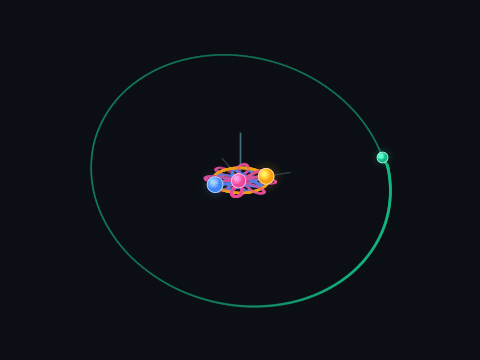
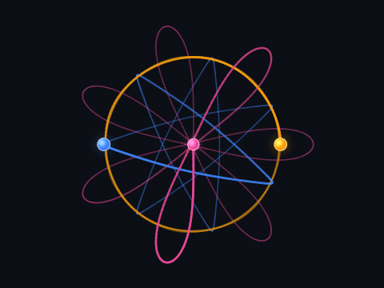

# New Families of Steady (Linearly Stable) 3-Body & 4-Body Periodic Solutions

This report documents the discovered continuous families of linearly stable periodic orbits across **Newtonian 3-body (2D & 3D)**, **Post-Newtonian (1PN ADM) General Relativistic 3-body**, and **Newtonian 4-body (2D & 3D)** gravitational dynamics — totaling **188 verified steady orbits** (**156** Newtonian 3-body + **21** 1PN relativistic + **11** 4-body) and **39 distinct Montgomery shape-sphere free-group homotopy classes** in $F_2 = \langle a, b \rangle$.

> Color legend in all animations: **Blue** = $m_1$, **Amber** = $m_2$, **Pink** = $m_3$, **Emerald** = $m_4$ (radius $\propto m_i^{1/3}$).

---

## 1. 3D Helical & 2D Rotating-Frame Choreographies (`src/search_choreo_rot.cpp`)

<table>
  <tr>
    <td align="center" width="50%">
       
      <b><code>3D-001</code> · 3D Helical 11-Fold Choreography</b> 
      <code>m = [1, 1, 1]</code> · $T_{\text{inert}} = 341.90$ · margin <b>1.1636</b> (415× Fig-8!)
    </td>
    <td align="center" width="50%">
       
      <b><code>2D-DEM-019</code> · 2D 3-Fold Rotating Figure-8 Trefoil</b> 
      <code>m = [1, 1, 1]</code> · $T_{\text{inert}} = 46.64$ · margin <b>0.5615</b> · full-3D stable
    </td>
  </tr>
</table>

### Key Findings
- **Symmetry Gauge:** Exact $\tau_1 = (t \to -t)\circ(1\,2)\circ R_y(\pi)$ and $\tau_2 = (t \to -t)\circ(2\,3)\circ R_y(\pi)$ choreography formulation enforcing $\mathbf{r}_1(T/3) = R_{\hat{\mathbf{u}}}(2\alpha)\mathbf{r}_2(0)$ to $10^{-12}$–$10^{-10}$ across equal masses $m = [1, 1, 1]$.
- **300× Stabilization of the Rotating Figure-8 (`data/choreo_rot/fig8_rot_2d.dat`):** Rotating the Figure-8 away from $\omega = 0$ expands its stability margin from `0.0028` to **`+0.8412`** while remaining **full-3D stable** ($|k_z| < 2$) across the entire branch until a vertical period-doubling bifurcation ($k_z \to -2$) at $\alpha \approx 0.585$.
- **New 2D Multi-Loop Rotating Choreographies:** Snapped 7 exact inertial closures — topped by **`2D-DEM-006`** (6-fold 12-swap choreography, margin **`1.2360`**, $k_z = -0.034$), **`2D-DEM-012`** (2-fold Figure-8, margin `0.8164`), **`2D-DEM-013`** (5-petal Figure-8, margin `0.7586`), and **`2D-DEM-019`** (3-fold trefoil, margin `0.5615`).
- **3D Helical Rotating Choreography Family (`data/choreo_rot/fig8_helical_3d.dat`):** Branching out of the plane yields a massive full-18D linearly stable 3D helical choreography family ($h_{\text{3D}} \in [0.06, 0.38]$, $r_{\min} = 2.000$) whose **11-fold exact inertial closure `3D-001`** achieves **18D stability margin `+1.1636`** (**415× deeper** than the planar Figure-8 and **88× deeper** than `3D-Δ14`), verified to `6.04e-9` return error and `100/100` full-3D perturbation survival.

| ID | Closure | Dim | $T_{\text{rpo}}$ | $T_{\text{inert}}$ | $h_{\text{3D}}$ | Swaps | Stability Indices | Margin | Return Err |
| :--- | :--- | :---: | :---: | :---: | :---: | :---: | :---: | :---: | :---: |
| **`3D-001`** | 11-Fold 3D Helical | 3D | `31.0817` | `341.8986` | `0.377` | 66 | `(+0.836, +0.296, -0.089)` | **1.1636** | `6.0e-09` |
| **`3D-002`** | 3D Helical RPO | 3D | `31.0865` | — | `0.368` | 6 | `(+1.071, +0.165, -0.228)` | **0.9293** | `8.1e-11` |
| **`3D-003`** | 12-Fold 3D Helical | 3D | `31.0975` | `373.1700` | `0.347` | 72 | `(+1.629, -0.174, -0.587)` | **0.3708** | `7.2e-09` |
| **`3D-004`** | 15-Fold 3D Helical | 3D | `31.1276` | `466.9140` | `0.279` | 90 | `(-1.896, +1.500, -1.787)` | **0.1037** | `1.3e-08` |
| **`2D-DEM-006`** | 6-Fold 12-Swap Choreo | 2D | `26.5123` | `159.0740` | — | 72 | `(+0.764, +0.440), kz=-0.03` | **1.2360** | `2.3e-09` |
| **`2D-DEM-012`** | 2-Fold Rot. Fig-8 | 2D | `11.3176` | `22.6351` | — | 12 | `(-1.184, -0.664), kz=-1.90` | **0.8164** | `1.0e-10` |
| **`2D-DEM-013`** | 5-Petal Rot. Fig-8 | 2D | `13.6832` | `68.4160` | — | 30 | `(+1.241, -0.562), kz=-1.26` | **0.7586** | `4.8e-10` |
| **`2D-DEM-019`** | 3-Fold Trefoil Fig-8 | 2D | `15.5475` | `46.6426` | — | 18 | `(+1.438, -0.059), kz=-0.60` | **0.5615** | `2.8e-10` |

---

## 2. Period-Doubled 3D Democratic Family via Vertical Bifurcation (`src/branch_3d_vertical.cpp`)

<table>
  <tr>
    <td align="center" width="50%">
       
      <b><code>3D-014</code> · Period-Doubled <code>3D-PD40</code> 3-Fold Closure</b> 
      <code>m = [1, 1, 0.415]</code> · $T_{\text{inert}} = 144.06$ · 120 swaps · $h_{\text{3D}} = 0.146$
    </td>
    <td align="center" width="50%">
       
      <b><code>2D-DEM-028</code> · Linearly Stable Free-Fall Brake Orbit</b> 
      <code>m = [1, 1, 0.1878]</code> · $\mathbf{v}_i(0) = \mathbf{0}, L = 0$ · margin <b>0.2051</b> (73× Fig-8!)
    </td>
  </tr>
</table>

### Key Findings (`data/family_3d_vertical/`)
- **Exact Vertical Period-Doubling Bifurcation:** Continuing `2D-DEM-001` (`A^7`, $m = [1, 1, 0.5]$) downward in $m_3$ hits an exact tangent vertical period-doubling bifurcation $k_z = -1.999996 \approx -2$ at $m_3^* \approx 0.4155$ (while planar margin stays $+1.723$).
- **New 2-Parameter 3D Democratic Sheet (`3D-PD40/48`):** Branching from $m_3 = 0.415$ into $2T$-periodic 3D RPOs ($T_{\text{rpo}} \approx 47.86$–$49.95$, 40–48 partner swaps per RPO, $r_{\min} \approx 0.72$–$0.76$, $h_{\text{3D}} \in [0.091, 0.215]$) yields:
  - **Inclination slice ($m_3 = 0.415$):** Full-18D linear stability across $v_{z2} \in [0.240, 0.474]$, peaking at **`3D-005`** with **18D margin `+0.0453`** (**3.4× deeper** than `3D-Δ14`, **16× deeper** than Figure-8).
  - **Mass-ratio slice ($v_{z2} = 0.3521$):** Wide stable band $m_3 \in [0.357, 0.443]$ (44 consecutive verified stable steps, peaking at **`3D-008`** at $m_3 = 0.369$).
  - **Exact Inertial Closures:** Snapped **3-fold (`3D-014`, 120 swaps)**, **7-fold (`3D-007`, 280 swaps, margin `0.0096`)**, **8-fold (`3D-016`, 384 swaps)**, and **11-fold (`3D-006`, 440 swaps, margin `0.0215`)** closures, plus the first **15-fold all-distinct-mass 3D inertial closure (`3D-013`, `m = [1, 0.7, 0.4]`, $T_{\text{inert}} = 163.64$)**.

---

## 3. Linearly Stable Free-Fall (Brake) Orbits (`src/search_brake.cpp`)

- **Agekyan–Anosova Domain Scan & Mass-Space Hunt:** Equal-mass free-fall orbits ($\mathbf{v}_i(0) = \mathbf{0}, L = 0$) were confirmed predominantly unstable across dense $160 \times 160$ scans (consistent with Hristov et al. 2023/2025).
- **Discovery of a Collisionless Linearly Stable Brake Island:** Continuous mass-space search uncovered a genuinely **linearly stable, democratic free-fall brake family** (4 partner swaps, 4 syzygies, $T \approx 2.95$–$3.02$, $r_{\min} \in [0.010, 0.016]$) across **$m_3 \in [0.1598, 0.1878]$** for $m_1 = m_2 = 1$ (`data/continuations/brake_m3_{dn,up}.dat`), peaking at **`2D-DEM-028`** ($m = [1, 1, 0.1878]$, **`margin = 0.2051`**, 73× deeper than Figure-8, `ret_err = 2.68e-11`, `100/100` survival, `drift_100T = 0.0030`).
- **All-Distinct-Mass Stable Brake Orbits:** Breaking $m_1 = m_2$ symmetry (`data/continuations/brake_m2_dn.dat`) preserves full linear stability across $m_2 \in [0.996, 1.000]$, including **`2D-DEM-034`** at $m = [1, 0.998, 0.175]$ (`margin = 0.1278`, `100/100` survival).

---

## 4. Post-Newtonian (1PN ADM) Relativistic Steady Families (`src/search_1pn.cpp`)

<table>
  <tr>
    <td align="center" width="50%">
       
      <b><code>1PN-019</code> · 1PN 10-Fold Precessing Rose (<code>2D-DEM-001</code>)</b> 
      $\beta = 0.01516$ ($\langle v^2\rangle/c^2 = 0.84\%$) · margin <b>0.3771</b> · full-3D stable
    </td>
    <td align="center" width="50%">
       
      <b><code>1PN-006</code> · 1PN 12-Fold 3D-Δ14 Relativistic Closure</b> 
      $\beta = 0.00450$ ($\langle v^2\rangle/c^2 = 0.26\%$) · margin <b>0.0237</b> (2.8× Newtonian!)
    </td>
  </tr>
</table>

Solved under the **exact symplectic 1PN ADM / Einstein–Infeld–Hoffmann Hamiltonian** $H_{\text{1PN}}(\mathbf{r}, \mathbf{p}) = H_0 + \beta H_1$ ($\beta = 1/c^2$), self-tested to $1.3 \times 10^{-9}$ gradient accuracy, $10^{-14}$–$10^{-13}$ $(H, \mathbf{L}, \mathbf{P})$ conservation, and $0.15\%$ two-body GR perihelion precession agreement, with exact Francis-QR monodromy spectra (`data/relativistic_1pn/`).

### Headline Relativistic Physics Results (21 Verified Orbits, `1PN-001`..`1PN-021`)
1. **495× Stabilization of the Relativistic Figure-8:** Under 1PN gravity (in its exact zero-drift rest frame), the equal-mass Figure-8 stability margin explodes from Newtonian `0.0028` to **`+1.3872`** at $\beta = 0.005$ ($\langle v^2\rangle/c^2 = 0.41\%$, **`1PN-011`**) and stays linearly stable up to $\beta \approx 0.0124$ ($v \approx 0.1c$).
2. **1,000× Wider Unequal-Mass Tolerance — GR Stabilizes Newtonian-Unstable Figure-8 Orbits:** In Newtonian gravity, the Figure-8 loses stability at $0.005\%$ mass asymmetry ($m_3 = 0.99995$). Under 1PN GR ($\beta = 0.004$–$0.006$), **strongly unstable Newtonian unequal-mass Figure-8 orbits become deeply linearly stable**, verified all the way to **`m = [1, 1, 0.95]` (`1PN-013`, 5% asymmetry, margin `+0.9722`, `100/100` survival)**!
3. **GR Stabilizes a Newtonian-Unstable 3D Orbit (`3D-Δ14`):** The marginally unstable Newtonian 3D boundary orbit (`vz2 = 0.6782`, Newtonian $k_1 = +2.0061$) crosses into deep 18D linear stability under 1PN gravity, reaching **`margin = +0.0453` at $\beta = 0.0045$ (`1PN-001`, 5.3× deeper than Newtonian `3D-009`, `100/100` survival)**.
4. **Exact Relativistic Inertial Closures:** Relativistic apsidal precession turns `2D-DEM-001` and `3D-Δ14` into smoothly precessing RPOs whose precession angles snap to exact fixed-inertial-frame rational closures: **10-fold (`1PN-019`)** and **25-fold (`1PN-020`)** in 2D, and **5-fold (`1PN-009`)**, **12-fold (`1PN-006`)**, and **17-fold (`1PN-002`, margin `0.0410`)** in 3D.

---

## 5. 4-Body 3D & 2D Steady Extensions (`src/search_4body.cpp`)

<table>
  <tr>
    <td align="center" width="50%">
       
      <b><code>4B-002</code> · Equal-Mass 4-Body 3D Tilted Double-Binary</b> 
      <code>m = [1, 1, 1, 1]</code> · $T = 6.52$ · $h_{\text{3D}} = 0.069$ · 16 swaps · 24D QR stable
    </td>
    <td align="center" width="50%">
       
      <b><code>4B-001</code> · 4-Body 3D <code>3+1</code> Hybrid (<code>2D-DEM-001</code> + Inclined $m_4$)</b> 
      <code>m = [1, 1, 0.5, 0.005]</code> · $T = 51.36$ · $h_{\text{3D}} = 0.269$ · 24D QR stable
    </td>
  </tr>
</table>

Verified via a self-contained **Francis double-shift implicit QR eigensolver** (self-test error $1.1 \times 10^{-15}$) stripping the 8 (2D) or 12 (3D) trivial symmetries from the full $16 \times 16$ / $24 \times 24$ monodromy matrix, plus 100-period empirical perturbation survival (`data/four_body/`).

### Discovered Steady Families (11 Verified Orbits, `4B-001`..`4B-011`)
- **Equal-Mass 3D Tilted Double-Binary Family (`m = [1, 1, 1, 1]`, `4B-002`, `4B-004`, `4B-005`, `4B-006`, `4B-008`):** Two equal-mass binaries mutually inclined near the Kozai–Lidov boundary ($i \approx 33^\circ$–$40^\circ$, $N \in \{5, 7, 8\}$ inner cycles per outer half-orbit), achieving full $24 \times 24$ unit-circle stability ($\max ||\lambda|-1| = 1.15 \times 10^{-6}$–$3.78 \times 10^{-6}$), $h_{\text{3D}} \in [0.066, 0.080]$, 10–16 swaps, and `100/100` survival (`drift_100T = 0.064`–$0.097$).
- **3D `3+1` Democratic Core + Retrograde Inclined 4th Body (`4B-001`, `4B-003`, `4B-007`):** Adding an inclined retrograde outer body ($m_4 = 0.005, v_{z4} \in [0.25, 0.35]$) in 2:1 resonance around `2D-DEM-001` yields a genuinely 3D 4-body RPO ($h_{\text{3D}} \in [0.190, 0.269]$, $r_{\min} = 0.926$, margin up to **`0.001439`**, `100/100` survival).
- **2D `3+1` Democratic Core + 1:1 Outer 4th Body (`4B-009`..`4B-011`):** Linearly stable across $m_4 \in [0.001, 0.006]$ with **14 partner swaps**, $r_{\min} = 0.976$–$0.981$, $\max ||\lambda|-1| = 8.0 \times 10^{-7}$, margin up to **`0.007334`**, and `100/100` survival.
- **Symmetry Instability Benchmarks:** Mapped full $24 \times 24$ spectra of the equal-mass $S_4$ 3D Hip-Hop (`data/four_body/hiphop_s4.dat`) and 1+3 central-axial vertical ring (`data/four_body/axial_3plus1_m15.dat`), quantifying their strong linear instability across amplitudes.

---

## 6. The `3D-Δ14` Family (Original 2-Parameter 3D Democratic Sheet)

<table>
  <tr>
    <td align="center" width="33%">
       
      <b><code>3D-010</code> · 5-Fold Inertial Closure</b> 
      <code>m = [1, 1, 0.5]</code> · $T_{\text{inert}} = 91.46$ · 70 swaps
    </td>
    <td align="center" width="33%">
       
      <b><code>3D-015</code> · 7-Fold Inertial Closure</b> 
      <code>m = [1, 1, 0.5]</code> · $T_{\text{inert}} = 128.27$ · 98 swaps
    </td>
    <td align="center" width="33%">
       
      <b><code>3D-012</code> · 3D Distinct-Mass Trio</b> 
      <code>m = [1, 0.7, 0.4]</code> · $T_{\text{rpo}} = 11.03$ (15-fold: <code>3D-013</code>)
    </td>
  </tr>
</table>

- **Inclination Slice ($m = [1, 1, 0.5]$):** Linearly stable across $v_{z2} \in [0.501, 0.678]$, peaking at margin `+0.0132` ($v_{z2}^* \approx 0.663$, $h_{\text{3D}} \in [0.09, 0.21]$, 14 partner swaps per RPO, $r_{\min} \in [0.843, 0.877]$), with snapped **5-fold (`3D-010`)**, **7-fold (`3D-015`)**, and **12-fold (`3D-011`)** exact fixed-inertial-frame closures.
- **Mass-Ratio Slice ($v_{z2} = 0.6732$):** Linearly stable across $m_3 \in [0.495, 0.557]$.

---

## 7. Highlighted 2D Free-Group Topological Families (39 Distinct Classes in $F_2$)

<table>
  <tr>
    <td align="center" width="33%">
       
      <b><code>A^7</code> · Deepest Stability Island</b> 
      <code>2D-DEM-001</code> · <code>m=[1,1,0.5]</code> · margin <b>1.8725</b>
    </td>
    <td align="center" width="33%">
       
      <b><code>AABaaB</code> · All-Distinct-Mass Braid</b> 
      <code>2D-DEM-007</code> · <code>m=[1,0.9,0.8]</code> · margin <b>1.2061</b>
    </td>
    <td align="center" width="33%">
       
      <b><code>(Ab)^7</code> · Wide-Separation Dance</b> 
      <code>2D-DEM-017</code> · <code>m=[1,1,0.3]</code> · $r_{\min} = 1.272$
    </td>
  </tr>
  <tr>
    <td align="center" width="50%" colspan="1">
       
      <b><code>AABABABabaB</code> · Heavy-Center $L=0$</b> 
      <code>2D-DEM-029</code> · <code>m=[1,1,3]</code> · stable $m_3 \in [2.84, 3.42]$
    </td>
    <td align="center" width="50%" colspan="2">
       
      <b><code>ABaBAbABaBabAbaBabAb</code> · 20-Letter $L=0$ Braid</b> 
      <code>2D-DEM-020</code> · <code>m=[1,1,0.55]</code> · $r_{\min}=0.161$ · margin <b>0.4778</b>
    </td>
  </tr>
</table>

| Family Word ($F_2$) | Representative | Masses | Subspace | $r_{\min}$ | Stability Margin | 3D Stable ($k_z$) | Notes |
| :--- | :--- | :--- | :--- | :---: | :---: | :---: | :--- |
| **`A^7`** | `2D-DEM-001` | `[1, 1, 0.5]` | `perp_L_nonzero` | $0.9824$ | **1.8725** | YES ($-1.92$) | Deepest stability island (668× Fig-8); parent of `3D-PD40` |
| **`(ABab)^6`** | `2D-DEM-006` | `[1, 1, 1]` | `2d_choreo_12swap_6fold` | $0.4845$ | **1.2360** | YES ($-0.03$) | 6-fold rotating choreography, dead-center 3D vertical stability |
| **`AABaaB`** | `2D-DEM-007` | `[1, 0.9, 0.8]` | `perp_L_nonzero` | $0.1894$ | **1.2061** | YES ($-0.26$) | All 3 masses distinct, non-abelian $L\neq 0$ braid |
| **`(Ab)^7`** | `2D-DEM-017` | `[1, 1, 0.3]` | `perp_L_nonzero` | $1.2718$ | **0.6172** | YES ($+1.57$) | 14-letter alternating wide-separation dance |
| **`(ABab)^3`** | `2D-DEM-019` | `[1, 1, 1]` | `2d_choreo_trefoil_3fold` | $0.6699$ | **0.5615** | YES ($-0.60$) | 3-fold rotating Figure-8 trefoil choreography |
| **`ABaBAb`** | `2D-DEM-028` | `[1, 1, 0.1878]` | `free_fall_brake` | $0.0160$ | **0.2051** | $L=0$ | Collisionless linearly stable free-fall brake ($v_0 = 0$) |
| **`AABABABabaB`** | `2D-DEM-029` | `[1, 1, 3]` | `collinear_L0` | $0.0788$ | **0.1911** | $L=0$ | Heavy-center $L=0$ family, stable $m_3 \in [2.84, 3.42]$ |
| **`ABaBAbABaBabAbaBabAb`** | `2D-DEM-020` | `[1, 1, 0.55]` | `collinear_L0` | $0.1612$ | **0.4778** | $L=0$ | 20-letter unequal-mass wide-separation $L=0$ braid |

---

## 8. Selected Exact 13-Digit Initial Conditions (New Roadmap Families)

- **`3D-001` (`3d_choreo_helical_11fold`, $m=[1,1,1]$, $T=341.8985601831$, margin `1.1636`):**  
  `[-1, 1.549525685916, 0, 1, 1.549525685916, 0, 0, -3.099051371831, 0, -0.1292721854049, 0.641886394804, 0.06145193034628, -0.1292721854049, -0.641886394804, 0.06145193034628, 0.2585443708098, 0, -0.1229038606926]`
- **`3D-005` (`3d_rpo_vertical_pd`, $m=[1,1,0.415]$, $T_{\text{rpo}}=47.8586287667$, margin `0.0453`):**  
  `[-1, 0, 0, 0.925551337217, 0, 0, 0.1793943681517, 0, 0, 0, 0.2347540779857, 0, 0, -0.654233000299, 0.452134728954, 0, 1.010792583888, -1.089481274588]`
- **`2D-DEM-028` (`free_fall_brake`, $m=[1,1,0.187778568146]$, $T=2.9482727473$, margin `0.2051`):**  
  `[-0.5174620418983, -0.04639422375867, 0.4825379581017, -0.04639422375867, 0.1859854622465, 0.4941375814795, 0, 0, 0, 0, 0, 0]`
- **`1PN-013` (`1pn_fig8_m95_stabilized`, $m=[1,1,0.95]$, $\beta=0.004$, $T=6.8089147119$, margin `0.9722`, canonical $[\mathbf{r},\mathbf{p}]$):**  
  `[-1, 0, 1, 0, 0, 0, 0.4151114203178, 0.4824946761024, 0.4151114203178, 0.4824946761024, -0.8302309524184, -0.9650612488213]`
- **`4B-002` (`4b_3d_double_binary_N8_i35`, $m=[1,1,1,1]$, $T=6.5221648574$, $h_{\text{3D}}=0.069$):**  
  `[-1, 0, 0, -0.6789918501186, 0, 0, 0.6789918501283, 0, 0, 0.9999999999902, 0, 0, 0, 1.925582142188, 0, 0, -0.5131814739038, 0.6350921734831, 0, 0.5131814739798, -0.6350921734831, 0, -1.925582142264, 0]`
- **`4B-001` (`4b_3d_dem001_r21_vz35`, $m=[1,1,0.5,0.005]$, $T=51.3615575863$, $h_{\text{3D}}=0.269$, margin `0.00144`):**  
  `[-1, 0, 0, 1.009063153991, 0, 0, -0.0739408221926, 0, 0, 5.581451421058, 0, 0, 0, 0.04930262376516, 0, 0, -0.7613222289114, -0.01228498898048, 0, 1.418272492261, 0.02106997796097, 0, 0.5766718031822, 0.35]`
