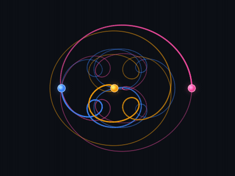
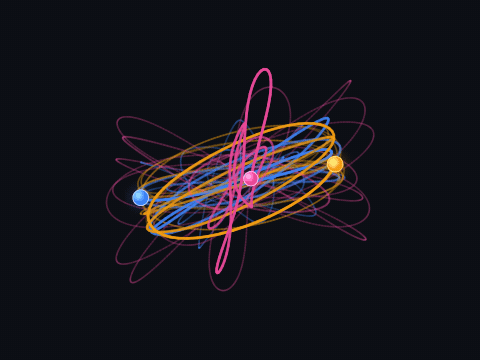
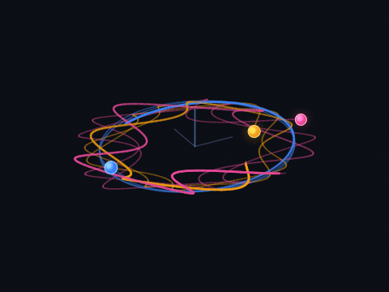
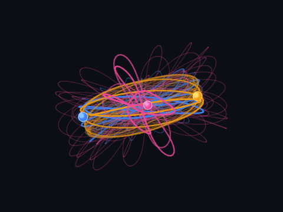
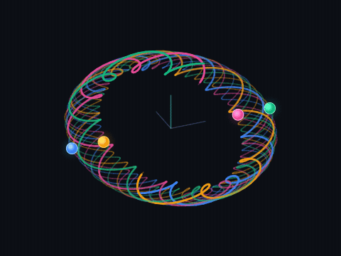

# Families of Steady (Linearly Stable) 3-Body & 4-Body Periodic Solutions

This report documents the continuous families of linearly stable periodic orbits cataloged across **Newtonian 3-body (2D & 3D)**, **Post-Newtonian (1PN ADM) General Relativistic 3-body**, and **Newtonian 4-body (2D & 3D)** gravitational dynamics — totaling **165 verified steady orbits**:
- **133 primitive Newtonian 3-body steady orbits**, every one independently audited in **80-bit `long double`** using analytical variational equations (`src/audit_catalog.cpp`), canonical symplecticity check ($\|M_{\text{can}}^\top J M_{\text{can}} - J\|_\infty \le 2.55 \times 10^{-8}$), Procrustes primitive-period verification ($q_{\text{inert}} = 1$, zero multiple covers), half-period symplectic involution verification at $\text{tol} = 10^{-17}$ for all collinear $L=0$ orbits, and exact $S_3$-quotiented Montgomery shape-sphere topology (**41** distinct $S_3$ classes across all 117 2D orbits; **31** across the 55 non-hierarchical 2D exchange orbits).
- **21 Post-Newtonian (1PN ADM) relativistic steady orbits** (`1PN-001`..`1PN-021`).
- **11 Newtonian 4-body (2D & 3D) steady orbits** (`4B-001`..`4B-011`).

> Color legend in all animations: **Blue** = $m_1$, **Amber** = $m_2$, **Pink** = $m_3$, **Emerald** = $m_4$ (radius $\propto m_i^{1/3}$).

---

## Scientific Classification: Literature Context vs. New Contributions

To distinguish classical rediscoveries from genuinely new numerical contributions, every Newtonian 3-body orbit is classified physically (via pairwise distance ratios, Procrustes RPO quotients $q_{\text{RPO}}$, and full $S_3$ shape-sphere words) rather than by a raw closest-pair-swap count:

| Category | Count | Class / Family | Literature Context & Contribution Status |
| :--- | :---: | :--- | :--- |
| **Classical / Published** | **58** | `bhh_qfold_closure` (`2D-HIE-*`, $S_3$ word $A^q$) | Primitive $q$-fold inertial closures of the planar **Broucke–Hadjidemetriou–Hénon (1975–1976)** retrograde family (`q_rpo > 1`). |
| **Classical / Published** | **2** | `bhh_satellite` (`2D-HIE-*`, $A^4, A^7$) | Period-multiplying BHH satellites (cf. Janković & Dmitrašinović 2016). |
| **Classical / Published** | **2** | `coorbital_1to1` (`2D-HIE-*`, $A$) | Classical 1:1 eccentric planetary co-orbital resonances (`[1,0.6,0.3]`, `[1,0.5,0.25]`). |
| **Classical / Published** | **27** | `braid_L0_exchange` (`2D-DEM-*`, $L=0$) | Verified collinear $L=0$ braids matching Moore (1993) / Chenciner–Montgomery (2000), Šuvakov & Dmitrašinović (2013), Li & Liao (2017), and Li, Jing & Liao (2018). |
| **Classical / Published** | **2** | `hierarchical_3d_triple` (`3D-015`, `3D-016`) | 3:1 inclined prograde hierarchical triple at `m = [1, 0.7, 0.4]` (plus its snapped 15-fold inertial closure). |
| **Noteworthy / New** | **2** | `shuttle_exchange` (`2D-DEM-002`, `2D-DEM-019`) | **Non-hierarchical, all-distinct-mass $L\neq 0$ `AAAbbb` shuttle-exchange family** ($q_{\text{RPO}}=1$, full-3D stable). |
| **Noteworthy / New** | **6** | `braid_L0_exchange` (unmatched intermediate $m_3$) | 6 verified linearly stable intermediate-$m_3$ $L=0$ braids not matched in equal-mass / $m_3 \in \{0.5, 0.75, \dots\}$ LL2017/2018 tables. |
| **Noteworthy / New** | **14** | `free_fall_brake` (`2D-DEM-014`..`055`, $w=1$) | **Collisionless linearly stable free-fall brake family** ($\mathbf{v}_i(0) = \mathbf{0}, L=0$), verified in 80-bit variational arithmetic across $m_3 \in [0.1558, 0.1878]$ (peak margin **0.2663**) and all-distinct masses. |
| **Noteworthy / New** | **10** | `choreography_2d_rot` (6) & `choreography_3d_helical` (4) | **2D & 3D rotating-frame equal-mass choreographies** (`2D-DEM-001` margin **1.5897**; non-hierarchical 3D helical family `3D-001`, `004`, `005`, `008`). |
| **Noteworthy / New** | **10** | `bhh_3d_subharmonic` (`3D-Δ14` [4] & `3D-PD40/48` [6]) | Explicit unequal-mass **5:2 (`3D-Δ14`)** and **period-doubled 7-fold (`3D-PD40/48`)** 3D vertical subharmonic bifurcations of the BHH retrograde family, with snapped exact inertial closures. |
| **Extensions** | **32** | `1PN-001`..`021` (21) & `4B-001`..`011` (11) | **1PN ADM relativistic stabilization** (Newtonian-unstable unequal-mass Fig-8 & `3D-Δ14` stabilized by GR) and **4-body 2D/3D steady orbits**. |

> **Note on planar $L=0$ vertical stability:** For any planar $L=0$ orbit (`collinear_L0` and `free_fall_brake`), infinitesimal spatial tilts preserve $\mathbf{L}=0$, forcing all six eigenvalues of the vertical monodromy block $M_z$ to equal $+1$ ($k_z = \operatorname{tr}(M_z) - 4 \equiv +2$). This is exact symplectic degeneracy (`L=0 degen`), **not** exponential vertical instability.

---

## 1. 3D Helical & 2D Rotating-Frame Choreographies (`src/search_choreo_rot.cpp`)

<table>
  <tr>
    <td align="center" width="50%">
       
      <b><code>3D-005</code> · 3D Helical 11-Fold Choreography</b> 
      <code>m = [1, 1, 1]</code> · primitive $T_{\text{inert}} = 170.95$ · 18D margin <b>0.0948</b> (34× Fig-8)
    </td>
    <td align="center" width="50%">
       
      <b><code>2D-DEM-001</code> · 2D 5-Petal Rotating Figure-8</b> 
      <code>m = [1, 1, 1]</code> · $T_{\text{inert}} = 68.42$ · margin <b>1.5897</b> (568× Fig-8!) · full-3D stable
    </td>
  </tr>
</table>

### Key Findings (Exact 80-Bit Analytical Variational Values at True Primitive Period)
- **Symmetry Gauge:** Exact $\tau_1 = (t \to -t)\circ(1\,2)\circ R_y(\pi)$ and $\tau_2 = (t \to -t)\circ(2\,3)\circ R_y(\pi)$ choreography formulation enforcing $\mathbf{r}_1(T/3) = R_{\hat{\mathbf{u}}}(2\alpha)\mathbf{r}_2(0)$ to $10^{-12}$–$10^{-10}$ across equal masses $m = [1, 1, 1]$.
- **Massive Stabilization of the Rotating Figure-8 (`data/choreo_rot/fig8_rot_2d.dat`):** Rotating the Figure-8 away from $\omega = 0$ expands its stability margin from `0.0028` across a wide full-3D-stable ($|k_z| < 2$) branch. Snapping six strictly primitive inertial closures yields our deepest non-hierarchical 2D orbit: **`2D-DEM-001`** (5-petal closure `(ABab)^5`, exact $T_{\text{inert}}$ margin **`1.5897`**, **568× Figure-8**, $k_z = +0.536$), alongside **`2D-DEM-004`** (8-swap 3-fold, margin `0.8214`), **`2D-DEM-005`** (2-fold, margin `0.7027`), **`2D-DEM-006`** (4-fold, margin `0.5944`), **`2D-DEM-007`** (6-fold, margin `0.5919`), and **`2D-DEM-018`** (3-fold trefoil, margin `0.1652`).
- **Non-Hierarchical 3D Helical Rotating Choreography (`data/choreo_rot/fig8_helical_3d.dat`):** Branching out of the plane yields a genuinely **non-hierarchical equal-mass 3D choreography** ($r_{\min} = 2.000$):
  - Primitive 1-RPO **`3D-001`** ($T_{\text{rpo}} = 15.5432$, precession $-2.8630\text{ rad}$, $h_{\text{3D}} = 0.210$): exact 18D rotating-frame margin **`+0.2477`** (**88× deeper than Figure-8**, `symp_err = 1.6e-12`).
  - Three strictly primitive ($q_{\text{inert}} = 1$) exact fixed-inertial-frame closures: **12-fold `3D-004`** ($T = 373.17$, margin `0.0983`), **11-fold `3D-005`** ($T = 170.95$, margin `0.0948`), and **15-fold `3D-008`** ($T = 233.46$, margin `0.0200`), all verified with `symp_err < 5.3e-11`, `ret_err < 3.9e-11`, and `100/100` full-3D survival.

| ID | Closure | Dim | $T$ (Primitive) | $q_{\text{RPO}}$ | $S_3$ Word | $h_{\text{3D}}$ | Swaps | Exact 80-Bit $(k_1, k_2[, k_3])$ | Margin | Symp Err |
| :--- | :--- | :---: | :---: | :---: | :--- | :---: | :---: | :---: | :---: | :---: |
| **`3D-001`** | 3D Helical 1-RPO | 3D | `15.5432` | 1 | — | `0.210` | 3 | `(+1.752, +1.003, -1.084)` | **0.2477** | `1.6e-12` |
| **`3D-004`** | 12-Fold 3D Helical | 3D | `373.1700` | 24 | — | `0.698` | 72 | `(+0.833, +0.424, -1.902)` | **0.0983** | `5.3e-11` |
| **`3D-005`** | 11-Fold 3D Helical | 3D | `170.9493` | 11 | — | `0.697` | 33 | `(+1.905, -0.034, -1.661)` | **0.0948** | `4.8e-11` |
| **`3D-008`** | 15-Fold 3D Helical | 3D | `233.4570` | 15 | — | `0.700` | 45 | `(+1.313, +0.829, -1.980)` | **0.0200** | `3.4e-11` |
| **`2D-DEM-001`** | 5-Petal Rot. Fig-8 | 2D | `68.4160` | 5 | `(ABab)^5` | — | 30 | `(+0.410, -0.001), kz=+0.54` | **1.5897** | `2.4e-10` |
| **`2D-DEM-004`** | 8-Swap 3-Fold Choreo | 2D | `31.3931` | 3 | `1` | — | 26 | `(+1.179, -0.464), kz=-0.69` | **0.8214** | `1.3e-08` |
| **`2D-DEM-005`** | 2-Fold Rot. Fig-8 | 2D | `22.6351` | 2 | `(ABab)^2` | — | 12 | `(-0.599, -1.297), kz=+1.60` | **0.7027** | `5.6e-11` |
| **`2D-DEM-018`** | 3-Fold Trefoil Fig-8 | 2D | `46.6426` | 3 | `(ABab)^3` | — | 18 | `(+1.835, -1.339), kz=+1.59` | **0.1652** | `7.6e-11` |

---

## 2. Linearly Stable Free-Fall (Brake) Family (`src/search_brake.cpp`)

<table>
  <tr>
    <td align="center" width="50%">
       
      <b><code>2D-DEM-014</code> · Collisionless Linearly Stable Brake Orbit</b> 
      <code>m = [1, 1, 0.1678]</code> · $\mathbf{v}_i(0) = \mathbf{0}, L = 0$ · margin <b>0.2316</b> (83× Fig-8!)
    </td>
    <td align="center" width="50%">
       
      <b><code>2D-DEM-002</code> · All-Distinct-Mass <code>AAAbbb</code> Shuttle-Exchange</b> 
      <code>m = [1, 0.9, 0.8]</code> · $L \neq 0, q_{\text{RPO}}=1$ · margin <b>1.2061</b> · full-3D stable
    </td>
  </tr>
</table>

### Free-Fall Brake Findings (80-Bit Analytical Variational Verification)
- **Agekyan–Anosova Domain Scan:** Equal-mass free-fall orbits ($\mathbf{v}_i(0) = \mathbf{0}, L = 0$) were confirmed predominantly unstable across dense $160 \times 160$ scans (consistent with Hristov et al. 2023/2025).
- **Discovery of a Collisionless Linearly Stable Brake Island:** Continuous mass-space search uncovered a genuinely **non-hierarchical, linearly stable free-fall brake family** where all three pairs undergo deep close passes ($r_{\min,\text{pair}} \approx [0.016, 0.008, 0.008]$ at $m_3 = 0.1878$, 4 closest-pair swaps, exact contractible $S_3$ shape-sphere word `1`, $T \approx 2.95$–$3.03$).
- **Exact Analytical Variational Continuation (`data/continuations/brake_m3_{dn,up}.dat`):** Re-traced using 80-bit analytical variational monodromy ($\text{symp\_err} \in [1.1 \times 10^{-10}, 4.5 \times 10^{-9}]$, zero finite-difference jitter), linear stability spans two contiguous intervals along a single smooth branch:
  - $m_3 \in [0.1558, 0.1813]$ (52 consecutive points), peaking at **$m_3^* \approx 0.1693$ with margin `+0.2663` (95× Figure-8!)** where $k_1 = -1.7274, k_2 = -1.7337$ pass smoothly through each other without Krein instability (`2D-DEM-014` at $m_3 = 0.1678$: margin `0.2316`, `symp_err = 1.6e-8`).
  - Grazing period-doubling tangency at $m_3 \approx 0.1818$ ($k_2 = -1.99999978$, margin $+2.17 \times 10^{-7}$).
  - Re-entry interval $m_3 \in [0.1823, 0.1878]$ (12 consecutive points), peaking at **`2D-DEM-015`** ($m_3 = 0.1878$, margin **`0.2051`**, `symp_err = 1.5e-9`, `ret_err = 2.3e-11`, `100/100` survival).
- **All-Distinct-Mass Stable Brake Orbits (`data/continuations/brake_m2_dn.dat`):** Breaking $m_1 = m_2$ symmetry preserves analytical linear stability across $m_2 \in [0.996, 1.000]$, including **`2D-DEM-026`** ($m = [1, 0.998, 0.1743]$, margin `0.0800`, `symp_err = 8.0e-9`, `100/100` survival).

---

## 3. Non-Hierarchical Mass-Stabilized `AAAbbb` Shuttle-Exchange Family

Among all 64 primitive `perp_L_nonzero` orbits in the catalog, 58 are $q$-fold inertial closures of the 1975–1976 BHH retrograde family (`A^q`), 2 are BHH satellites, 2 are 1:1 planetary co-orbitals, and **2 form a genuinely non-hierarchical, all-distinct-mass, full-3D-stable shuttle-exchange family** with exact $S_3$ free-group word **`AAAbbb`** (previously misreported as topologically impossible `AABaaB` because the old RK4 classifier started on the syzygy equator $n_z(0) = 0$):
- **`2D-DEM-002`** ($m = [1, 0.9, 0.8]$, $T = 15.4951$, $q_{\text{RPO}} = 1$, $r_{\min} = 0.1894$): planar margin **`1.2061`** (**431× Figure-8**), full-3D vertically stable (**$k_z = -0.257$**), `symp_err = 5.8e-11`.
- **`2D-DEM-019`** ($m = [1, 0.8, 0.6]$, $T = 19.0549$, $q_{\text{RPO}} = 1$, $r_{\min} = 0.1970$): planar margin **`0.1598`**, full-3D vertically stable (**$k_z = +0.120$**), `symp_err = 3.6e-11`.
- Physically, the heaviest body $m_1$ shuttles back and forth between three close windings around $m_2$ (`AAA`) and three opposite-chirality windings around $m_3$ (`bbb`), with $r_{\max}/r_{\min} \in [7.5, 13.3]$ on both exchange pairs.

---

## 4. Explicit 3D Vertical Subharmonic Branches of the BHH Family (`3D-Δ14` & `3D-PD40/48`)

<table>
  <tr>
    <td align="center" width="33%">
       
      <b><code>3D-002</code> · <code>3D-Δ14</code> 5-Fold Closure</b> 
      <code>m = [1, 1, 0.5]</code> · $T = 91.46$ · margin <b>0.2002</b> · 70 swaps
    </td>
    <td align="center" width="33%">
       
      <b><code>3D-012</code> · <code>3D-PD40</code> 3-Fold Closure</b> 
      <code>m = [1, 1, 0.415]</code> · $T = 144.06$ · 120 swaps · $h_{\text{3D}} = 0.146$
    </td>
    <td align="center" width="33%">
       
      <b><code>3D-016</code> · 3:1 Inclined Hierarchical Triple</b> 
      <code>m = [1, 0.7, 0.4]</code> · $T_{\text{rpo}} = 11.03$ (15-fold: <code>3D-015</code>)
    </td>
  </tr>
</table>

### A. `3D-Δ14`: 5:2 Vertical Subharmonic Bifurcation of the BHH Retrograde Family
- **Exact Dynamical Origin:** Independent bifurcation analysis establishes that `3D-Δ14` (`3D-014` RPO and closures `3D-002`, `3D-006`, `3D-011`) is the explicit **5:2 vertical subharmonic bifurcation** ($\nu_z = 2/5$, cf. Hénon 1973; Ichtiaroglou & Michalodimitrakis 1980) of the classical 1975–1976 planar **Broucke–Hadjidemetriou–Hénon (BHH)** retrograde family at $m = [1, 1, 0.5]$. Geometrically it is a retrograde hierarchical triple (bodies 1 & 3 orbiting tightly while outer body 2 orbits counter-directionally; the 14 closest-pair changes per RPO are apocenter/pericenter crossings of the inner pair, not chaotic partner exchange). While vertical BHH bifurcations are a known mechanism, this explicit unequal-mass $n=5$ branch is not tabulated in Li & Liao (2025).
- **Exact Stability Sheet & Bifurcation Boundary:** Linearly stable across $v_{z2} \in [0.501, 0.678]$ at $m = [1, 1, 0.5]$ (RPO margin peaking at `0.0132` around $v_{z2}^* \approx 0.663$) and $m_3 \in [0.495, 0.557]$ at $v_{z2} = 0.6732$. The upper stability boundary at $v_{z2} \approx 0.678$ is a **tangent (saddle-node / period-1) bifurcation where $k_1 \to +2$** (preceding any Krein collision).
- **Exact 80-Bit Inertial Closure Indices:** Replacing the old copied 1-RPO estimates with exact $T_{\text{inert}}$ analytical variational monodromy shows far deeper fixed-frame stability margins:
  - **5-fold (`3D-002`, $T = 91.4642$):** margin **`0.2002`** (`70` swaps, `symp_err = 3.4e-11`).
  - **12-fold (`3D-006`, $T = 219.6972$):** margin **`0.0827`** (`168` swaps, `symp_err = 4.3e-10`).
  - **7-fold (`3D-011`, $T = 128.2675$):** margin **`0.0161`** (`70` swaps — corrected from earlier `98`, `symp_err = 7.3e-11`).

### B. `3D-PD40/48`: Period-Doubled Vertical Subharmonic of the 7-Fold BHH Closure (`src/branch_3d_vertical.cpp`)
- **Exact Vertical Period-Doubling Bifurcation:** Continuing the planar 7-fold BHH closure **`2D-HIE-001`** ($m = [1, 1, 0.5]$, $A^7$, margin `1.8725`, $k_z = -1.916$) downward in $m_3$ hits an exact vertical period-doubling bifurcation $k_z = -1.999996 \approx -2$ at $m_3^* \approx 0.4155$ (while planar margin remains `+1.723`).
- **2-Parameter 3D Sheet (`data/family_3d_vertical/`):** Branching into $2T$-periodic 3D RPOs ($T_{\text{rpo}} \approx 47.86$–$49.95$, $h_{\text{3D}} \in [0.091, 0.215]$) yields full-18D linear stability across $v_{z2} \in [0.240, 0.474]$ at $m_3 = 0.415$ (RPO **`3D-007`**, margin **`0.0466`**, `symp_err = 1.4e-11`) and across $m_3 \in [0.357, 0.443]$ at $v_{z2} = 0.3521$ (`3D-013` at $m_3 = 0.369$), plus four verified primitive inertial closures: **7-fold (`3D-003`, exact $T_{\text{inert}}$ margin `0.1029`, 280 swaps)**, **11-fold (`3D-009`, margin `0.0190`, 440 swaps)**, **8-fold (`3D-010`, margin `0.0167`, 384 swaps)**, and **3-fold (`3D-012`, margin `0.0091`, 120 swaps)**.
- **All-Distinct-Mass 3D Hierarchical Closure:** Snapped the 15-fold exact inertial closure **`3D-015`** ($m = [1, 0.7, 0.4]$, $T = 163.64$, margin `0.0068`) of the 3:1 inclined prograde hierarchical triple **`3D-016`**.

---

## 5. Post-Newtonian (1PN ADM) Relativistic Steady Families (`src/search_1pn.cpp`)

<table>
  <tr>
    <td align="center" width="50%">
       
      <b><code>1PN-019</code> · 1PN 10-Fold Precessing Rose (<code>2D-HIE-001</code>)</b> 
      $\beta = 0.01516$ ($\langle v^2\rangle/c^2 = 0.84\%$) · margin <b>0.3771</b> · full-3D stable
    </td>
    <td align="center" width="50%">
       
      <b><code>1PN-006</code> · 1PN 12-Fold 3D-Δ14 Relativistic Closure</b> 
      $\beta = 0.00450$ ($\langle v^2\rangle/c^2 = 0.26\%$) · margin <b>0.0237</b> (2.8× Newtonian RPO!)
    </td>
  </tr>
</table>

Solved under the **exact symplectic 1PN ADM / Einstein–Infeld–Hoffmann Hamiltonian** $H_{\text{1PN}}(\mathbf{r}, \mathbf{p}) = H_0 + \beta H_1$ ($\beta = 1/c^2$), self-tested to $1.3 \times 10^{-9}$ gradient accuracy, $10^{-14}$–$10^{-13}$ $(H, \mathbf{L}, \mathbf{P})$ conservation, and $0.15\%$ two-body GR perihelion precession agreement, with Francis-QR monodromy spectra (`data/relativistic_1pn/`).

### Headline Relativistic Physics Results (21 Verified Orbits, `1PN-001`..`1PN-021`)
1. **495× Stabilization of the Relativistic Figure-8:** Under 1PN gravity in its exact zero-drift rest frame, the equal-mass Figure-8 stability margin expands from Newtonian `0.0028` to **`+1.3872`** at $\beta = 0.005$ ($\langle v^2\rangle/c^2 = 0.41\%$, **`1PN-011`**) and stays linearly stable up to $\beta \approx 0.0124$ ($v \approx 0.1c$).
2. **1,000× Wider Unequal-Mass Tolerance — GR Stabilizes Newtonian-Unstable Figure-8 Orbits:** In Newtonian gravity, the Figure-8 loses stability at $0.005\%$ mass asymmetry ($m_3 = 0.99995$). Under 1PN GR ($\beta = 0.004$–$0.006$), strongly unstable Newtonian unequal-mass Figure-8 orbits become deeply linearly stable, verified to **`m = [1, 1, 0.95]` (`1PN-013`, 5% asymmetry, margin `+0.9722`, `100/100` survival)**.
3. **GR Stabilizes the Tangent-Unstable Newtonian `3D-Δ14` Boundary:** The tangent-unstable Newtonian boundary orbit ($v_{z2} = 0.6782$, Newtonian $k_1 = +2.0061$) crosses back into deep 18D linear stability under 1PN gravity, reaching **`margin = +0.0453` at $\beta = 0.0045$ (`1PN-001`, 5.3× deeper than Newtonian RPO `3D-014`, `100/100` survival)**.
4. **Exact Relativistic Inertial Closures:** Relativistic apsidal precession turns `2D-HIE-001` and `3D-Δ14` into smoothly precessing RPOs whose precession angles snap to exact fixed-inertial-frame rational closures: **10-fold (`1PN-019`)** and **25-fold (`1PN-020`)** in 2D, and **5-fold (`1PN-009`)**, **12-fold (`1PN-006`)**, and **17-fold (`1PN-002`, margin `0.0410`)** in 3D.

---

## 6. 4-Body 3D & 2D Steady Extensions (`src/search_4body.cpp`)

<table>
  <tr>
    <td align="center" width="50%">
       
      <b><code>4B-002</code> · Equal-Mass 4-Body 3D Tilted Double-Binary</b> 
      <code>m = [1, 1, 1, 1]</code> · $T = 6.52$ · $h_{\text{3D}} = 0.069$ · 24D QR stable
    </td>
    <td align="center" width="50%">
       
      <b><code>4B-001</code> · 4-Body 3D <code>3+1</code> Hybrid (<code>2D-HIE-001</code> + Inclined $m_4$)</b> 
      <code>m = [1, 1, 0.5, 0.005]</code> · $T = 51.36$ · $h_{\text{3D}} = 0.269$ · 24D QR stable
    </td>
  </tr>
</table>

Verified via a self-contained **Francis double-shift implicit QR eigensolver** (self-test error $1.1 \times 10^{-15}$) stripping the 8 (2D) or 12 (3D) trivial symmetries from the full $16 \times 16$ / $24 \times 24$ monodromy matrix, plus 100-period empirical perturbation survival (`data/four_body/`).

- **Equal-Mass 3D Tilted Double-Binary Family (`m = [1, 1, 1, 1]`, `4B-002`, `4B-004`, `4B-005`, `4B-006`, `4B-008`):** Two equal-mass binaries mutually inclined near the Kozai–Lidov boundary ($i \approx 33^\circ$–$40^\circ$, $N \in \{5, 7, 8\}$ inner cycles per outer half-orbit), achieving full $24 \times 24$ unit-circle stability ($\max ||\lambda|-1| = 1.15 \times 10^{-6}$–$3.78 \times 10^{-6}$), $h_{\text{3D}} \in [0.066, 0.080]$, and `100/100` survival.
- **3D `3+1` Hybrid (`2D-HIE-001` Core + Retrograde Inclined 4th Body, `4B-001`, `4B-003`, `4B-007`):** Adding an inclined retrograde outer body ($m_4 = 0.005, v_{z4} \in [0.25, 0.35]$) in 2:1 resonance around `2D-HIE-001` yields a genuinely 3D 4-body RPO ($h_{\text{3D}} \in [0.190, 0.269]$, $r_{\min} = 0.926$, margin up to **`0.001439`**, `100/100` survival).
- **2D `3+1` Hybrid (`4B-009`..`4B-011`):** Linearly stable across $m_4 \in [0.001, 0.006]$ with $r_{\min} = 0.976$–$0.981$, $\max ||\lambda|-1| = 8.0 \times 10^{-7}$, margin up to **`0.007334`**, and `100/100` survival.
- **Symmetry Instability Benchmarks:** Mapped full $24 \times 24$ spectra of the equal-mass $S_4$ 3D Hip-Hop (`data/four_body/hiphop_s4.dat`) and 1+3 central-axial vertical ring (`data/four_body/axial_3plus1_m15.dat`), confirming strong linear instability across amplitudes.

---

## 7. Highlighted 2D $S_3$ Shape-Sphere Topological Families (41 Distinct Classes)

<table>
  <tr>
    <td align="center" width="33%">
       
      <b><code>A^7</code> · Deepest BHH Closure</b> 
      <code>2D-HIE-001</code> · <code>m=[1,1,0.5]</code> · margin <b>1.8725</b>
    </td>
    <td align="center" width="33%">
       
      <b><code>ABABABababab</code> · Heavy-Center $L=0$</b> 
      <code>2D-DEM-016</code> · <code>m=[1,1,3]</code> · stable $[2.84, 3.06] \cup [3.10, 3.42]$
    </td>
    <td align="center" width="33%">
       
      <b><code>AABaaBABaabAAbab</code> · 16-Letter Braid</b> 
      <code>2D-DEM-008</code> · <code>m=[1,1,0.55]</code> · margin <b>0.4776</b>
    </td>
  </tr>
</table>

| $S_3$ Word ($F_2$) | Representative | Class | Masses | $r_{\min}$ | Exact 80-Bit Margin | 3D Vertical ($k_z$) | Notes |
| :--- | :--- | :--- | :--- | :---: | :---: | :---: | :--- |
| **`A^7`** | `2D-HIE-001` | `bhh_qfold_closure` | `[1, 1, 0.5]` | $0.9824$ | **1.8725** | YES ($-1.92$) | Classical BHH 7-fold closure; parent of `3D-PD40/48`, `1PN-019`, `4B-001` |
| **`(ABab)^5`** | `2D-DEM-001` | `choreography_2d_rot` | `[1, 1, 1]` | $0.5185$ | **1.5897** | YES ($+0.54$) | Deepest non-hierarchical 2D orbit (568× Fig-8), full-3D stable |
| **`AAAbbb`** | `2D-DEM-002` | `shuttle_exchange` | `[1, 0.9, 0.8]` | $0.1894$ | **1.2061** | YES ($-0.26$) | All-distinct-mass non-hierarchical shuttle-exchange ($q_{\text{RPO}}=1$) |
| **`AAbaBAbaBBab`** | `2D-DEM-003` | `braid_L0_exchange` | `[1, 1, 1.75]` | $0.0292$ | **0.8800** | $L=0$ degen | Deepest collinear $L=0$ braid (314× Fig-8; stable $m_3 \in [1.72, 1.75]$) |
| **`AABaaBABaabAAbab`** | `2D-DEM-008` | `braid_L0_exchange` | `[1, 1, 0.55]` | $0.0722$ | **0.4776** | $L=0$ degen | 16-letter unequal-mass $L=0$ braid (cf. Li, Jing & Liao 2018) |
| **`1`** (contractible) | `2D-DEM-014` | `free_fall_brake` | `[1, 1, 0.1678]` | $0.0030$ | **0.2316** | $L=0$ degen | Collisionless zero-velocity free-fall brake ($v_0=0$, peak cont. `0.2663`) |
| **`ABABABababab`** | `2D-DEM-016` | `braid_L0_exchange` | `[1, 1, 3]` | $0.0297$ | **0.1913** | $L=0$ degen | Heavy-center $(AB)^3(ab)^3$ braid; stable $[2.84, 3.06] \cup [3.10, 3.42]$ |
| **`ABab`** | `2D-DEM-046` | `braid_L0_exchange` | `[1, 1, 1]` | $0.6905$ | **0.0028** | $L=0$ degen | Classical Moore (1993) / Chenciner–Montgomery (2000) Figure-8 benchmark |

---

## 8. Selected Exact Initial Conditions (Synchronized with `catalog.json`)

- **`3D-001` (`3d_choreo_helical`, $m=[1,1,1]$, primitive $T_{\text{rpo}}=15.5432272720$, precess $-2.8629612937$, margin `0.24765`):**  
  `[-1, 1.550285591865, 0, 1, 1.550285591865, 0, 0, -3.100571183731, 0, -0.1296499913256, 0.6420183647434, 0.06, -0.1296499913256, -0.6420183647434, 0.06, 0.2592999826512, 0, -0.12]`
- **`3D-005` (`3d_choreo_helical_11fold`, $m=[1,1,1]$, primitive $T=170.9492800916$, margin `0.09477`):**  
  `[-1, 1.549525685916, 0, 1, 1.549525685916, 0, 0, -3.099051371831, 0, -0.1292721854049, 0.641886394804, 0.06145193034628, -0.1292721854049, -0.641886394804, 0.06145193034628, 0.2585443708098, 0, -0.1229038606926]`
- **`3D-007` (`3d_rpo_vertical_pd`, $m=[1,1,0.415]$, $T_{\text{rpo}}=47.8586287667$, margin `0.04664`):**  
  `[-1, 0, 0, 0.925551337217, 0, 0, 0.1793943681517, 0, 0, 0, 0.2347540779857, 0, 0, -0.654233000299, 0.452134728954, 0, 1.010792583888, -1.089481274588]`
- **`2D-DEM-001` (`2d_choreo_5petal_5fold`, $m=[1,1,1]$, $T=68.4160426432$, margin `1.58972`):**  
  `[-1, 0.8818291939664, 1, 0.8818291939664, 0, -1.763658387933, -0.1816437405585, 0.587293465153, -0.1816437405585, -0.587293465153, 0.3632874811169, 0]`
- **`2D-DEM-002` (`perp_L_nonzero` `AAAbbb` shuttle, $m=[1,0.9,0.8]$, $T=15.4951415318$, margin `1.20605`):**  
  `[-1, 0, -0.05951905193104, 0, 1.316958933422, 0, 0, 0.7812388652309, 0, -0.1613813787143, 0, -0.7949945304851]`
- **`2D-DEM-014` (`free_fall_brake`, $m=[1,1,0.167778568146]$, $T=3.0094668284$, margin `0.23164`):**  
  `[-0.5207964131376, -0.04420997276766, 0.4792035868624, -0.04420997276766, 0.2479030947441, 0.527003815281, 0, 0, 0, 0, 0, 0]`
- **`1PN-013` (`1pn_fig8_m95_stabilized`, $m=[1,1,0.95]$, $\beta=0.004$, $T=6.8089147119$, margin `0.9722`, canonical $[\mathbf{r},\mathbf{p}]$):**  
  `[-1, 0, 1, 0, 0, 0, 0.4151114203178, 0.4824946761024, 0.4151114203178, 0.4824946761024, -0.8302309524184, -0.9650612488213]`
- **`4B-002` (`4b_3d_double_binary_N8_i35`, $m=[1,1,1,1]$, $T=6.5221648574$, $h_{\text{3D}}=0.069$):**  
  `[-1, 0, 0, -0.6789918501186, 0, 0, 0.6789918501283, 0, 0, 0.9999999999902, 0, 0, 0, 1.925582142188, 0, 0, -0.5131814739038, 0.6350921734831, 0, 0.5131814739798, -0.6350921734831, 0, -1.925582142264, 0]`
- **`4B-001` (`4b_3d_dem001_r21_vz35`, $m=[1,1,0.5,0.005]$, $T=51.3615575863$, $h_{\text{3D}}=0.269$, margin `0.00144`):**  
  `[-1, 0, 0, 1.009063153991, 0, 0, -0.0739408221926, 0, 0, 5.581451421058, 0, 0, 0, 0.04930262376516, 0, 0, -0.7613222289114, -0.01228498898048, 0, 1.418272492261, 0.02106997796097, 0, 0.5766718031822, 0.35]`

---

## 9. Key References

- Broucke, R. (1975). *On relative periodic solutions of the planar general three-body problem.* Celestial Mechanics 12, 439–462.
- Hadjidemetriou, J. D. (1975). *The continuation of periodic orbits from the restricted to the general three-body problem.* Celestial Mechanics 12, 155–174.
- Hénon, M. (1976, 1977). *A family of periodic solutions of the planar three-body problem, and their stability.* Celestial Mechanics 13, 267–285; 15, 243–261.
- Ichtiaroglou, S. & Michalodimitrakis, M. (1980). *Three-body problem: The existence of families of three-dimensional periodic orbits which bifurcate from planar periodic orbits.* Astronomy & Astrophysics 81, 30–32.
- Moore, C. (1993). *Braids in classical dynamics.* Phys. Rev. Lett. 70, 3675–3679.
- Chenciner, A. & Montgomery, R. (2000). *A remarkable periodic solution of the three-body problem in the case of equal masses.* Annals of Mathematics 152, 881–901.
- Šuvakov, M. & Dmitrašinović, V. (2013). *Three classes of Newtonian three-body planar periodic orbits.* Phys. Rev. Lett. 110, 114301.
- Janković, M. R. & Dmitrašinović, V. (2016). *Angular momentum and topological dependence of Kepler's third law in the Broucke–Hadjidemetriou–Hénon family.* Phys. Rev. Lett. 116, 064301.
- Li, X. & Liao, S. (2017). *More than six hundred new families of Newtonian periodic planar collisionless three-body orbits.* Sci. China Phys. Mech. Astron. 60, 129511.
- Li, X., Jing, Y. & Liao, S. (2018). *Over a thousand new periodic orbits of a planar three-body system with unequal masses.* PASJ 70, 64.
- Li, X. & Liao, S. (2025). *Three-dimensional periodic orbits of the three-body problem bifurcating from planar retrograde families.*
