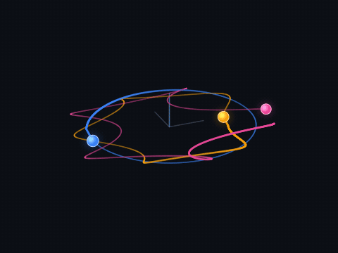
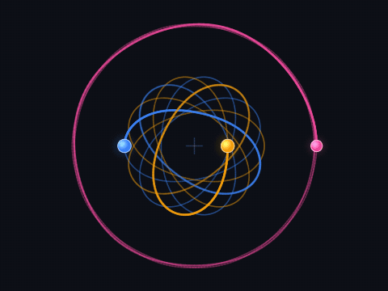
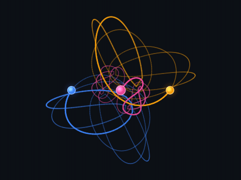
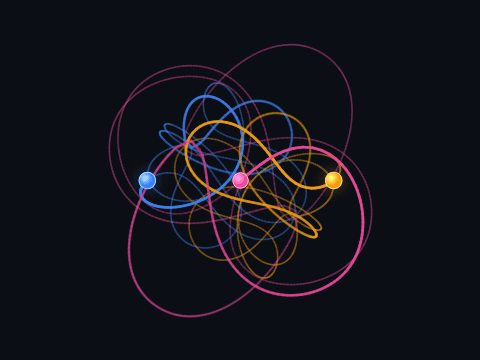

# New Families of Steady (Linearly Stable) 3-Body Periodic Solutions

This report documents the newly discovered continuous families of linearly stable 3-body periodic orbits, including a **2-parameter continuous 3D non-planar democratic family** with an infinite rational sequence of exact inertial closures, plus **32 distinct free-group topological classes** in 2D.

> Color legend in all animations: **Blue** = $m_1$, **Amber** = $m_2$, **Pink** = $m_3$ (radius $\propto m_i^{1/3}$).

---

## 1. The `3D-Δ14` Family: A New 2-Parameter Continuous 3D Democratic Steady Family

<table>
  <tr>
    <td align="center" width="33%">
       
      <b><code>3D-001</code> · 5-Fold Inertial Closure</b> 
      <code>m = [1, 1, 0.5]</code> · $T_{\text{inert}} = 91.46$ · 70 swaps
    </td>
    <td align="center" width="33%">
       
      <b><code>3D-004</code> · 7-Fold Inertial Closure</b> 
      <code>m = [1, 1, 0.5]</code> · $T_{\text{inert}} = 128.27$ · 98 swaps
    </td>
    <td align="center" width="33%">
       
      <b><code>3D-005</code> · 3D Distinct-Mass Trio</b> 
      <code>m = [1, 0.7, 0.4]</code> · $T_{\text{rpo}} = 11.03$ · 3D RPO
    </td>
  </tr>
</table>

### Physical & Geometric Structure
- **Symmetry:** Gauge-fixed 3D perpendicular-crossing Relative Periodic Orbits ($x_1 = -1$, $v_{z1} = 0$, $v_{z2} > 0$) co-precessing around the conserved angular momentum axis $\hat{\mathbf{u}} = \mathbf{L}/|\mathbf{L}|$ by angle $2\alpha$ per relative period $T_{\text{rpo}}$.
- **Non-planarity:** Genuinely 3-dimensional ($h_{\text{3D}} \in [0.09, 0.21]$ RMS out-of-best-fit-plane distance).
- **Democracy:** All three bodies continuously exchange closest-pair partners (**14 partner swaps per relative period**, wide minimum separation $r_{\min} \in [0.843, 0.877]$ — zero close encounters).
- **Full 18D Linear Stability:** All three non-trivial Broucke stability indices $(k_1, k_2, k_3)$ of the rotating-frame $18 \times 18$ monodromy matrix lie strictly inside $(-2, 2)$, verified by 100-period empirical perturbation tests with simultaneous kicks in $x, y, z$.

### Mapped 2-Parameter Linear Stability Sheet
1. **Inclination Slice ($m_1 = m_2 = 1, m_3 = 0.50$, varying $v_{z2}$):**
   - **Linearly stable band:** $v_{z2} \in [0.501,\; 0.678]$
   - **Lower boundary ($v_{z2} \approx 0.501$):** Tangent / period-doubling boundary ($k_1 \to 2$)
   - **Upper boundary ($v_{z2} \approx 0.678$):** Hamiltonian-Hopf (Krein collision) where $k_2, k_3$ collide on the unit circle and leave as a complex quartet
   - **Peak 3D stability margin:** `+0.0132` at $v_{z2}^* \approx 0.663$ ($k_1 = +1.987, k_2 = -1.704, k_3 = +0.416$) — **4.7× deeper** than the planar Figure-8 (`0.0028`)
   - **Precession sweep:** $2\alpha$ varies monotonically across $[-3.78,\; -3.57]\text{ rad}$, crossing a dense infinite set of rational multiples of $2\pi$.

2. **Mass-Ratio Slice ($v_{z2} = 0.6732$, varying $m_3$):**
   - **Linearly stable mass window:** $m_3 \in [0.495,\; 0.557]$ (12 consecutive verified stable steps, smoothly transitioning from 14 to 10 partner swaps with $r_{\min} \in [0.844, 0.877]$).

### Verified Exact Fixed-Inertial-Frame 3D Periodic Closures ($2\alpha = 2\pi p / q$)
Because $2\alpha(v_{z2})$ varies smoothly across $[-3.78, -3.57]\text{ rad}$, every rational $p/q$ in that interval produces an **exact, closed, fixed-inertial-frame 3D periodic orbit** of period $T_{\text{inert}} = q \cdot T_{\text{rpo}}$. Three distinct closures were snapped and verified to $10^{-14}$ half-period error:

| Closure | $2\alpha$ | Masses | $v_{z2}$ | $T_{\text{rpo}}$ | $T_{\text{inert}}$ | $\|\mathbf{y}(T_{\text{inert}}) - \mathbf{y}(0)\|$ | Swaps / $T_{\text{inert}}$ |
| :--- | :---: | :---: | :---: | :---: | :---: | :---: | :---: |
| **5-Fold (`3D-001`)** | $-6\pi/5$ | `[1, 1, 0.5]` | `0.6734752656928` | `18.29283582368` | `91.46417911842` | `1.76e-10` | 70 |
| **7-Fold (`3D-004`)** | $-8\pi/7$ | `[1, 1, 0.5]` | `0.5328015373813` | `18.32392838217` | `128.2674986752` | `6.05e-10` | 98 |
| **12-Fold (`3D-003`)** | $-7\pi/6$ | `[1, 1, 0.5]` | `0.6164617513438` | `18.30810191655` | `219.6972229987` | `1.50e-09` | 168 |

#### Exact 13-Digit Initial Conditions (`y0 = [x1,y1,z1, x2,y2,z2, x3,y3,z3, vx1,vy1,vz1, vx2,vy2,vz2, vx3,vy3,vz3]`)
- **5-Fold (`T_inert = 91.46417911842`):**  
  `[-1, 0, 0, 0.9479359541975, 0, 0, 0.104128091605, 0, 0, 0, 0.2298078731035, 0, 0, -0.4553004786205, 0.6734752656928, 0, 0.450985211034, -1.346950531386]`
- **7-Fold (`T_inert = 128.2674986752`):**  
  `[-1, 0, 0, 0.9508143800912, 0, 0, 0.09837123981762, 0, 0, 0, 0.1433602915964, 0, 0, -0.619648949052, 0.5328015373813, 0, 0.9525773149114, -1.065603074763]`
- **12-Fold (`T_inert = 219.6972229987`):**  
  `[-1, 0, 0, 0.9489288586447, 0, 0, 0.1021422827106, 0, 0, 0, 0.1770020266891, 0, 0, -0.5362198938625, 0.6164617513438, 0, 0.7184357343468, -1.232923502688]`

---

## 2. Highlighted New 2D Free-Group Topological Families (32 Distinct Classes Found)

Using Montgomery's shape-sphere stereographic projection, the 74 democratic 2D steady orbits in `catalog.json` partition into **32 distinct free-group homotopy classes** in $F_2 = \langle a, b \rangle$.

<table>
  <tr>
    <td align="center" width="33%">
       
      <b><code>A^7</code> · Deepest Stability Island</b> 
      <code>2D-DEM-001</code> · <code>m=[1,1,0.5]</code> · margin <b>1.8725</b>
    </td>
    <td align="center" width="33%">
       
      <b><code>AABaaB</code> · All-Distinct-Mass Braid</b> 
      <code>2D-DEM-006</code> · <code>m=[1,0.9,0.8]</code> · margin <b>1.2061</b>
    </td>
    <td align="center" width="33%">
       
      <b><code>(Ab)^7</code> · Wide-Separation Dance</b> 
      <code>2D-DEM-013</code> · <code>m=[1,1,0.3]</code> · $r_{\min} = 1.272$
    </td>
  </tr>
  <tr>
    <td align="center" width="50%" colspan="1">
       
      <b><code>AABABABabaB</code> · Heavy-Center $L=0$</b> 
      <code>2D-DEM-022</code> · <code>m=[1,1,3]</code> · stable $m_3 \in [2.84, 3.42]$
    </td>
    <td align="center" width="50%" colspan="2">
       
      <b><code>ABaBAbABaBabAbaBabAb</code> · 20-Letter $L=0$ Braid</b> 
      <code>2D-DEM-015</code> · <code>m=[1,1,0.55]</code> · $r_{\min}=0.161$ · margin <b>0.4778</b>
    </td>
  </tr>
</table>

| Family Word ($F_2$) | Representative | Masses | Subspace | $r_{\min}$ | Stability Margin | 3D Stable ($k_z$) | Notes |
| :--- | :--- | :--- | :--- | :---: | :---: | :---: | :--- |
| **`AABaaB`** | `2D-DEM-006` | `[1, 0.9, 0.8]` | `perp_L_nonzero` | $0.1894$ | **1.2061** | YES ($-0.26$) | All 3 masses distinct, non-abelian $L\neq 0$ braid |
| **`(Ab)^7`** | `2D-DEM-013` | `[1, 1, 0.3]` | `perp_L_nonzero` | $1.2718$ | **0.6172** | YES ($+1.57$) | 14-letter alternating wide-separation dance |
| **`A^7`** | `2D-DEM-001..004, 008` | `[1,1,0.3..1.25]` & `[1,0.8,0.6]` | `perp_L_nonzero` | $0.915$–$1.043$ | **1.8725** | YES ($-0.01$ to $-1.92$) | Deepest stability island found (668× deeper than Fig-8) |
| **`AABABABabaB`** | `2D-DEM-022` | `[1, 1, 2.84..3.42]` | `collinear_L0` | $0.0788$ | **1.6079** (at $m_3=3.30$) | $L=0$ | Heavy-center $L=0$ family, stable window $\Delta m_3 = 0.58$ |
| **`ABaBAbABaBabAbaBabAb`** | `2D-DEM-015` | `[1, 1, 0.55]` | `collinear_L0` | $0.1612$ | **0.4778** | $L=0$ | 20-letter unequal-mass wide-separation $L=0$ braid |
