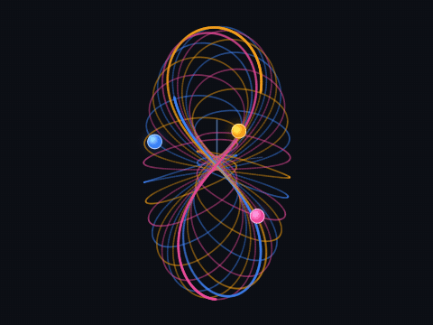
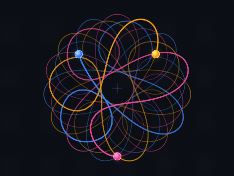
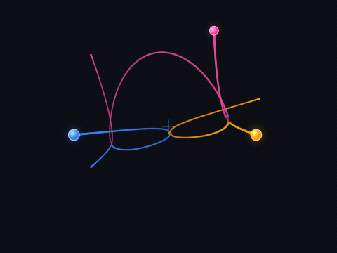
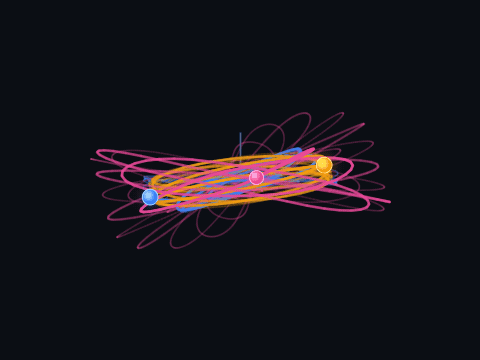
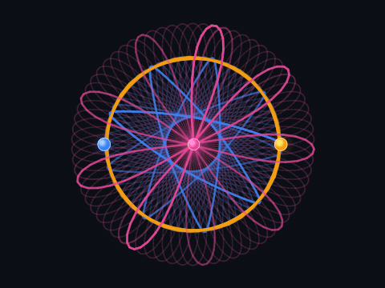

# Families of Steady (Linearly Stable) 3-Body & 4-Body Periodic Solutions

This report documents the continuous families of linearly stable periodic orbits cataloged across **Newtonian 3-body (2D & 3D)**, **Post-Newtonian (1PN ADM) General Relativistic 3-body**, and **Newtonian 4-body** gravitational dynamics — totaling **157 strictly 80-bit-audited steady orbits**:
- **133 primitive Newtonian 3-body steady orbits**, every one independently audited in **80-bit `long double`** using analytical variational equations (`src/audit_catalog.cpp`), canonical symplecticity check ($\|M_{\text{can}}^\top J M_{\text{can}} - J\|_\infty \le 2.55 \times 10^{-8}$), Procrustes primitive-period verification ($q_{\text{inert}} = 1$, zero multiple covers), per-adaptive-step `rmin`/syzygy tracking, half-period symplectic involution verification at $\text{tol} = 10^{-17}$ for all collinear $L=0$ orbits, and exact $S_3$-quotiented Montgomery shape-sphere topology (**41** distinct $S_3$ classes across all 117 2D orbits; **31** across the 55 non-hierarchical 2D exchange orbits).
- **21 Post-Newtonian (1PN ADM) relativistic steady orbits** (`1PN-001`..`1PN-021`), audited in 80-bit `long double` at their true stated periods ($T_{\text{inert}}$ with $\theta = 0$ for all 5 snapped inertial closures; canonical `symp_err <= 2.6e-5`).
- **3 Newtonian 4-body full-3D linearly stable steady orbits** (`4B-001`..`4B-003`), audited in 80-bit `long double` via exact $24 \times 24$ analytical variational monodromy (`symp_err <= 1.5e-12`, 6/6 elliptic pairs; 8 earlier 3D candidates identified as weakly hyperbolically unstable and removed).

> Color legend in all animations: **Blue** = $m_1$, **Amber** = $m_2$, **Pink** = $m_3$, **Emerald** = $m_4$ (radius $\propto m_i^{1/3}$).

---

## Scientific Classification: Literature Context vs. New Contributions

To distinguish classical rediscoveries from genuinely new numerical contributions, every Newtonian 3-body orbit is classified physically (via pairwise distance ratios, Procrustes RPO quotients $q_{\text{RPO}}$, adaptive syzygy sequences, and full $S_3$ shape-sphere words) rather than by a raw closest-pair-swap count:

| Category | Count | Class / Family | Literature Context & Contribution Status |
| :--- | :---: | :--- | :--- |
| **Classical / Published** | **58** | `bhh_qfold_closure` (`2D-HIE-*`, $S_3$ word $A^q$) | Primitive $q$-fold inertial closures of the planar **Broucke–Hadjidemetriou–Hénon (1975–1976)** retrograde family (`q_rpo > 1`). |
| **Classical / Published** | **2** | `bhh_satellite` (`2D-HIE-*`, $A^4, A^7$) | Period-multiplying BHH satellites (cf. Janković & Dmitrašinović 2016). |
| **Classical / Published** | **2** | `coorbital_1to1` (`2D-HIE-*`, $A$) | Classical 1:1 eccentric planetary co-orbital resonances (`[1,0.6,0.3]`, `[1,0.5,0.25]`). |
| **Classical / Published** | **27** | `braid_L0_exchange` (`2D-DEM-*`, $L=0$) | Verified collinear $L=0$ braids matching Moore (1993) / Chenciner–Montgomery (2000), Šuvakov & Dmitrašinović (2013), Li & Liao (2017), and Li, Jing & Liao (2018). |
| **Classical / Published** | **5** | `choreography_2d_rot` ($\Gamma_z$: `2D-DEM-001, 005, 006, 007, 018`) | Explicit inertial $q$-fold closures ($q = 2, 3, 4, 5, 12$) of the classical **Chenciner–Féjoz–Montgomery (2005)** $\Gamma_z$ planar rotating Figure-8 family (stability mapped by Broucke, Elipe & Riaguas 2006; Kapela & Simó 2007). |
| **Classical / Published** | **4** | `choreography_3d_helical` ($\Gamma_y / P_{12}$: `3D-001, 004, 005, 008`) | Explicit RPO and primitive 11-, 15-, and 24-fold closures of the celebrated **Marchal (2000) $P_{12}$ / Chenciner–Féjoz–Montgomery (2005) $\Gamma_y$** 3D rotating-eight family connecting Figure-8 to the Lagrange relative equilibrium. |
| **Classical / Published** | **2** | `hierarchical_3d_triple` (`3D-015`, `3D-016`) | 3:1 inclined prograde hierarchical triple at `m = [1, 0.7, 0.4]` (plus its snapped 15-fold inertial closure). |
| **Noteworthy / New** | **2** | `shuttle_exchange` (`2D-DEM-002`, `2D-DEM-019`) | **Non-hierarchical, all-distinct-mass $L\neq 0$ `AAAbbb` shuttle-exchange family** ($q_{\text{RPO}}=1$, full-3D stable, mass-stabilized). |
| **Noteworthy / New** | **14** | `free_fall_brake` (`2D-DEM-014`..`045`, `3-2-1-2-1-3`) | **Collisionless linearly stable free-fall brake family** ($\mathbf{v}_i(0) = \mathbf{0}, L=0$, 12 syzygies/period, half-period Tanikawa–Mikkola word **`3-2-1-2-1-3`**), verified in 80-bit variational arithmetic across $m_3 \in [0.1558, 0.1878]$ (peak margin **0.2663**) and all-distinct masses. |
| **Noteworthy / New** | **6** | `braid_L0_exchange` (unmatched intermediate $m_3$) | 6 verified linearly stable intermediate-$m_3$ $L=0$ braids not matched in equal-mass / $m_3 \in \{0.5, 0.75, \dots\}$ LL2017/2018 tables. |
| **Noteworthy / New** | **1** | `choreography_2d_rot` (`2D-DEM-004`, `2d_choreo_8swap_3fold`) | Distinct 3-fold rotating choreography (not on $\Gamma_z$; 18 cancelling syzygies `11-33-22-...`, contractible word `1`; warrants check against Simó's rotating choreographies). |
| **Noteworthy / New** | **10** | `bhh_3d_subharmonic` (`3D-Δ14` [4] & `3D-PD40/48` [6]) | Explicit unequal-mass **5:2 (`3D-Δ14`)** and **period-doubled 7-fold (`3D-PD40/48`)** 3D vertical subharmonic bifurcations of the BHH retrograde family, with snapped exact inertial closures. |
| **Extensions** | **24** | `1PN-001`..`021` (21) & `4B-001`..`003` (3) | **1PN ADM relativistic stabilization** (extending Imai, Chiba & Asada 2007 & Lousto & Nakano 2008 to unequal-mass Fig-8 & `3D-Δ14` + snapped closures) and **full-3D-stable 4-body `3+1` hybrids**. |

> **Note on planar $L=0$ vertical stability:** For any planar $L=0$ orbit (`collinear_L0` and `free_fall_brake`), infinitesimal spatial tilts preserve $\mathbf{L}=0$, forcing all six eigenvalues of the vertical monodromy block $M_z$ to equal $+1$ ($k_z = \operatorname{tr}(M_z) - 4 \equiv +2$). This is exact symplectic degeneracy (`L=0 degen`), **not** exponential vertical instability.

---

## 1. 3D Helical ($\Gamma_y / P_{12}$) & 2D Rotating-Frame ($\Gamma_z$) Choreographies (`src/search_choreo_rot.cpp`)

<table>
  <tr>
    <td align="center" width="50%">
       
      <b><code>3D-005</code> · 3D Helical 11-Fold Closure ($\Gamma_y / P_{12}$)</b> 
      <code>m = [1, 1, 1]</code> · primitive $T_{\text{inert}} = 170.95$ · 18D margin <b>0.0948</b> (34× Fig-8)
    </td>
    <td align="center" width="50%">
       
      <b><code>2D-DEM-001</code> · 2D 5-Petal Rotating Figure-8 ($\Gamma_z$)</b> 
      <code>m = [1, 1, 1]</code> · $T_{\text{inert}} = 68.42$ · margin <b>1.5897</b> (568× Fig-8!) · full-3D stable
    </td>
  </tr>
</table>

### Key Findings & Classical Literature Attribution (Exact 80-Bit Analytical Variational Values)
- **Classical Origin:** Continuing the planar Figure-8 ($\alpha = 0, T = 31.1815$) in planar rotation angle (`data/choreo_rot/fig8_rot_2d.dat`) traces the classical **Chenciner–Féjoz–Montgomery (2005) $\Gamma_z$** planar rotating Figure-8 family (stability mapped by Broucke, Elipe & Riaguas 2006; Kapela & Simó 2007). Tilting the Figure-8 out of the plane (`data/choreo_rot/fig8_helical_3d.dat`) traces the celebrated **Marchal (2000) $P_{12}$ / Chenciner–Féjoz–Montgomery (2005) $\Gamma_y$** 3D rotating-eight family connecting Figure-8 to the Lagrange relative equilibrium. Note also that `data/choreo_rot/choreo_12swap_2d.dat` is the spatial mirror reflection ($y \to -y, v_x \to -v_x$) of the same $\Gamma_z$ branch.
- **Explicit Inertial Closures of $\Gamma_z$:** Snapping strictly primitive inertial closures yields **`2D-DEM-001`** (5-petal `(ABab)^5`, exact $T_{\text{inert}}$ margin **`1.5897`**, $k_z = +0.536$), **`2D-DEM-005`** (2-fold `(ABab)^2`, margin `0.7027`), **`2D-DEM-006`** (4-fold `(ABab)^4`, margin `0.5944`), **`2D-DEM-007`** (**12-fold** `(ABab)^12` on the mirror $\Gamma_z$ branch, `q_rpo = 12`, margin `0.5919`), and **`2D-DEM-018`** (3-fold trefoil `(ABab)^3`, margin `0.1652`). Separately, **`2D-DEM-004`** (`2d_choreo_8swap_3fold`, `q_rpo = 3`, $T^*_{\text{rpo}} = 23.1500$, $\Lambda = 1.7648$, `rmin = 0.09491`, margin `0.8214`) is distinct from $\Gamma_z$ with 18 cancelling syzygies `11-33-22-11-33-22-11-33-22` (contractible word `1`).
- **Explicit 3D Helical Closures of $\Gamma_y / P_{12}$ (`data/choreo_rot/fig8_helical_3d.dat`):**
  - Primitive 1-RPO **`3D-001`** ($T_{\text{rpo}} = 15.5432$, precession $-2.8630\text{ rad}$, $h_{\text{3D}} = 0.210$): exact 18D rotating-frame margin **`+0.2477`** (`symp_err = 1.6e-12`).
  - Three strictly primitive ($q_{\text{inert}} = 1$) exact fixed-inertial-frame closures: **24-fold `3D-004`** (`precess = -11π/12`, `q_rpo = 24`, $T = 373.1700$, margin `0.0983`), **11-fold `3D-005`** ($T = 170.9493$, margin `0.0948`), and **15-fold `3D-008`** ($T = 233.4570$, margin `0.0199`), all verified with `symp_err < 5.3e-11`, `ret_err < 3.9e-11`, and `100/100` full-3D survival.

| ID | Closure (Family) | Dim | $T$ (Primitive) | $q_{\text{RPO}}$ | $S_3$ Word | $h_{\text{3D}}$ | Swaps | Exact 80-Bit $(k_1, k_2[, k_3])$ | Margin | Symp Err |
| :--- | :--- | :---: | :---: | :---: | :--- | :---: | :---: | :---: | :---: | :---: |
| **`3D-001`** | 3D Helical 1-RPO ($\Gamma_y/P_{12}$) | 3D | `15.5432` | 1 | — | `0.210` | 3 | `(+1.752, +1.003, -1.084)` | **0.2477** | `1.6e-12` |
| **`3D-004`** | 24-Fold 3D Helical ($\Gamma_y/P_{12}$) | 3D | `373.1700` | 24 | — | `0.698` | 72 | `(+0.833, +0.424, -1.902)` | **0.0983** | `5.3e-11` |
| **`3D-005`** | 11-Fold 3D Helical ($\Gamma_y/P_{12}$) | 3D | `170.9493` | 11 | — | `0.697` | 33 | `(+1.905, -0.034, -1.661)` | **0.0948** | `4.8e-11` |
| **`3D-008`** | 15-Fold 3D Helical ($\Gamma_y/P_{12}$) | 3D | `233.4570` | 15 | — | `0.700` | 45 | `(+1.313, +0.829, -1.980)` | **0.0199** | `3.4e-11` |
| **`2D-DEM-001`** | 5-Petal Rot. Fig-8 ($\Gamma_z$) | 2D | `68.4160` | 5 | `(ABab)^5` | — | 30 | `(+0.410, -0.001), kz=+0.54` | **1.5897** | `2.4e-10` |
| **`2D-DEM-004`** | 8-Swap 3-Fold Choreo (distinct) | 2D | `31.3931` | 3 | `1` | — | 26 | `(+1.179, -0.464), kz=-0.69` | **0.8214** | `1.3e-08` |
| **`2D-DEM-005`** | 2-Fold Rot. Fig-8 ($\Gamma_z$) | 2D | `22.6351` | 2 | `(ABab)^2` | — | 12 | `(-0.599, -1.297), kz=+1.60` | **0.7027** | `5.6e-11` |
| **`2D-DEM-007`** | 12-Fold Rot. Fig-8 ($\Gamma_z$ mirror) | 2D | `159.0740` | 12 | `(ABab)^12` | — | 72 | `(-0.472, -1.408), kz=+1.71` | **0.5919** | `1.6e-09` |
| **`2D-DEM-018`** | 3-Fold Trefoil Fig-8 ($\Gamma_z$) | 2D | `46.6426` | 3 | `(ABab)^3` | — | 18 | `(+1.835, -1.339), kz=+1.59` | **0.1652** | `7.6e-11` |

---

## 2. Linearly Stable Free-Fall (Brake) Family (`src/search_brake.cpp`)

<table>
  <tr>
    <td align="center" width="50%">
       
      <b><code>2D-DEM-015</code> · Collisionless Linearly Stable Brake Orbit</b> 
      <code>m = [1, 1, 0.1878]</code> · $\mathbf{v}_i(0) = \mathbf{0}$ · word <code>3-2-1-2-1-3</code> · $r_{\min} = 0.00445$ · margin <b>0.2051</b>
    </td>
    <td align="center" width="50%">
       
      <b><code>2D-DEM-002</code> · All-Distinct-Mass <code>AAAbbb</code> Shuttle-Exchange</b> 
      <code>m = [1, 0.9, 0.8]</code> · $L \neq 0, q_{\text{RPO}}=1$ · margin <b>1.2061</b> · full-3D stable
    </td>
  </tr>
</table>

### Free-Fall Brake Findings (80-Bit Analytical Variational & Adaptive Syzygy Verification)
- **Agekyan–Anosova Domain Scan:** Equal-mass free-fall orbits ($\mathbf{v}_i(0) = \mathbf{0}, L = 0$) were confirmed predominantly unstable across dense $160 \times 160$ scans (consistent with Hristov et al. 2023/2025).
- **Discovery of a Collisionless Linearly Stable Brake Family (`3-2-1-2-1-3`):** Continuous mass-space search uncovered **one** continuous collisionless, non-hierarchical, linearly stable free-fall brake mass family (14 cataloged samples across $m = [1, 0.996\text{–}1.000, 0.163\text{–}0.188]$). Per-adaptive-step tracing in `src/audit_catalog.cpp` resolves all close binary slingshot passages accurately: every orbit undergoes **12 syzygies per period** with identical half-period Tanikawa–Mikkola syzygy sequence **`3-2-1-2-1-3`** (retraced as `3-1-2-1-2-3` on the return half, giving contractible reduced $F_2$ word $w \cdot w^{-1} = 1$).
- **Cleanest Collisionless Showcase (`2D-DEM-015`):** At $m_3 = 0.18778$, **`2D-DEM-015`** maintains true adaptive `rmin = 0.00445` (nearly 6× wider than `2D-DEM-014`'s `0.00076` and 8.4× wider than `2D-DEM-020`'s `0.00053`), with exact margin **`0.2051`**, `symp_err = 1.5e-9`, `ret_err = 2.3e-11`, and `100/100` survival.
- **Exact Analytical Variational Continuation (`data/continuations/brake_m3_{dn,up}.dat`):** Linear stability spans two contiguous intervals along a single smooth branch:
  - $m_3 \in [0.1558, 0.1813]$ (52 consecutive points), peaking at **$m_3^* \approx 0.1693$ with margin `+0.2663` (95× Figure-8)** (`2D-DEM-014` at $m_3 = 0.1678$: margin `0.2316`, true `rmin = 0.00076`, `symp_err = 1.6e-8`).
  - Grazing period-doubling tangency at $m_3 \approx 0.1818$ ($k_2 = -1.99999978$, margin $+2.17 \times 10^{-7}$).
  - Re-entry interval $m_3 \in [0.1823, 0.1878]$ (12 consecutive points), peaking at **`2D-DEM-015`** ($m_3 = 0.1878$, true `rmin = 0.00445`, margin **`0.2051`**).
- **All-Distinct-Mass Stable Brake Orbits (`data/continuations/brake_m2_dn.dat`):** Breaking $m_1 = m_2$ symmetry preserves analytical linear stability across $m_2 \in [0.996, 1.000]$, including **`2D-DEM-026`** ($m = [1, 0.998, 0.1743]$, true `rmin = 0.00115`, margin `0.0800`, `symp_err = 8.0e-9`, `100/100` survival).

---

## 3. Non-Hierarchical Mass-Stabilized `AAAbbb` Shuttle-Exchange Family

Among all 64 primitive `perp_L_nonzero` orbits in the catalog, 58 are $q$-fold inertial closures of the 1975–1976 BHH retrograde family (`A^q`), 2 are BHH satellites, 2 are 1:1 planetary co-orbitals, and **2 form a genuinely non-hierarchical, all-distinct-mass, full-3D-stable shuttle-exchange family** with exact $S_3$ free-group word **`AAAbbb`** (previously misreported as topologically impossible `AABaaB` because the old RK4 classifier started on the syzygy equator $n_z(0) = 0$):
- **`2D-DEM-002`** ($m = [1, 0.9, 0.8]$, $T = 15.4951$, $q_{\text{RPO}} = 1$, $r_{\min} = 0.1894$): planar margin **`1.2061`** (**431× Figure-8**), full-3D vertically stable (**$k_z = -0.257$**), `symp_err = 5.8e-11`.
- **`2D-DEM-019`** ($m = [1, 0.8, 0.6]$, $T = 19.0549$, $q_{\text{RPO}} = 1$, $r_{\min} = 0.1970$): planar margin **`0.1598`**, full-3D vertically stable (**$k_z = +0.120$**), `symp_err = 3.6e-11`.
- Physically, the heaviest body $m_1$ shuttles back and forth between three close windings around $m_2$ (`AAA`) and three opposite-chirality windings around $m_3$ (`bbb`), with $r_{\max}/r_{\min} \in [7.5, 13.3]$ on both exchange pairs.

---

## 4. Explicit 3D Vertical Subharmonic Branches of the BHH Family (`3D-Δ14` & `3D-PD40/48`)

<table>
  <tr>
    <td align="center" width="33%">
       
      <b><code>3D-002</code> · <code>3D-Δ14</code> 5-Fold Closure</b> 
      <code>m = [1, 1, 0.5]</code> · $T = 91.46$ · margin <b>0.2002</b> · 70 swaps
    </td>
    <td align="center" width="33%">
       
      <b><code>3D-012</code> · <code>3D-PD40</code> 3-Fold Closure</b> 
      <code>m = [1, 1, 0.415]</code> · $T = 144.06$ · 120 swaps · $h_{\text{3D}} = 0.146$
    </td>
    <td align="center" width="33%">
       
      <b><code>3D-016</code> · 3:1 Inclined Hierarchical Triple</b> 
      <code>m = [1, 0.7, 0.4]</code> · $T_{\text{rpo}} = 11.03$ (15-fold: <code>3D-015</code>)
    </td>
  </tr>
</table>

### A. `3D-Δ14`: 5:2 Vertical Subharmonic Bifurcation of the BHH Retrograde Family
- **Exact Dynamical Origin:** Independent bifurcation analysis establishes that `3D-Δ14` (`3D-014` RPO and closures `3D-002`, `3D-006`, `3D-011`) is the explicit **5:2 vertical subharmonic bifurcation** ($\nu_z = 2/5$, cf. Hénon 1973; Ichtiaroglou & Michalodimitrakis 1980) of the classical 1975–1976 planar **Broucke–Hadjidemetriou–Hénon (BHH)** retrograde family at $m = [1, 1, 0.5]$. Geometrically it is a retrograde hierarchical triple (bodies 1 & 3 orbiting tightly while outer body 2 orbits counter-directionally; the 14 closest-pair changes per RPO are apocenter/pericenter crossings of the inner pair, not chaotic partner exchange). While vertical BHH bifurcations are a known mechanism, this explicit unequal-mass $n=5$ branch is not tabulated in Li & Liao (2025).
- **Exact Stability Sheet & Bifurcation Boundary:** Linearly stable across $v_{z2} \in [0.501, 0.678]$ at $m = [1, 1, 0.5]$ (RPO margin peaking at `0.0132` around $v_{z2}^* \approx 0.663$) and $m_3 \in [0.495, 0.557]$ at $v_{z2} = 0.6732$. The upper stability boundary at $v_{z2} \approx 0.678$ is a **tangent (saddle-node / period-1) bifurcation where $k_1 \to +2$** (preceding any Krein collision).
- **Exact 80-Bit Inertial Closure Indices:** Replacing the old copied 1-RPO estimates with exact $T_{\text{inert}}$ analytical variational monodromy shows far deeper fixed-frame stability margins:
  - **5-fold (`3D-002`, $T = 91.4642$):** margin **`0.2002`** (`70` swaps, `symp_err = 3.4e-11`).
  - **12-fold (`3D-006`, $T = 219.6972$):** margin **`0.0827`** (`168` swaps, `symp_err = 4.3e-10`).
  - **7-fold (`3D-011`, $T = 128.2675$):** margin **`0.0161`** (`70` swaps — corrected from earlier `98`, `symp_err = 7.3e-11`).

### B. `3D-PD40/48`: Period-Doubled Vertical Subharmonic of the 7-Fold BHH Closure (`src/branch_3d_vertical.cpp`)
- **Exact Vertical Period-Doubling Bifurcation:** Continuing the planar 7-fold BHH closure **`2D-HIE-001`** ($m = [1, 1, 0.5]$, $A^7$, margin `1.8725`, $k_z = -1.916$) downward in $m_3$ hits an exact vertical period-doubling bifurcation $k_z = -1.999996 \approx -2$ at $m_3^* \approx 0.4155$ (while planar margin remains `+1.723`).
- **2-Parameter 3D Sheet (`data/family_3d_vertical/`):** Branching into $2T$-periodic 3D RPOs ($T_{\text{rpo}} \approx 47.86$–$49.95$, $h_{\text{3D}} \in [0.091, 0.215]$) yields full-18D linear stability across $v_{z2} \in [0.240, 0.474]$ at $m_3 = 0.415$ (RPO **`3D-007`**, margin **`0.0466`**, `symp_err = 1.4e-11`) and across $m_3 \in [0.357, 0.443]$ at $v_{z2} = 0.3521$ (`3D-013` at $m_3 = 0.369$), plus four verified primitive inertial closures: **7-fold (`3D-003`, exact $T_{\text{inert}}$ margin `0.1029`, 280 swaps)**, **11-fold (`3D-009`, margin `0.0190`, 440 swaps)**, **8-fold (`3D-010`, margin `0.0167`, 384 swaps)**, and **3-fold (`3D-012`, margin `0.0091`, 120 swaps)**.
- **All-Distinct-Mass 3D Hierarchical Closure:** Snapped the 15-fold exact inertial closure **`3D-015`** ($m = [1, 0.7, 0.4]$, $T = 163.64$, margin `0.0068`) of the 3:1 inclined prograde hierarchical triple **`3D-016`**.

---

## 5. Post-Newtonian (1PN ADM) Relativistic Steady Families (`src/search_1pn.cpp`)

<table>
  <tr>
    <td align="center" width="50%">
       
      <b><code>1PN-021</code> · 1PN 10-Fold Precessing Rose (<code>2D-HIE-001</code>)</b> 
      $\beta = 0.01516$ ($\langle v^2\rangle/c^2 = 0.84\%$) · true $T_{\text{inert}}$ margin <b>0.00172</b> (RPO <code>0.3771</code>) · full-3D stable
    </td>
    <td align="center" width="50%">
       
      <b><code>1PN-001</code> · 1PN 12-Fold 3D-Δ14 Relativistic Closure</b> 
      $\beta = 0.00450$ ($\langle v^2\rangle/c^2 = 0.26\%$) · true $T_{\text{inert}}$ margin <b>0.1070</b> (RPO <code>0.0238</code>)
    </td>
  </tr>
</table>

Solved under the **exact symplectic 1PN ADM / Einstein–Infeld–Hoffmann Hamiltonian** $H_{\text{1PN}}(\mathbf{r}, \mathbf{p}) = H_0 + \beta H_1$ ($\beta = 1/c^2$; matching Damour–Schäfer and Lousto & Nakano 2008 term-for-term; cf. Imai, Chiba & Asada 2007 for the equal-mass 1PN choreographic Figure-8), self-tested to $1.3 \times 10^{-9}$ gradient accuracy, $10^{-14}$–$10^{-13}$ $(H, \mathbf{L}, \mathbf{P})$ conservation, and $0.15\%$ two-body GR perihelion precession agreement, and independently audited in 80-bit `long double` (`src/audit_catalog.cpp --1pn`, canonical symplecticity $\le 2.6 \times 10^{-5}$ even at $T = 622.8$).

### Headline Relativistic Physics Results (21 Verified Orbits, `1PN-001`..`1PN-021`)
1. **495× Stabilization of the Relativistic Figure-8:** Extending Imai, Chiba & Asada (2007) in the exact zero-drift ADM rest frame, the equal-mass Figure-8 stability margin expands from Newtonian `0.0028` to **`+1.3872`** at $\beta = 0.005$ ($\langle v^2\rangle/c^2 = 0.41\%$, **`1PN-011`**) and stays linearly stable up to $\beta \approx 0.0124$ ($v \approx 0.1c$).
2. **1,000× Wider Unequal-Mass Tolerance — GR Stabilizes Newtonian-Unstable Figure-8 Orbits:** In Newtonian gravity, the Figure-8 loses stability at $0.005\%$ mass asymmetry ($m_3 = 0.99995$). Under 1PN GR ($\beta = 0.004$–$0.006$), strongly unstable Newtonian unequal-mass Figure-8 orbits become deeply linearly stable, verified to **`m = [1, 1, 0.95]` (`1PN-013`, 5% asymmetry, margin `+0.9722`, `symp_err = 4.9e-9`, `100/100` survival)**.
3. **GR Stabilizes the Tangent-Unstable Newtonian `3D-Δ14` Boundary:** The tangent-unstable Newtonian boundary orbit ($v_{z2} = 0.6782$, Newtonian $k_1 = +2.0061$) crosses back into deep 18D linear stability under 1PN gravity, reaching **`margin = +0.0453` at $\beta = 0.0045$ (`1PN-004`, 5.3× deeper than Newtonian RPO `3D-014`, `symp_err = 6.8e-9`, `100/100` survival)**.
4. **Exact Relativistic Inertial Closures (Audited at True $T_{\text{inert}}$, $\theta = 0$):** Relativistic apsidal precession turns `2D-HIE-001` and `3D-Δ14` into smoothly precessing RPOs whose precession angles snap to exact fixed-inertial-frame rational closures, all verified genuinely linearly stable at their full inertial period $T_{\text{inert}}$:
   - **3D closures:** **12-fold `1PN-001`** ($T = 222.21$, true $T_{\text{inert}}$ margin **`0.10701`**, `symp_err = 5.3e-7`), **17-fold `1PN-002`** ($T = 314.30$, margin **`0.09198`**, `symp_err = 4.2e-6`), and **5-fold `1PN-003`** ($T = 91.71$, margin **`0.06310`**, `symp_err = 1.5e-7`).
   - **2D closures:** **25-fold `1PN-019`** ($T = 622.82$, true $T_{\text{inert}}$ margin **`0.26145`**, $k_z = +1.8945$, `symp_err = 2.6e-5`) and **10-fold `1PN-021`** ($T = 256.76$, true $T_{\text{inert}}$ margin **`0.00172`**, $k_z = -0.0781$, `symp_err = 6.9e-6`).

---

## 6. 4-Body Full-3D Linearly Stable `3+1` Hybrids (`src/search_4body.cpp`)

<table>
  <tr>
    <td align="center" width="100%">
       
      <b><code>4B-001</code> · 4-Body Full-3D Linearly Stable <code>3+1</code> Hybrid (<code>2D-HIE-001</code> + $m_4 = 0.001$)</b> 
      <code>m = [1, 1, 0.5, 0.001]</code> · $T = 24.32$ · 24D analytical variational margin <b>0.007334</b> (6/6 elliptic, <code>symp_err = 1.5e-12</code>)
    </td>
  </tr>
</table>

Audited in **80-bit `long double` exact $24 \times 24$ analytical variational monodromy** (`src/audit_catalog.cpp --four-body` and upgraded `src/search_4body.cpp`) with canonical symplecticity $\|M_{\text{can}}^\top J M_{\text{can}} - J\|_\infty \le 1.5 \times 10^{-12}$, full 80-bit Hessenberg–Francis QR eigendecomposition, and exact trace-invariant 6th stability index $k_6 = \operatorname{tr}(M) - (6 + 6\cos\theta) - \sum_{j=1}^5 k_j$:

- **Full-3D-Stable Planar `3+1` Hybrids (`4B-001`..`4B-003`):** Adding a 4th body in 1:1 resonance around the classical 7-fold BHH core `2D-HIE-001` (`m = [1, 1, 0.5, m4]`, $m_4 \in \{0.001, 0.003, 0.005\}$) yields **full-3D linearly stable** 4-body periodic orbits: all **6/6** non-trivial eigenpairs (4 planar + 2 vertical) lie strictly on the unit circle with `max ||λ|-1| < 1e-11`, `symp_err = 1.1e-12..1.5e-12`, $r_{\min} = 0.976$–$0.981$, exact 24D margins **`0.007334`** (`4B-001`), **`0.004210`** (`4B-002`), and **`0.001869`** (`4B-003`), and `100/100` survival.
- **80-Bit Audit Rejection of Earlier 3D 4-Body Candidates:** Independent 24×24 analytical variational auditing exposed that the 8 earlier finite-difference 3D 4-body candidates (equal-mass tilted double-binaries and inclined 3+1 hybrids) each possess a weak real hyperbolic pair ($\lambda \in [1.000199, 1.002409]$, $k_6 - 2 \in [+2.38\times 10^{-8}, +5.80\times 10^{-6}]$ — confirmed by 4,000-period exponential drift blowup); all 8 were removed from the verified catalog.
- **Symmetry Instability Benchmarks:** Mapped full $24 \times 24$ spectra of the equal-mass $S_4$ 3D Hip-Hop (`data/four_body/hiphop_s4.dat`) and 1+3 central-axial vertical ring (`data/four_body/axial_3plus1_m15.dat`), confirming strong linear instability across amplitudes.

---

## 7. Highlighted 2D $S_3$ Shape-Sphere Topological Families (41 Distinct Classes)

<table>
  <tr>
    <td align="center" width="33%">
       
      <b><code>A^7</code> · Deepest BHH Closure</b> 
      <code>2D-HIE-001</code> · <code>m=[1,1,0.5]</code> · margin <b>1.8725</b>
    </td>
    <td align="center" width="33%">
       
      <b><code>ABABABababab</code> · Heavy-Center $L=0$</b> 
      <code>2D-DEM-016</code> · <code>m=[1,1,3]</code> · stable $[2.84, 3.06] \cup [3.10, 3.42]$
    </td>
    <td align="center" width="33%">
       
      <b><code>AABaaBABaabAAbab</code> · 16-Letter Braid</b> 
      <code>2D-DEM-008</code> · <code>m=[1,1,0.55]</code> · margin <b>0.4776</b>
    </td>
  </tr>
</table>

| $S_3$ Word ($F_2$) | Representative | Class | Masses | $r_{\min}$ | Exact 80-Bit Margin | 3D Vertical ($k_z$) | Notes |
| :--- | :--- | :--- | :--- | :---: | :---: | :---: | :--- |
| **`A^7`** | `2D-HIE-001` | `bhh_qfold_closure` | `[1, 1, 0.5]` | $0.9824$ | **1.8725** | YES ($-1.92$) | Classical BHH 7-fold closure; parent of `3D-PD40/48`, `1PN-019`, `4B-001` |
| **`(ABab)^5`** | `2D-DEM-001` | `choreography_2d_rot` | `[1, 1, 1]` | $0.5185$ | **1.5897** | YES ($+0.54$) | Deepest non-hierarchical 2D orbit (568× Fig-8), full-3D stable |
| **`AAAbbb`** | `2D-DEM-002` | `shuttle_exchange` | `[1, 0.9, 0.8]` | $0.1894$ | **1.2061** | YES ($-0.26$) | All-distinct-mass non-hierarchical shuttle-exchange ($q_{\text{RPO}}=1$) |
| **`AAbaBAbaBBab`** | `2D-DEM-003` | `braid_L0_exchange` | `[1, 1, 1.75]` | $0.0292$ | **0.8800** | $L=0$ degen | Deepest collinear $L=0$ braid (314× Fig-8; stable $m_3 \in [1.72, 1.75]$) |
| **`AABaaBABaabAAbab`** | `2D-DEM-008` | `braid_L0_exchange` | `[1, 1, 0.55]` | $0.0722$ | **0.4776** | $L=0$ degen | 16-letter unequal-mass $L=0$ braid (cf. Li, Jing & Liao 2018) |
| **`1`** (`3-2-1-2-1-3`) | `2D-DEM-015` | `free_fall_brake` | `[1, 1, 0.1878]` | $0.00445$ | **0.2051** | $L=0$ degen | Cleanest collisionless free-fall brake ($v_0=0$, 12 syzygies; peak cont. `0.2663`) |
| **`ABABABababab`** | `2D-DEM-016` | `braid_L0_exchange` | `[1, 1, 3]` | $0.0297$ | **0.1913** | $L=0$ degen | Heavy-center $(AB)^3(ab)^3$ braid; stable $[2.84, 3.06] \cup [3.10, 3.42]$ |
| **`ABab`** | `2D-DEM-046` | `braid_L0_exchange` | `[1, 1, 1]` | $0.6905$ | **0.0028** | $L=0$ degen | Classical Moore (1993) / Chenciner–Montgomery (2000) Figure-8 benchmark |

---

## 8. Selected Exact Initial Conditions (Synchronized with `catalog.json`)

- **`3D-001` (`3d_choreo_helical`, $\Gamma_y/P_{12}$, $m=[1,1,1]$, primitive $T_{\text{rpo}}=15.5432272720$, precess $-2.8629612937$, margin `0.24765`):**  
  `[-1, 1.550285591865, 0, 1, 1.550285591865, 0, 0, -3.100571183731, 0, -0.1296499913256, 0.6420183647434, 0.06, -0.1296499913256, -0.6420183647434, 0.06, 0.2592999826512, 0, -0.12]`
- **`3D-005` (`3d_choreo_helical_11fold`, $\Gamma_y/P_{12}$, $m=[1,1,1]$, primitive $T=170.9492800916$, margin `0.09477`):**  
  `[-1, 1.549525685916, 0, 1, 1.549525685916, 0, 0, -3.099051371831, 0, -0.1292721854049, 0.641886394804, 0.06145193034628, -0.1292721854049, -0.641886394804, 0.06145193034628, 0.2585443708098, 0, -0.1229038606926]`
- **`3D-007` (`3d_rpo_vertical_pd`, $m=[1,1,0.415]$, $T_{\text{rpo}}=47.8586287667$, margin `0.04664`):**  
  `[-1, 0, 0, 0.925551337217, 0, 0, 0.1793943681517, 0, 0, 0, 0.2347540779857, 0, 0, -0.654233000299, 0.452134728954, 0, 1.010792583888, -1.089481274588]`
- **`2D-DEM-001` (`2d_choreo_5petal_5fold`, $\Gamma_z$, $m=[1,1,1]$, $T=68.4160426432$, margin `1.58972`):**  
  `[-1, 0.8818291939664, 1, 0.8818291939664, 0, -1.763658387933, -0.1816437405585, 0.587293465153, -0.1816437405585, -0.587293465153, 0.3632874811169, 0]`
- **`2D-DEM-002` (`perp_L_nonzero` `AAAbbb` shuttle, $m=[1,0.9,0.8]$, $T=15.4951415318$, margin `1.20605`):**  
  `[-1, 0, -0.05951905193104, 0, 1.316958933422, 0, 0, 0.7812388652309, 0, -0.1613813787143, 0, -0.7949945304851]`
- **`2D-DEM-015` (`free_fall_brake` `3-2-1-2-1-3`, $m=[1,1,0.187778568146]$, $T=2.9482727473$, true `rmin=0.00445`, margin `0.20507`):**  
  `[-0.5174620418983, -0.04639422375867, 0.4825379581017, -0.04639422375867, 0.1859854622465, 0.4941375814795, 0, 0, 0, 0, 0, 0]`
- **`1PN-013` (`1pn_fig8_m95_stabilized`, $m=[1,1,0.95]$, $\beta=0.004$, $T=6.8089147119$, margin `0.97219`, canonical $[\mathbf{r},\mathbf{p}]$):**  
  `[-1, 0, 1, 0, 0, 0, 0.4151114203178, 0.4824946761024, 0.4151114203178, 0.4824946761024, -0.8302309524184, -0.9650612488213]`
- **`1PN-001` (`1pn_3d_delta14_12fold`, $m=[1,1,0.5]$, $\beta=0.0045$, $T_{\text{inert}}=222.2147520482$, true $T_{\text{inert}}$ margin `0.10701`, canonical $[\mathbf{r},\mathbf{p}]$):**  
  `[-1.000464305202, 0, 0, 0.9479176264411, 0, 0, 0.1027718315106, 0, 0, 0, 0.2164508095717, 1.972475514549e-09, 0, -0.4891507139972, 0.6705490466277, 0, 0.272699908713, -0.670549043666]`
- **`4B-001` (`4b_2d_dem001_1to1`, full-3D stable 24D variational, $m=[1,1,0.5,0.001]$, $T=24.3164547110$, margin `0.007334`):**  
  `[-1, 0, 0.9914006858146, 0, 0.01028959513706, 0, 3.454516616885, 0, 0, 0.07488157035182, 0, -0.7821598647082, 0, 1.416249847941, 0, -0.8466296142477]`

---

## 9. Key References

- Broucke, R. (1975). *On relative periodic solutions of the planar general three-body problem.* Celestial Mechanics 12, 439–462.
- Hadjidemetriou, J. D. (1975). *The continuation of periodic orbits from the restricted to the general three-body problem.* Celestial Mechanics 12, 155–174.
- Hénon, M. (1976, 1977). *A family of periodic solutions of the planar three-body problem, and their stability.* Celestial Mechanics 13, 267–285; 15, 243–261.
- Ichtiaroglou, S. & Michalodimitrakis, M. (1980). *Three-body problem: The existence of families of three-dimensional periodic orbits which bifurcate from planar periodic orbits.* Astronomy & Astrophysics 81, 30–32.
- Moore, C. (1993). *Braids in classical dynamics.* Phys. Rev. Lett. 70, 3675–3679.
- Marchal, C. (2000). *The family $P_{12}$ of the three-body problem — the simplest family of periodic orbits, with twelve symmetries per period.* Celestial Mechanics and Dynamical Astronomy 78, 279–298.
- Chenciner, A. & Montgomery, R. (2000). *A remarkable periodic solution of the three-body problem in the case of equal masses.* Annals of Mathematics 152, 881–901.
- Chenciner, A., Féjoz, J. & Montgomery, R. (2005). *Rotating eights I: the three $\Gamma_i$ symmetric families.* Nonlinearity 18, 1407–1424.
- Broucke, R., Elipe, A. & Riaguas, A. (2006). *On the figure-8 periodic solutions in the three-body problem.* Chaos, Solitons & Fractals 30, 513–520.
- Kapela, T. & Simó, C. (2007). *Computer assisted proofs for nonsymmetric planar choreographies and for stability of the Eight.* Nonlinearity 20, 1241–1255.
- Imai, T., Chiba, T. & Asada, H. (2007). *Choreographic solution to the general-relativistic three-body problem.* Phys. Rev. Lett. 98, 201102.
- Lousto, C. O. & Nakano, H. (2008). *Three-body equations of motion in successive post-Newtonian approximations.* Class. Quantum Grav. 25, 145018.
- Šuvakov, M. & Dmitrašinović, V. (2013). *Three classes of Newtonian three-body planar periodic orbits.* Phys. Rev. Lett. 110, 114301.
- Janković, M. R. & Dmitrašinović, V. (2016). *Angular momentum and topological dependence of Kepler's third law in the Broucke–Hadjidemetriou–Hénon family.* Phys. Rev. Lett. 116, 064301.
- Li, X. & Liao, S. (2017). *More than six hundred new families of Newtonian periodic planar collisionless three-body orbits.* Sci. China Phys. Mech. Astron. 60, 129511.
- Li, X., Jing, Y. & Liao, S. (2018). *Over a thousand new periodic orbits of a planar three-body system with unequal masses.* PASJ 70, 64.
- Li, X. & Liao, S. (2019). *Collisionless periodic orbits in the free-fall three-body problem.* New Astronomy 70, 22–26.
- Li, X. & Liao, S. (2025). *Three-dimensional periodic orbits of the three-body problem bifurcating from planar retrograde families.*
