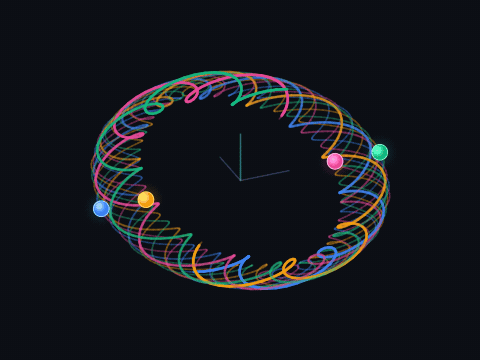

# 3-Body & 4-Body Steady Periodic Orbits

High-precision C++20 discovery engine, **80-bit (`long double`) analytical variational & Francis-QR monodromy auditor**, $S_3$ Montgomery shape-sphere topological classifier, and interactive 2D/3D explorer for **linearly stable ("steady") periodic orbits** across **Newtonian 3-body**, **Post-Newtonian (1PN ADM) General Relativistic 3-body**, and **Newtonian 4-body** gravitational dynamics.

<table>
  <tr>
    <td align="center" width="33%"><br/><b>3D Helical 11-Fold Choreography</b><br/><code>3D-005</code> · 18D margin <b>0.0948</b> (RPO <b>0.2477</b>)</td>
    <td align="center" width="33%"><br/><b>Linearly Stable Free-Fall Brake</b><br/><code>2D-DEM-014</code> · $\mathbf{v}_i(0)=\mathbf{0}$ · margin <b>0.2316</b></td>
    <td align="center" width="33%"><br/><b>All-Distinct-Mass <code>AAAbbb</code> Shuttle</b><br/><code>2D-DEM-002</code> · $L\neq 0$ · margin <b>1.2061</b></td>
  </tr>
  <tr>
    <td align="center" width="33%"><br/><b>1PN Relativistic 10-Fold Rose</b><br/><code>1PN-019</code> · $\beta=0.0152$ · full-3D stable</td>
    <td align="center" width="33%"><br/><b>1PN 3D-Δ14 12-Fold Closure</b><br/><code>1PN-006</code> · 2.8× deeper than Newtonian RPO</td>
    <td align="center" width="33%"><br/><b>4-Body 3D Tilted Double-Binary</b><br/><code>4B-002</code> · <code>m=[1,1,1,1]</code> · 24D QR stable</td>
  </tr>
</table>

## Highlights
- **165 strictly verified linearly stable periodic orbits** (zero multiple covers, canonical symplecticity $\le 2.55 \times 10^{-8}$, `ret_err < 1e-7`, `stab_margin > 1e-4`, `100/100` empirical perturbation survival):
  - **133 primitive Newtonian 3-body orbits** audited in 80-bit `long double` analytical variational equations (`src/audit_catalog.cpp`): **16** 3D non-planar, **55** 2D non-hierarchical exchange (`2D-DEM-*`), and **62** 2D hierarchical / Broucke–Hadjidemetriou–Hénon (BHH) / co-orbital (`2D-HIE-*`), spanning **41 distinct $S_3$ Montgomery shape-sphere classes** in $F_2 = \langle a, b \rangle$.
  - **21 Post-Newtonian (1PN ADM) General Relativistic orbits** (`1PN-001`..`1PN-021`, $\beta = 1/c^2$).
  - **11 Newtonian 4-body steady orbits** (`4B-001`..`4B-011`, 8 3D + 3 2D, verified with full $24 \times 24$ / $16 \times 16$ Francis-QR monodromy).
- **3D Helical & 2D Rotating Choreographies (`src/search_choreo_rot.cpp`):** Rotating the Figure-8 yields full-3D-stable inertial closures up to margin **`1.5897`** (`2D-DEM-001`, 568× Figure-8); its non-hierarchical 3D helical equal-mass branch achieves **18D margin `+0.2477`** at the primitive 1-RPO (`3D-001`, 88× Figure-8) with primitive 11-, 12-, and 15-fold closures (`3D-005`, `3D-004`, `3D-008`).
- **Linearly Stable Free-Fall Brake Family (`src/search_brake.cpp`):** Collisionless zero-velocity ($\mathbf{v}_i(0) = \mathbf{0}, L = 0$) non-hierarchical brake island verified in 80-bit analytical variational arithmetic across $m_3 \in [0.1558, 0.1878]$ (continuation peak margin **`0.2663`**, 95× Figure-8, at $m_3 \approx 0.1693$; catalog peak `2D-DEM-014` at `0.2316`) and all-distinct-mass brake orbits (`2D-DEM-026`, `m = [1, 0.998, 0.1743]`).
- **Non-Hierarchical `AAAbbb` Shuttle-Exchange Family:** Mass-stabilized all-distinct-mass $L\neq 0$ exchange orbits (`2D-DEM-002` at `[1, 0.9, 0.8]`, margin **`1.2061`**, full-3D stable $k_z = -0.257$; `2D-DEM-019` at `[1, 0.8, 0.6]`, $k_z = +0.120$).
- **Unequal-Mass 3D Vertical Subharmonic Branches of BHH (`src/branch_3d_vertical.cpp`):** Explicit 5:2 (`3D-Δ14`, 5-fold closure `3D-002` exact $T_{\text{inert}}$ margin **`0.2002`**) and period-doubled 7-fold (`3D-PD40/48`, bifurcating at $m_3^* \approx 0.4155$, 7-fold closure `3D-003` margin **`0.1029`**) 3D vertical subharmonic sheets of the 1975–1976 BHH retrograde family.
- **1PN General Relativistic Stabilization (`src/search_1pn.cpp`):** 1PN ADM gravity expands Figure-8's stability margin **495×** (to `1.387`), stabilizes Newtonian-unstable unequal-mass Figure-8 orbits out to **$m_3 = 0.95$** (1,000× wider mass tolerance), stabilizes the tangent-unstable Newtonian `3D-Δ14` boundary ($v_{z2} = 0.6782$) to margin `0.0453`, and snaps exact relativistic 2D/3D closures.
- **4-Body 3D Steady Extensions (`src/search_4body.cpp`):** Equal-mass (`[1, 1, 1, 1]`) 3D tilted double-binaries plus 3D and 2D `3+1` hybrids around `2D-HIE-001`, verified via full $24 \times 24$ / $16 \times 16$ Francis double-shift QR monodromy.

## Quick Start
- Open `explorer.html` in any browser for the self-contained interactive 2D/3D explorer (Newtonian 3-body, 1PN ADM relativistic, and 4-body orbits live in-browser; filter by class/subspace, inspect $S_3$ words and symplecticity errors, drag to rotate 3D orbits, inject live `+2e-3` kicks).
- Read `NEW_FAMILIES.md` for the scientific report, literature comparison, showcase animations, and exact initial conditions.
- Read `CATALOG.md` for the complete 165-orbit audited catalog and branch-jump-aware mass-continuation windows.

## Repository Structure
- `src/` — C++20 solvers (`campaign_2d`, `search_brake`, `branch_3d_vertical`, `search_choreo_rot`, `search_1pn`, `search_4body`), **80-bit analytical variational auditor (`audit_catalog.cpp`)**, and GIF renderer (`render_gif.cpp`)
- `scripts/` — Audited catalog builder (`build_catalog.py`), adaptive DOPRI5 $S_3$ shape-sphere word classifier (`classify_topology.py`), HTML explorer generator (`build_explorer.py`), and GIF generator (`generate_gifs.py`)
- `data/` — Raw JSONL catalogs, exact 80-bit `kz_results.dat`, mass continuations, vertical-bifurcation sheets, rotating choreography curves, 1PN relativistic traces, and 4-body stability curves
- `CATALOG.md`, `NEW_FAMILIES.md`, `catalog.json`, `explorer.html`, `assets/*.gif` — Generated reports, dataset, interactive viewer, and animations

## Building & Self-Testing
```bash
make -j4
./bin/search_1pn --verify-physics
./bin/search_4body --verify-eig
python3 scripts/build_catalog.py
python3 scripts/classify_topology.py --verify
```
