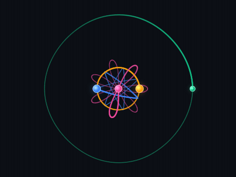

# 3-Body & 4-Body Steady Periodic Orbits

High-precision C++20 discovery engine, **80-bit (`long double`) analytical variational & Francis-QR monodromy auditor**, $S_3$ Montgomery shape-sphere topological classifier, and interactive 2D/3D explorer for **linearly stable ("steady") periodic orbits** across **Newtonian 3-body**, **Post-Newtonian (1PN ADM) General Relativistic 3-body**, and **Newtonian 4-body** gravitational dynamics.

<table>
  <tr>
    <td align="center" width="33%"><br/><b>3D Helical 11-Fold ($\Gamma_y / P_{12}$)</b><br/><code>3D-005</code> · 18D margin <b>0.0948</b> (RPO <b>0.2477</b>)</td>
    <td align="center" width="33%"><br/><b>Linearly Stable Free-Fall Brake</b><br/><code>2D-DEM-015</code> · $\mathbf{v}_i(0)=\mathbf{0}$ · <code>3-2-1-2-1-3</code> · margin <b>0.2051</b></td>
    <td align="center" width="33%"><br/><b>All-Distinct-Mass <code>AAAbbb</code> Shuttle</b><br/><code>2D-DEM-002</code> · $L\neq 0$ · margin <b>1.2061</b></td>
  </tr>
  <tr>
    <td align="center" width="33%"><br/><b>1PN Relativistic 10-Fold Rose</b><br/><code>1PN-021</code> · $\beta=0.0152$ · $T_{\text{inert}}$ margin <b>0.00172</b></td>
    <td align="center" width="33%"><br/><b>1PN 3D-Δ14 12-Fold Closure</b><br/><code>1PN-001</code> · $T_{\text{inert}}$ margin <b>0.1070</b></td>
    <td align="center" width="33%"><br/><b>4-Body Full-3D-Stable <code>3+1</code> Hybrid</b><br/><code>4B-001</code> · <code>m=[1,1,0.5,0.001]</code> · 24D 6/6 ell.</td>
  </tr>
</table>

## Highlights
- **157 strictly verified linearly stable periodic orbits** — **every** Newtonian 3-body, 1PN ADM relativistic, and Newtonian 4-body orbit independently audited in **80-bit `long double`** (`src/audit_catalog.cpp`) with canonical symplecticity verification, `ret_err < 1e-7`, `stab_margin > 1e-4`, `q_inert = 1`, and `100/100` empirical perturbation survival:
  - **133 primitive Newtonian 3-body orbits** (`symp_err <= 2.55e-8`): **16** 3D non-planar, **55** 2D non-hierarchical exchange (`2D-DEM-*`), and **62** 2D hierarchical / Broucke–Hadjidemetriou–Hénon (BHH) / co-orbital (`2D-HIE-*`), spanning **41 distinct $S_3$ Montgomery shape-sphere classes** in $F_2 = \langle a, b \rangle$.
  - **21 Post-Newtonian (1PN ADM) General Relativistic orbits** (`1PN-001`..`1PN-021`, $\beta = 1/c^2$), audited at their true stated period ($T_{\text{inert}}$ with $\theta = 0$ for all 5 snapped closures; canonical `symp_err <= 2.6e-5`).
  - **3 Newtonian 4-body full-3D-stable steady orbits** (`4B-001`..`4B-003`, `4b_2d_dem001_1to1`, 6/6 elliptic pairs in exact $24\times 24$ 80-bit analytical variational monodromy, `symp_err <= 1.5e-12`; 8 weakly hyperbolic 3D candidates removed by 24D variational audit).
- **Non-Hierarchical `AAAbbb` Shuttle-Exchange Family:** Mass-stabilized all-distinct-mass $L\neq 0$ exchange orbits (`2D-DEM-002` at `[1, 0.9, 0.8]`, margin **`1.2061`**, full-3D stable $k_z = -0.257$; `2D-DEM-019` at `[1, 0.8, 0.6]`, $k_z = +0.120$).
- **Linearly Stable Free-Fall Brake Family (`src/search_brake.cpp`):** Collisionless zero-velocity ($\mathbf{v}_i(0) = \mathbf{0}, L = 0$) non-hierarchical brake family with half-period Tanikawa–Mikkola syzygy sequence **`3-2-1-2-1-3`** (12 syzygies/period), verified in 80-bit analytical variational arithmetic across $m_3 \in [0.1558, 0.1878]$ (peak continuation margin **`0.2663`**; cleanest collisionless showcase **`2D-DEM-015`** at $m_3 = 0.1878$, adaptive $r_{\min} = 0.00445$, margin `0.2051`) and all-distinct-mass brake orbits (`2D-DEM-026`, `m = [1, 0.998, 0.1743]`).
- **Rotating 2D ($\Gamma_z$) & 3D Helical ($\Gamma_y / P_{12}$) Choreographies (`src/search_choreo_rot.cpp`):** Explicit rational inertial closures of the classical **Chenciner–Féjoz–Montgomery (2005)** $\Gamma_z$ planar rotating Figure-8 (up to 5-petal `2D-DEM-001` margin **`1.5897`** and 12-fold `2D-DEM-007`) and **Marchal (2000) $P_{12}$ / CFM $\Gamma_y$** 3D helical Figure-8 (`3D-001` 1-RPO margin **`+0.2477`**, plus primitive 11-, 15-, and 24-fold closures `3D-005`, `3D-008`, `3D-004`), alongside the distinct contractible 8-swap 3-fold choreography `2D-DEM-004`.
- **Unequal-Mass 3D Vertical Subharmonic Branches of BHH (`src/branch_3d_vertical.cpp`):** Explicit 5:2 (`3D-Δ14`, 5-fold closure `3D-002` exact $T_{\text{inert}}$ margin **`0.2002`**) and period-doubled 7-fold (`3D-PD40/48`, bifurcating at $m_3^* \approx 0.4155$, 7-fold closure `3D-003` margin **`0.1029`**) 3D vertical subharmonic sheets of the 1975–1976 BHH retrograde family.
- **1PN General Relativistic Stabilization (`src/search_1pn.cpp`):** Extending Imai, Chiba & Asada (2007) and Lousto & Nakano (2008), 1PN ADM gravity expands Figure-8's stability margin **495×** (to `1.387`), stabilizes Newtonian-unstable unequal-mass Figure-8 orbits out to **$m_3 = 0.95$** (`1PN-013`, 1,000× wider mass tolerance), stabilizes the tangent-unstable Newtonian `3D-Δ14` boundary ($v_{z2} = 0.6782$) to margin `0.0453` (`1PN-004`), and snaps exact relativistic 2D/3D closures (up to 12-fold `1PN-001` true $T_{\text{inert}}$ margin `0.1070` and 25-fold `1PN-019` true $T_{\text{inert}}$ margin `0.2615`).
- **4-Body Full-3D-Stable `3+1` Hybrids (`src/search_4body.cpp`):** Planar `3+1` hybrids around `2D-HIE-001` (`4B-001`..`4B-003`, $m_4 \in [0.001, 0.005]$) verified full-3D linearly stable (6/6 elliptic pairs) in exact $24 \times 24$ 80-bit analytical variational monodromy.

## Quick Start
- Open `explorer.html` in any browser for the self-contained interactive 2D/3D explorer (Newtonian 3-body, 1PN ADM relativistic, and 4-body orbits live in-browser; filter by class/subspace, inspect $S_3$ words and symplecticity errors, drag to rotate 3D orbits, inject live `+2e-3` kicks).
- Read `NEW_FAMILIES.md` for the scientific report, literature comparison, showcase animations, and exact initial conditions.
- Read `CATALOG.md` for the complete 157-orbit audited catalog and branch-jump-aware mass-continuation windows.

## Repository Structure
- `src/` — C++20 solvers (`campaign_2d`, `search_brake`, `branch_3d_vertical`, `search_choreo_rot`, `search_1pn`, `search_4body`), **80-bit analytical variational auditor (`audit_catalog.cpp`)**, and GIF renderer (`render_gif.cpp`)
- `scripts/` — Audited catalog builder (`build_catalog.py`), adaptive DOPRI5 $S_3$ shape-sphere word classifier (`classify_topology.py`), HTML explorer generator (`build_explorer.py`), and GIF generator (`generate_gifs.py`)
- `data/` — Raw JSONL catalogs, exact 80-bit `kz_results.dat`, mass continuations, vertical-bifurcation sheets, rotating choreography curves, 1PN relativistic traces, and 4-body stability curves
- `CATALOG.md`, `NEW_FAMILIES.md`, `catalog.json`, `explorer.html`, `assets/*.gif` — Generated reports, dataset, interactive viewer, and animations

## Building & Self-Testing
```bash
make -j4
./bin/search_1pn --verify-physics
./bin/search_4body --verify-eig
python3 scripts/build_catalog.py
python3 scripts/classify_topology.py --verify
```
