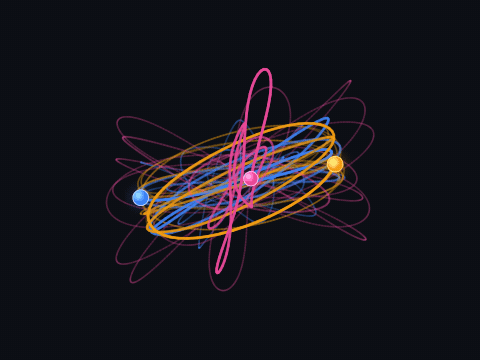
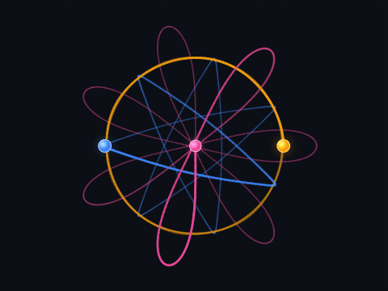
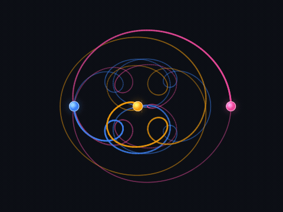

# 3-Body Steady Periodic Orbits

High-precision C++20 discovery engine, exact Floquet stability analyzer, topological classifier, and interactive 2D/3D explorer for **linearly stable ("steady") periodic orbits** of the Newtonian gravitational three-body problem.

<table>
  <tr>
    <td align="center" width="33%"><br/><b>3D-Δ14 (5-Fold Inertial)</b></td>
    <td align="center" width="33%"><br/><b>2D <code>A^7</code> (Margin 1.87)</b></td>
    <td align="center" width="33%"><br/><b>2D <code>AABaaB</code> (Distinct Masses)</b></td>
  </tr>
</table>

## Highlights
- **124 unique verified linearly stable orbits** across equal and unequal masses (including all-distinct-mass triples)
- **New `3D-Δ14` Family**: a 2-parameter continuous **3D non-planar democratic** steady family (14 partner swaps per relative period, full $18\times 18$ rotating-frame Floquet stability, 100/100 full-3D perturbation survival) with snapped **5-fold, 7-fold, and 12-fold exact fixed-inertial-frame closures** (verified to $10^{-10}$–$10^{-9}$)
- **32 distinct Montgomery shape-sphere free-group homotopy classes** in $F_2 = \langle a, b \rangle$
- **Mass-continuation stability windows** mapped across $m_3$

## Quick Start
- Open `explorer.html` in any browser for the self-contained interactive 2D/3D orbit visualizer (drag to rotate 3D orbits, inject live `+2e-3` kicks, click points on the Floquet stability square).
- Read `NEW_FAMILIES.md` for the `3D-Δ14` family report and standout 2D free-group families.
- Read `CATALOG.md` for the full 124-orbit catalog and exact initial conditions.

## Repository Structure
- `src/` — C++20 solvers, Floquet analyzers, continuation tracers, and rational-closure snappers
- `scripts/` — Python catalog builder, explorer generator, and Montgomery shape-sphere word classifier
- `data/` — Raw JSONL discoveries, 3D vertical stability (`kz_results.dat`), mass continuations, and 3D family traces
- `CATALOG.md`, `NEW_FAMILIES.md`, `catalog.json`, `explorer.html` — Generated reports, dataset, and interactive viewer

## Building Solvers
```bash
make
```
