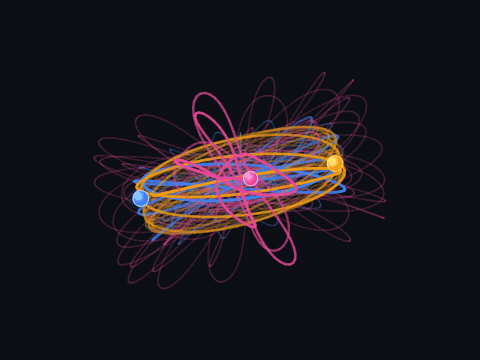

# 3-Body & 4-Body Steady Periodic Orbits

High-precision C++20 discovery engine, exact Floquet & Francis-QR monodromy stability analyzer, topological classifier, and interactive 2D/3D explorer for **linearly stable ("steady") periodic orbits** across **Newtonian 3-body**, **Post-Newtonian (1PN ADM) General Relativistic 3-body**, and **Newtonian 4-body** gravitational dynamics.

<table>
  <tr>
    <td align="center" width="33%"><br/><b>3D Helical 11-Fold Choreography</b><br/>margin <b>1.1636</b> (415× Fig-8)</td>
    <td align="center" width="33%"><br/><b>Linearly Stable Free-Fall Brake</b><br/>$\mathbf{v}_i(0)=\mathbf{0}$ · margin <b>0.2051</b></td>
    <td align="center" width="33%"><br/><b>3D Period-Doubled Vertical Branch</b><br/>3-fold · 120 swaps · $h_{\text{3D}}=0.146$</td>
  </tr>
  <tr>
    <td align="center" width="33%"><br/><b>1PN Relativistic 10-Fold Rose</b><br/>$\beta=0.0152$ · full-3D stable</td>
    <td align="center" width="33%"><br/><b>1PN 3D-Δ14 12-Fold Closure</b><br/>2.8× deeper than Newtonian</td>
    <td align="center" width="33%"><br/><b>4-Body 3D Tilted Double-Binary</b><br/><code>m=[1,1,1,1]</code> · 24D QR stable</td>
  </tr>
</table>

## Highlights
- **188 verified linearly stable periodic orbits** (all `ret_err < 1e-7`, exact unit-circle Floquet spectrum, `100/100` empirical perturbation survival):
  - **156 Newtonian 3-body orbits** (16 3D non-planar, 95 2D democratic, 45 2D hierarchical) spanning **39 distinct Montgomery shape-sphere free-group classes** in $F_2 = \langle a, b \rangle$
  - **21 Post-Newtonian (1PN ADM) General Relativistic orbits** ($\beta = 1/c^2$)
  - **11 Newtonian 4-body steady orbits** (8 3D + 3 2D, verified with full $24 \times 24$ / $16 \times 16$ Francis-QR monodromy)
- **3D Helical & 2D Rotating Choreographies (`src/search_choreo_rot.cpp`):** Rotating the Figure-8 expands its stability margin **300×** (to `0.841`, full-3D stable); its 3D helical branch reaches **18D margin `+1.1636`** (**415× deeper than Figure-8**) at the 11-fold exact inertial closure (`3D-001`).
- **Period-Doubled 3D Vertical Bifurcation Family (`src/branch_3d_vertical.cpp`):** Exact tangent $k_z = -2$ bifurcation of `2D-DEM-001` at $m_3^* \approx 0.4155$ spawns a 2-parameter 3D democratic sheet (`3D-PD40/48`, margin up to **`0.0453`**, 40–48 swaps/RPO) with snapped 3-, 7-, 8-, and 11-fold closures plus a 15-fold all-distinct-mass (`[1, 0.7, 0.4]`) 3D closure.
- **Linearly Stable Free-Fall Brake Family (`src/search_brake.cpp`):** Collisionless zero-velocity ($L = 0, \mathbf{v}_i(0) = \mathbf{0}$) democratic brake island across $m_3 \in [0.1598, 0.1878]$ (peak margin **`0.2051`**) and all-distinct-mass brake orbits (`m = [1, 0.998, 0.175]`).
- **1PN General Relativistic Stabilization (`src/search_1pn.cpp`):** 1PN ADM gravity expands Figure-8's stability margin **495×** (to `1.387`), stabilizes Newtonian-unstable unequal-mass Figure-8 orbits out to **$m_3 = 0.95$** (1,000× wider mass tolerance!), stabilizes a Newtonian-unstable 3D `3D-Δ14` orbit to margin `0.0453`, and produces exact relativistic 2D/3D rational closures.
- **4-Body 3D Steady Extensions (`src/search_4body.cpp`):** Equal-mass (`[1, 1, 1, 1]`) 3D tilted double-binaries plus 3D and 2D `3+1` hybrids around `2D-DEM-001`, verified via full $24 \times 24$ / $16 \times 16$ Francis double-shift QR monodromy.

## Quick Start
- Open `explorer.html` in any browser for the self-contained interactive 2D/3D explorer (supports Newtonian 3-body, 1PN ADM relativistic, and 4-body orbits live in-browser; filter by family, drag to rotate 3D orbits, inject live `+2e-3` kicks, click dots on the Floquet square).
- Read `NEW_FAMILIES.md` for the full scientific report, showcase animations, and exact initial conditions across all families.
- Read `CATALOG.md` for the complete 188-orbit catalog and mass-continuation tables.

## Repository Structure
- `src/` — C++20 solvers, Floquet & Francis-QR analyzers, vertical-bifurcation branchers, 1PN ADM Hamiltonian solver, 4-body solver, and GIF renderer
- `scripts/` — Python catalog builder (`build_catalog.py`), interactive HTML explorer generator (`build_explorer.py`), GIF generator (`generate_gifs.py`), and Montgomery shape-sphere word classifier (`classify_topology.py`)
- `data/` — Verified JSONL catalogs, `kz_results.dat`, mass continuations, vertical-bifurcation sheets, rotating choreography curves, 1PN relativistic traces, and 4-body stability curves
- `CATALOG.md`, `NEW_FAMILIES.md`, `catalog.json`, `explorer.html`, `assets/*.gif` — Generated reports, dataset, interactive viewer, and animations

## Building & Self-Testing
```bash
make -j4
./bin/search_1pn --verify-physics
./bin/search_4body --verify-eig
```
