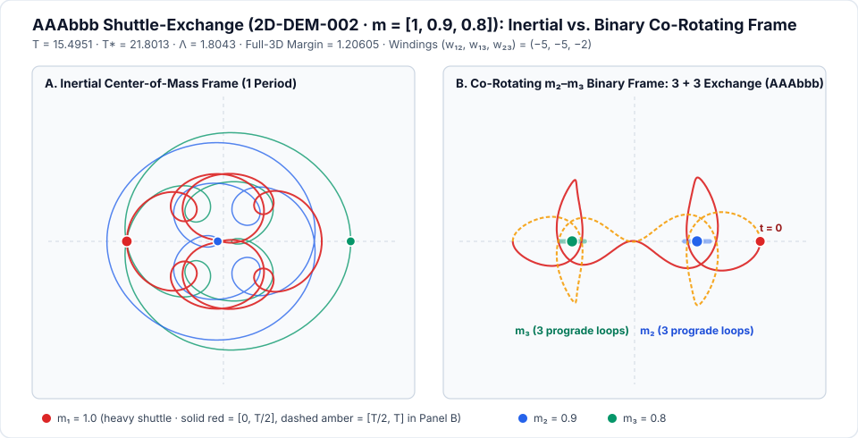
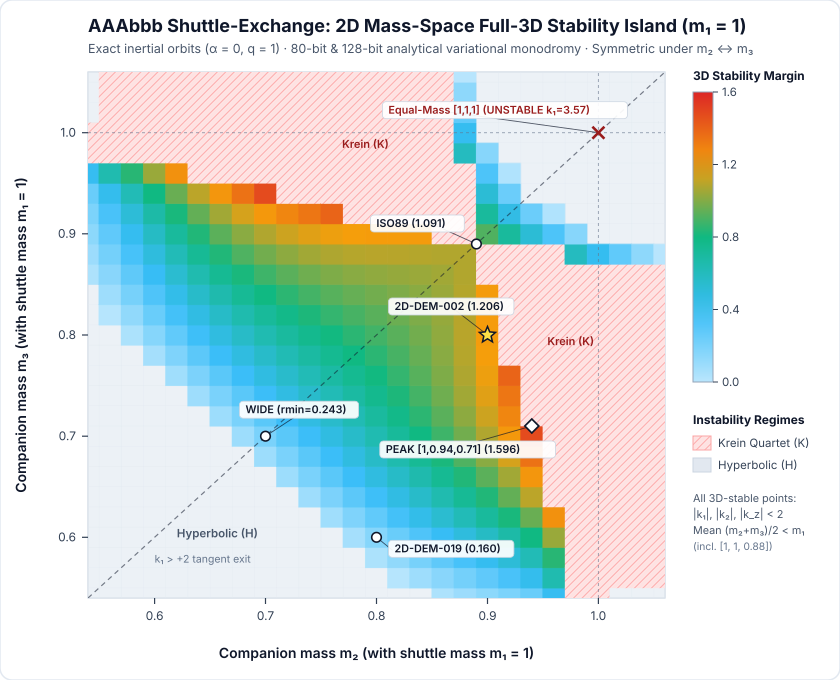

# A Mass-Stabilized, Non-Hierarchical `AAAbbb` Periodic Three-Body Family with Nonzero Angular Momentum

**Authors:** `gawydion@gmail.com`, Gemini 4 Neon  
**Repository & Dataset:** https://github.com/gawydion/3-body-orbits  
**Date:** November 2026

---

## Abstract

We report a periodic orbit family of the planar Newtonian three-body problem with nonzero angular momentum ($L \neq 0$). The family has the canonical $S_3$ Montgomery shape-sphere free-group word `AAAbbb` (length 6). In the inertial frame, the pairwise winding numbers are $(w_{12}, w_{13}, w_{23}) = (-5, -5, -2)$. In the co-rotating frame of bodies 2 and 3, body 1 makes three prograde loops around body 2 and three prograde loops around body 3.

At equal masses ($m_1 = m_2 = m_3 = 1$) and zero precession ($\alpha = 0$), the orbit is linearly unstable ($k_1 = +3.5689$, largest Floquet multiplier $|\lambda| = 3.268$). We find two mechanisms that produce full three-dimensional (3D) linear stability ($|k_1|, |k_2|, |k_z| < 2$). First, reducing the mean companion mass $(m_2 + m_3)/2$ below $m_1$ opens a broad two-dimensional (2D) mass-space stability island. Every planar-stable orbit in this island is also vertically stable ($|k_z| < 0.6$). The linear 3D stability margin reaches $1.5963$ at $m = [1, 0.94, 0.71]$. The island contains all-distinct-mass orbits such as `2D-DEM-002` at $m = [1, 0.9, 0.8]$ (margin $1.2061$). It also contains isosceles orbits on $m_2 = m_3 \in [0.683, 0.939]$ and narrow peninsulas that pass through $m = [1, 1, 0.88]$ (margin $0.4267$). Second, at equal masses $m = [1, 1, 1]$, adding frame precession $\alpha/\pi \in [0.061, 0.096]$ produces full-3D linearly stable $q$-fold inertial rosettes `(AAAbbb)^q` for $q \in \{11, 12, 13, 14, 15, 16\}$.

We trace the isosceles branch $m = [\varepsilon, 1, 1]$ to the restricted limit $\varepsilon \to 0$. It connects smoothly to a 2:1 resonant orbit of the equal-mass elliptic restricted three-body problem ($e = 0.092555$) and then to a violently unstable doubly-symmetric 3+3 exchange orbit of the circular Copenhagen problem ($C_J = 3.696245$, $|\lambda| \approx 337.8$). We verify nine benchmark orbits in 128-bit quad precision using a 16th-order symplectic Gauss–Legendre integrator (`ret_err <= 4.1e-31`, canonical `symp_err <= 3.4e-28`). Full-3D symplectic integrations over 10,000 periods confirm bounded motion under 3D velocity perturbations of $10^{-5}$ and $10^{-4}$, while the equal-mass inertial control orbit breaks apart in 10 periods. We check the `threebodyorbits.com` Atlas (3,942 orbits), `/hunt/garden` (82,032 loops), and major published $L = 0$ and $L \neq 0$ catalogs, and find zero matches to `AAAbbb`.

---

## 1. Introduction

Most known periodic orbits of the general planar three-body problem fall into two groups. The first group contains hierarchical orbits with nonzero angular momentum ($L \neq 0$), such as the Broucke–Hadjidemetriou–Hénon (BHH) family and its satellites (Broucke 1975; Broucke & Boggs 1975; Hadjidemetriou 1975; Hénon 1976; Janković & Dmitrašinović 2016; Li & Liao 2020). In those orbits, one close binary pair stays intact while a third body orbits outside it, and the Montgomery free-group word has the form $A^k$. The second group contains non-hierarchical exchange orbits with zero angular momentum ($L = 0$), such as the figure-eight orbit and its unequal-mass extensions (Moore 1993; Chenciner & Montgomery 2000; Šuvakov & Dmitrašinović 2013; Li & Liao 2017; Li, Jing & Liao 2018).

Linearly stable, non-hierarchical, unequal-mass periodic orbits with $L \neq 0$ are rare. Li, Li & Liao (2021) reported one such family of 13,315 stable orbits. That family belongs to the length-10 Moth I class `ABAbaBABab`, has small scale-invariant angular momentum $\Lambda = |L|\sqrt{|E|} \in [0.006, 0.058]$, and has close passages near $r_{\min} \approx 0.016$.

In this note, we present a second, distinct non-hierarchical $L \neq 0$ family with canonical free-group word `AAAbbb`. This family has large angular momentum ($\Lambda \in [1.28, 2.24]$), wide minimum separations ($r_{\min} \in [0.163, 0.246]$), and deep full-3D linear stability across a broad region of mass space.

---

## 2. Equations of Motion and Numerical Methods

We study three point masses $m_1, m_2, m_3$ under Newtonian gravity with $G = 1$ in the center-of-mass frame ($\sum m_i \mathbf{r}_i = \mathbf{0}$, $\sum m_i \mathbf{v}_i = \mathbf{0}$). The equations of motion are:

$$\ddot{\mathbf{r}}_i = \sum_{j \neq i} m_j \frac{\mathbf{r}_j - \mathbf{r}_i}{\|\mathbf{r}_j - \mathbf{r}_i\|^3}, \qquad i \in \{1, 2, 3\}.$$

We set $m_1 = 1$ and normalize the spatial scale by $x_1(0) = -1$. Every orbit in this family starts on the collinear perpendicular crossing subspace at $t = 0$:

$$y_i(0) = 0, \qquad \dot{x}_i(0) = 0, \qquad i \in \{1, 2, 3\}.$$

We shoot to the half-period $t = T/2$ in a rotated frame $R(-\alpha)$ and solve four boundary equations:

$$y_1^{\text{rot}}(T/2) = 0, \qquad y_2^{\text{rot}}(T/2) = 0, \qquad \dot{x}_1^{\text{rot}}(T/2) = 0, \qquad \dot{x}_2^{\text{rot}}(T/2) = 0.$$

Time-reversal symmetry guarantees closure after one full period $T$ with total rotation $2\alpha$. Setting $\alpha = 0$ gives an exact inertial periodic orbit. Setting $\alpha = \pi/q$ gives a relative periodic orbit (RPO) that closes in the inertial frame after $q$ periods ($T_{\text{inert}} = qT$).

To verify each benchmark orbit without double-precision limits, we use an independent C++20 solver (`src/confirm_aaabbb.cpp`) in 128-bit quad precision (`__float128`, about 34 decimal digits). The solver uses an 8-stage, 16th-order symplectic Gauss–Legendre integrator (`GL16`). We compute the Butcher tableau directly from the roots of the Legendre polynomial $P_8$ using factored Lagrange quadrature. Self-tests give order-16 quadrature error $3.85 \times 10^{-34}$, symplecticity error $|b_i A_{ij} + b_j A_{ji} - b_i b_j|_{\max} = 6.62 \times 10^{-35}$, and a two-body Kepler ($e = 0.6$) one-period return error of $9.82 \times 10^{-32}$.

We compute linear stability from exact analytical variational equations integrated over one full period $T$: the $12 \times 12$ planar monodromy matrix $M_p$ and the $6 \times 6$ out-of-plane vertical matrix $M_z$. We verify canonical symplecticity $\|S^\top J S - J\|_\infty$ directly, where $S = D M_{\text{rot}} D^{-1}$ converts velocities to canonical momenta $p_i = m_i v_i$. We extract the three nontrivial Broucke–Floquet stability indices $(k_1, k_2, k_z)$ from trace invariants of $M_{\text{rot}}$ and $M_z$. An orbit is full-3D linearly stable when $k_1, k_2, k_z$ are real and lie strictly inside $(-2, 2)$. We define the 3D linear stability margin as:

$$M_{3\text{D}} = 2 - \max(|k_1|,\, |k_2|,\, |k_z|).$$

To test nonlinear stability, we apply a zero-momentum 3D velocity kick $\Delta \mathbf{v}_1 = \frac{\delta}{\sqrt{3}}(1, 1, 1)$ (compensated equally on bodies 2 and 3) and integrate the full 18D system for $10{,}000$ periods using a fixed-step 4-stage, 8th-order symplectic Gauss–Legendre integrator (`GL8`, 1,200 steps per period).

---

## 3. Geometry, Symmetries, and Restricted-Problem Origin

### 3.1 Co-Rotating 3 + 3 Shuttle-Exchange Motion

Figure 1 shows the flagship orbit `AAAbbb-DEM002` (`2D-DEM-002`, $m = [1, 0.9, 0.8]$) in both the inertial frame and the co-rotating frame of bodies 2 and 3.



*Figure 1. Flagship orbit `AAAbbb-DEM002` ($m = [1, 0.9, 0.8]$, $T = 15.4951$, $M_{3\text{D}} = 1.2061$). Left: inertial center-of-mass frame over one period. Right: co-rotating frame aligned with the body 2–body 3 axis. Body 1 makes three prograde loops around body 2 (`AAA`) and three prograde loops around body 3 (`bbb`).*

Over one inertial period, the pairwise winding numbers are $(w_{12}, w_{13}, w_{23}) = (-5, -5, -2)$. Bodies 2 and 3 orbit each other two times clockwise while staying well separated ($r_{23} \in [1.290, 1.948]$). In the co-rotating frame of the body 2–body 3 pair, the relative windings are:

$$(w_{12} - w_{23},\, w_{13} - w_{23}) = (-3,\, -3).$$

Body 1 acts as a shuttle. It completes three prograde loops around body 2, crosses the central saddle between bodies 2 and 3, and completes three prograde loops around body 3. This double-trifoil geometry yields the canonical $S_3$ Montgomery free-group word `AAAbbb` (length 6). Both exchange pairs span wide distance ratios: $r_{12} \in [0.2321, 2.2235]$ and $r_{13} \in [0.1893, 2.3170]$.

When $m_2 = m_3$, the orbit gains two additional symmetries:
1. Half-period companion exchange with $180^\circ$ rotation: $\mathbf{r}_1(T/2) = -\mathbf{r}_1(0)$, $\mathbf{r}_2(T/2) = -\mathbf{r}_3(0)$, and $\mathbf{r}_3(T/2) = -\mathbf{r}_2(0)$.
2. Exact isosceles triangle configurations ($r_{12} = r_{13}$) at $t = T/4$ and $t = 3T/4$, where body 1 crosses the perpendicular bisector of the body 2–body 3 axis at maximum companion separation.

### 3.2 Connection to the Copenhagen Restricted Three-Body Problem

We continue the isosceles exchange branch in Jacobi coordinates ($x_2(0) - x_3(0) = 1$) in both directions from equal masses $m = [1, 1, 1]$:

1. **Restricted limit $m = [\varepsilon, 1, 1]$ ($\varepsilon \to 0$):** The branch continues smoothly to $\varepsilon = 0$ with no collision or bifurcation. At $\varepsilon = 0$, bodies 2 and 3 move on a Kepler ellipse with eccentricity $e = 0.09255493$. Body 1 moves on a 2:1 resonant periodic orbit ($T / T_{\text{Kep}} = 2$) of the equal-mass elliptic restricted three-body problem (ER3BP). This ER3BP orbit is Krein-unstable ($k = (-0.5144, \pm 35.234i)$, $|\lambda| \approx 35.2$).
2. **Circular Copenhagen limit ($e \to 0$ at $m_1 = 0$):** Continuing the ER3BP orbit from $e = 0.092555$ to $e = 0$ reaches a doubly-symmetric 3+3 prograde exchange orbit of the circular Copenhagen problem ($m_2 = m_3 = 1/2$, $a = 1$, $T_{\text{rot}} = 4\pi$). Its initial state is $x_0 = 0.95455981$ and $\dot{y}_{\text{rot}} = +0.31994239$, with Jacobi constant $C_J = 3.69624503$. This circular limit is strongly hyperbolic, with Hénon stability index $a_{\text{Hénon}} = +168.9022$ ($|\lambda| \approx 337.8$).
3. **Lower mass fold $m = [1, \mu, \mu]$ ($\mu$ decreasing):** Decreasing $\mu$ below $1$ enters stability at $\mu \approx 0.9396$, leaves stability at $\mu \approx 0.6825$ ($k_1 \to +2$), and ends at a smooth saddle-node fold at $\mu_{\min} \approx 0.45746$ ($r_{\min} \approx 0.2144$). The family does not reach the planetary limit $\mu \to 0$.

---

## 4. Dual Full-3D Stabilization Mechanisms

### 4.1 Two-Dimensional Mass-Space Stability Island ($\alpha = 0$)

We map the inertial family ($\alpha = 0$) on a uniform $0.02$-step grid over $(m_2, m_3) \in [0.54, 1.06]^2$ with $m_1 = 1$ (729 grid points; Figure 2). The phase diagram is symmetric under $m_2 \leftrightarrow m_3$ and contains 310 full-3D linearly stable grid points (`S3`), 224 Krein-unstable points (`K`), and 195 hyperbolically unstable points (`H`).



*Figure 2. Two-dimensional mass-space stability diagram for the inertial `AAAbbb` family ($m_1 = 1$, $\alpha = 0$, 729 points on a $0.02$-step grid). Color shows the full-3D linear stability margin $M_{3\text{D}}$. Hatched pink marks Krein-quartet instability (`K`). Light gray marks hyperbolic instability (`H`). Every planar-stable point is also vertically stable ($|k_z| < 0.6$).*

Key properties of the stability island are:
- **Automatic 3D vertical stability:** Every planar-stable point in the island satisfies $|k_z| < 0.6$. No vertical instability occurs anywhere inside the planar stability region.
- **Mean-mass condition and narrow peninsulas:** Along the symmetry diagonal $m_2 = m_3$, full-3D stability spans $\mu \in [0.683, 0.939]$ and peaks at `AAAbbb-ISO89` ($m = [1, 0.89, 0.89]$, $M_{3\text{D}} = 1.0909$). Off the diagonal, stability holds across a broad region where $(m_2 + m_3)/2 < m_1$. Two narrow stable peninsulas around $m_3 \approx 0.88$ (and $m_2 \approx 0.88$) thread between the upper hyperbolic region and the lower Krein tongue past $m_2 = 1$. Independent 80-bit checks confirm full-3D stability at the two-equal-mass point $m = [1, 1, 0.88]$ ($M_{3\text{D}} = 0.42669$, `symp_err = 8.7e-11`) and out to $m = [1, 1.06, 0.88]$ ($M_{3\text{D}} = 0.00636$).
- **Symmetry-protected crossing vs. Krein cliff:** Along $m_2 = m_3$, the two planar stability indices $k_1$ and $k_2$ cross near $\mu \approx 0.893$ without becoming complex because the two modes have opposite exchange parity. Breaking $m_2 = m_3$ opens this crossing into two Krein-quartet tongues (`K`). The global linear margin peaks right beside the Krein boundary at `AAAbbb-PEAK` ($m = [1, 0.94, 0.71]$, $M_{3\text{D}} = 1.59631$, $|k_1 - k_2| = 0.1147$).

### 4.2 Equal-Mass Rotating-Frame Stabilization ($m = [1, 1, 1]$)

Continuing the unstable equal-mass orbit ($m = [1, 1, 1]$, $\alpha = 0$) in frame precession angle $\alpha$ opens a full-3D linearly stable RPO window across $\alpha/\pi \in [0.061, 0.096]$. Every rational value $\alpha/\pi = 1/q$ for $q \in \{11, 12, 13, 14, 15, 16\}$ yields a full-3D linearly stable equal-mass inertial rosette `(AAAbbb)^q`. The strongest closure is $q = 13$ (`AAAbbb-EQ-RPO13`), which has RPO margin $1.16261$ and exact full inertial ($13T$) margin $0.57216$.

---

## 5. High-Precision Benchmarks and 10,000-Period 3D Survival

Table 1 lists the 128-bit `GL16` verification metrics for nine benchmark orbits. Every orbit passes canonical symplecticity to $\le 3.41 \times 10^{-28}$, energy conservation to $|dE| \le 1.19 \times 10^{-32}$, angular momentum conservation to $|dL| \le 2.70 \times 10^{-33}$, and independent `GL16` step-halving (`h` vs. `h/2`) to $\le 5.07 \times 10^{-31}$. On `AAAbbb-DEM002`, step-halving also verifies the Floquet indices $(k_1, k_2, k_z)$ to $9.02 \times 10^{-28}$.

| Orbit ID | Masses $[m_1, m_2, m_3]$ | $T$ | $T^*$ | $\Lambda$ | $k_1$ | $k_2$ | $k_z$ | $M_{3\text{D}}$ | $r_{\min}$ | `ret_err` | `symp_err` |
| :--- | :--- | :---: | :---: | :---: | :---: | :---: | :---: | :---: | :---: | :---: | :---: |
| `AAAbbb-DEM002` | `[1, 0.9, 0.8]` | `15.495142` | `21.8013` | `1.8043` | `+0.79395` | `+0.21888` | `-0.25682` | **`1.20605`** | `0.18932` | `1.29e-31` | `7.36e-29` |
| `AAAbbb-PEAK` | `[1, 0.94, 0.71]` | `16.334090` | `20.7337` | `1.7052` | `+0.40369` | `+0.28899` | `-0.26323` | **`1.59631`** | `0.17139` | `2.49e-31` | `6.88e-29` |
| `AAAbbb-DEEP` | `[1, 0.94, 0.70]` | `16.465102` | `20.5320` | `1.6867` | `+0.52383` | `+0.15164` | `-0.25853` | **`1.47617`** | `0.17047` | `2.94e-31` | `7.76e-29` |
| `AAAbbb-ISO89` | `[1, 0.89, 0.89]` | `14.638051` | `23.3967` | `1.9507` | `+0.90909` | `+0.87531` | `-0.34943` | **`1.09091`** | `0.20088` | `4.12e-31` | `6.63e-29` |
| `AAAbbb-ISO85` | `[1, 0.85, 0.85]` | `15.265692` | `21.8265` | `1.8071` | `+0.96561` | `+0.09784` | `-0.24006` | **`1.03439`** | `0.20762` | `1.96e-31` | `8.71e-29` |
| `AAAbbb-WIDE` | `[1, 0.70, 0.70]` | `18.360881` | `16.3075` | `1.3136` | `+1.80415` | `-1.64471` | `+0.22735` | **`0.19585`** | `0.24291` | `6.72e-32` | `1.13e-28` |
| `AAAbbb-DEM019` | `[1, 0.80, 0.60]` | `19.054860` | `16.2116` | `1.3033` | `+1.84021` | `-1.34311` | `+0.12022` | **`0.15979`** | `0.19703` | `4.13e-31` | `9.60e-29` |
| `AAAbbb-EQ-UNST` | `[1, 1, 1]` | `13.199687` | `27.9251` | `2.3722` | `+3.56886` | `+0.92332` | `-0.61842` | *unstable* | `0.18603` | `1.67e-31` | `1.14e-28` |
| `AAAbbb-EQ-RPO13` | `[1, 1, 1]` ($q=13$) | `166.111724` | `27.3519` | `2.3705` | `+1.23742` | `-1.42784` | `-1.29651` | **`0.57216`** | `0.17936` | `3.30e-29` | `1.72e-25` |

*Table 1. 128-bit `GL16` verification of nine `AAAbbb` benchmarks. For `AAAbbb-EQ-RPO13`, $T$, stability indices, $M_{3\text{D}}$, `ret_err`, and `symp_err` are reported for the exact 13-fold inertial closure ($T_{\text{inert}} = 13 T_{\text{rpo}}$); $T^*$ and $\Lambda$ are for one primitive RPO period ($T_{\text{rpo}} = 12.777825$).*

Table 2 summarizes the 10,000-period full-3D symplectic `GL8` perturbation tests.

| Orbit ID | Kick $\delta$ | Survived Periods | Observed $r_{\min}$ | Observed $r_{\max}$ | $\max |z|$ | Max $|\Delta E / E_0|$ |
| :--- | :---: | :---: | :---: | :---: | :---: | :---: |
| `AAAbbb-DEM002` | $10^{-5}$ / $10^{-4}$ | **`10,000` / `10,000`** | `0.1891` / `0.1872` | `2.3174` / `2.3241` | `8.53e-6` / `8.56e-5` | `3.92e-11` / `4.37e-11` |
| `AAAbbb-ISO89` | $10^{-5}$ / $10^{-4}$ | **`10,000` / `10,000`** | `0.2008` / `0.1998` | `2.2109` / `2.2159` | `7.40e-6` / `7.42e-5` | `1.31e-11` / `1.37e-11` |
| `AAAbbb-ISO85` | $10^{-5}$ / $10^{-4}$ | **`10,000` / `10,000`** | `0.2075` / `0.2066` | `2.2479` / `2.2530` | `8.04e-6` / `8.06e-5` | `1.12e-11` / `1.14e-11` |
| `AAAbbb-PEAK` | $10^{-5}$ / $10^{-4}$ | **`10,000`** / `10` | `0.1708` / `0.0999` | `2.4534` / `3.3251` | `9.81e-6` / `9.87e-5` | `2.05e-10` / `2.46e-2` |
| `AAAbbb-DEEP` | $10^{-5}$ / $10^{-4}$ | **`10,000`** / `11` | `0.1700` / `0.0642` | `2.4693` / `6.1050` | `9.99e-6` / `1.59e-4` | `2.24e-10` / `3.68e-2` |
| `AAAbbb-WIDE` | $10^{-5}$ | **`10,000`** | `0.2426` | `2.4269` | `1.15e-5` | `4.49e-12` |
| `AAAbbb-DEM019` | $10^{-5}$ | **`10,000`** | `0.1966` | `2.6271` | `1.32e-5` | `8.79e-11` |
| `AAAbbb-EQ-RPO13` | $10^{-5}$ | **`1,000`** *(13,000 RPOs)* | `0.1793` | `2.1378` | `6.06e-6` | `2.38e-11` |
| `AAAbbb-EQ-UNST` | $10^{-5}$ | `10` *(control)* | `0.0740` | `3.4186` | `1.14e-5` | `2.29e-4` |

*Table 2. Full-3D symplectic `GL8` perturbation tests (zero-momentum 3D velocity kick of magnitude $\delta$). All stable benchmarks survive 10,000 periods at $\delta = 10^{-5}$. At $\delta = 10^{-4}$, `AAAbbb-DEM002`, `AAAbbb-ISO89`, and `AAAbbb-ISO85` survive 10,000 periods, while the Krein-adjacent orbits `AAAbbb-PEAK` and `AAAbbb-DEEP` escape in 10–11 periods.*

These tests confirm an important physical distinction. `AAAbbb-PEAK` and `AAAbbb-DEEP` sit close to the off-diagonal Krein collision boundary, so they have a high linear margin ($1.48$–$1.60$) but a small nonlinear stability radius (between $10^{-5}$ and $10^{-4}$). By contrast, `AAAbbb-DEM002` (far from the Krein boundary, $|k_1 - k_2| = 0.575$), `AAAbbb-ISO85` ($|k_1 - k_2| = 0.868$), and `AAAbbb-ISO89` (on the symmetry-protected diagonal crossing) stay tightly bound for 10,000 periods even at $\delta = 10^{-4}$.

### Reference 34-Digit Initial Conditions (`AAAbbb-DEM002`, $m = [1, 0.9, 0.8]$)

```text
T   =  15.49514152882967630717557496239618
r1  = (-1,                                      0)   v1 = (0,  0.781238865166643361852021448914456)
r2  = (-0.05951905189342309840563071207168729,  0)   v2 = (0, -0.1613813786482114336044792251480184)
r3  = ( 1.316958933380100985706334551080648,    0)   v3 = (0, -0.7949945304790663395099876828515493)
```

Full 34-digit initial conditions for all nine benchmarks are archived in `data/aaabbb/aaabbb_submission_34digits.txt` and `data/aaabbb/aaabbb_quad32.json`.

---

## 6. Archive Comparison and Novelty Check

We checked the `AAAbbb` family against major published catalogs and online databases using free-group word lookup, invariant matching, and 80-bit recomputation of raw initial conditions:
- **`threebodyorbits.com` Atlas (3,942 orbits in 41 families) and `/hunt/garden` (82,032 loops):** Zero matches. The shortest loop in `/hunt/garden` has 16 syzygies/letters.
- **Li, Li & Liao (2021) (135,445 unequal-mass $L \neq 0$ orbits):** Zero matches. Direct 80-bit audit of the supplementary dataset confirms that all entries belong to the Moth I family `ABAbaBABab` ($\Lambda \in [0.006, 0.058]$, $r_{\min} \approx 0.016$).
- **Other $L \neq 0$ catalogs:** We find zero matches in Broucke (1975 A/R), Hénon (1976), Simó (2001, 343 choreographies), Janković & Dmitrašinović (2016, 57 BHH satellites), Šuvakov's `SN.*` collection, and Li & Liao (2020, 598,996 BHH orbits). We also audited raw initial conditions in 80-bit arithmetic for Broucke & Boggs (1975) `S4` and `S122` (both strictly `AAA` with zero swaps) and for all 17 orbits of Sheen (2016). None match `AAAbbb`.
- **$L = 0$ catalogs:** Zero matches in Šuvakov & Dmitrašinović (2013), Li & Liao (2017, 695 orbits), Li, Jing & Liao (2018, 1,349 orbits), and Hristov et al. (2025).

*Scope note:* Older print-only 1970s tables not digitized into `threebodyorbits.com` (such as unlisted entries of Broucke & Boggs 1975 or Hadjidemetriou & Christides 1975) were not inspected line by line. However, because `AAAbbb` is strongly unstable in both the equal-mass inertial case ($|\lambda| = 3.27$) and the Copenhagen restricted limits ($|\lambda| \approx 338$ and $35.2$), classical stability surveys would not identify it as a stable family.

---

## 7. Reproducibility

All source code, data tables, and verification outputs are public in the repository. To build and run the 128-bit verification suite:

```bash
make bin/confirm_aaabbb
./bin/confirm_aaabbb --self-test
./bin/confirm_aaabbb --all --periods 10000
```

---

## References

- Broucke, R. (1975). On relative periodic solutions of the planar general three-body problem. *Celestial Mechanics*, 12, 439–462.
- Broucke, R. & Boggs, D. (1975). Periodic orbits in the planar general three-body problem. *Celestial Mechanics*, 11, 13–38.
- Chenciner, A. & Montgomery, R. (2000). A remarkable periodic solution of the three-body problem in the case of equal masses. *Annals of Mathematics*, 152, 881–901.
- Hadjidemetriou, J. D. (1975). The continuation of periodic orbits from the restricted to the general three-body problem. *Celestial Mechanics*, 12, 155–174.
- Hadjidemetriou, J. D. & Christides, T. (1975). Families of periodic orbits in the planar three-body problem. *Celestial Mechanics*, 12, 175–187.
- Hairer, E., Lubich, C. & Wanner, G. (2006). *Geometric Numerical Integration* (2nd ed.). Springer.
- Hénon, M. (1965). Exploration numérique du problème restreint. I & II. *Annales d'Astrophysique*, 28, 499–511; 992–1007.
- Hénon, M. (1976). A family of periodic solutions of the planar three-body problem, and their stability. *Celestial Mechanics*, 13, 267–285.
- Janković, M. R. & Dmitrašinović, V. (2016). Angular momentum and topological dependence of Kepler's third law in the Broucke–Hadjidemetriou–Hénon family. *Physical Review Letters*, 116, 064301.
- Li, X. & Liao, S. (2017). More than six hundred new families of Newtonian periodic planar collisionless three-body orbits. *Sci. China Phys. Mech. Astron.*, 60, 129511.
- Li, X., Jing, Y. & Liao, S. (2018). Over a thousand new periodic orbits of a planar three-body system with unequal masses. *PASJ*, 70, 64.
- Li, X. & Liao, S. (2020). Collisionless periodic orbits in the unequal-mass Broucke–Hadjidemetriou–Hénon family. `arXiv:2008.13550`.
- Li, X., Li, X. & Liao, S. (2021). One family of 13315 stable periodic orbits of non-hierarchical unequal-mass triple systems. *Sci. China Phys. Mech. Astron.*, 64, 219511.
- Moore, C. (1993). Braids in classical dynamics. *Physical Review Letters*, 70, 3675–3679.
- Šuvakov, M. & Dmitrašinović, V. (2013). Three classes of Newtonian three-body planar periodic orbits. *Physical Review Letters*, 110, 114301.
